# Botashka 架构说明文档（内部演进版）

本文档系统阐述 Botashka 当前的架构设计、核心模块契约、数据驱动状态机实现，以及面向未来 Durable Agent（持久化断点续跑）和 Recursive Coding Agent 的系统演进。

---

## 1. 架构总览 (Mermaid)

```mermaid
flowchart TB
    subgraph Client["入口编排与可观测层"]
        AgentRun["botashka.agent/run!<br/>状态机循环驱动 & 终态保护"]
        AuthGating["AuthorizationPolicy<br/>独立授权判定: :allow / :deny / :ask"]
        Bus["botashka.bus (双通道事件总线)<br/>Topic Multiplexer: :stream & :canonical"]
        ChatUI["botashka.chat (交互 UI)<br/>双通道实时打字 & 结构化呈现"]
        TraceProj["botashka.trace/render-trace-graph<br/>Transducer 轨迹投影 (CLI --graph / -g)"]
    end

    subgraph Core["Functional Core (纯函数核心 - botashka.run)"]
        direction TB
        NewRun["new-run<br/>创建不可变初始 Run 状态"]
        CtxProj["build-model-context<br/>纯上下文投影算子 (RunState ──► ModelParams)"]
        
        subgraph FSM_Tables["数据驱动状态机 (Data-Driven FSM)"]
            ActionPolicy["ActionPolicy 体系<br/>default-action-policy<br/>first-applicable-action-policy<br/>arbitrate-proposals"]
            ActionRules["status-action-rules 映射表<br/>状态到扁平 Command 纯映射"]
            EventTransitions["event-transitions 转移表<br/>(event-transitions type run data evidence)"]
        end

        Apply["apply-event / append-event<br/>只追加事件日志 & 纯状态派生"]
        Constructors["Canonical Event 构造器<br/>:run-started / :model-responded / :model-failed<br/>:tool-proposed / :tool-result (全带 :origin) / ..."]
        TermResult["terminal-result<br/>提取最终结果、状态与审计日志"]
    end

    subgraph Shell["Imperative Shell (外部副作用适配器)"]
        direction TB
        CmdExec["botashka.command-executor<br/>全 Command 归一化、授权拦截、总线发布 & 时钟采样"]
        ModelClient["botashka.model-client<br/>Transducer SSE 流解析 & 聚合收敛"]
        
        subgraph ToolSubsystem["工具子系统 (Tools & Runtime)"]
            ToolReg["botashka.tools<br/>Malli 契约校验 & JSON Schema 自动编译降级"]
            ToolRuntime["botashka.tool-runtime<br/>Babashka 独立子进程、30s超时与输出截断"]
        end
    end

    subgraph Ext["外部环境 / 资源"]
        LLM[("Gemini API 服务<br/>localhost:6655/gemini/v1beta")]
        ToolScripts[("独立工具脚本 (0 依赖纯 EDN)<br/>tools/read_file.clj<br/>tools/list_files.clj")]
        FS[("工作区文件系统<br/>Workspace Root")]
    end

    %% 控制流与数据流连接
    AgentRun -->|"1. new-run 初始化"| NewRun
    AgentRun -->|"2. ActionPolicy 决策"| ActionPolicy
    ActionPolicy --> ActionRules
    ActionRules --> CtxProj
    AgentRun -->|"3. 派发命令执行 (带授权检查与总线分流)"| CmdExec
    AuthGating -.->|"拦截未获准动作"| CmdExec

    CmdExec -->|"调用数据驱动状态转移"| Apply
    Apply --> EventTransitions
    CmdExec -.->|"使用标准事件构造器"| Constructors
    Apply -->|"返回更新后的不可变状态"| AgentRun

    CmdExec -->|"发布规范事实 (:canonical)"| Bus
    CmdExec -->|"发布实时 Token (:stream)"| Bus
    Bus -->|"实时 token 流 (滑动缓冲)"| ChatUI
    Bus -->|"规范事件流 (精确无丢包)"| ChatUI

    CmdExec -->|":model/complete (扁平参数)"| ModelClient
    ModelClient <-->|"SSE 流式传输与聚合"| LLM

    CmdExec -->|":tool/execute (归一化入参)"| ToolReg
    ToolReg -->|"m/validate 宿主前置校验"| ToolReg
    ToolReg -->|"校验通过后执行子进程"| ToolRuntime
    ToolRuntime <-->|"EDN stdin/stdout 通信"| ToolScripts
    ToolScripts <-->|"沙箱路径限制与读写"| FS

    AgentRun -->|"4. 达到终态后提取结果"| TermResult
    TermResult -->|"Transducer 纯投影"| TraceProj
```



---

## 2. 核心模块与契约设计

### 2.1 入口编排层 (`botashka.agent`)
- **文件**：`src/botashka/agent.clj`
- **核心契约**：
  ```clojure
  (run! {:keys [command-executor! action-policy authorization-policy
                run-id system prompt tools max-turns bus messages]})
  ```
- **关键机制**：
  1. **ActionPolicy 驱动**：替代旧版 `model-driver`，将动作选择抽象为 $\text{RunState} \to \text{Command} \mid \text{nil}$ 的纯策略函数；
  2. **终态守卫（Terminal Guard）**：循环内显式检查 `(if (= :finished (:status run)) (run/terminal-result run) ...)`，防止在终态后策略被重复无效触发；
  3. **授权策略缝隙（Authorization Seam）**：支持传入 `:authorization-policy`，在命令执行器层级强制进行动作拦截；
  4. **总线连接（Bus Injection）**：可选接入 `bus`，自动向下传递给命令执行器，将事实与瞬态数据分别发布。

### 2.2 纯函数核心 (`botashka.run`)
- **文件**：`src/botashka/run.clj`
- **设计哲学**：严格遵守 Functional Core，无 I/O、无环境依赖、无隐藏可变状态。
- **关键机制**：
  1. **数据驱动的事件转移表 (`event-transitions`)**：
     - 废除冗长脆弱的 `case type`，将所有 8 类核心事件（`:run-started`、`:user-submitted`、`:model-requested`、`:model-responded`、`:model-failed`、`:tool-proposed`、`:tool-result`、`:limit-reached`、`:run-finished`）的转移逻辑收敛为纯数据映射表；
     - `apply-event` 简化为极度纯粹的数据查询：`(if-let [f (get event-transitions type)] (f run data evidence) run)`。
  2. **数据驱动的动作规则表 (`status-action-rules`)**：
     - `default-action-policy` 采用映射表派发，透明表达各状态下的默认动作意图；
     - 提供组合器 `first-applicable-action-policy`（优先级短路求值）与候选仲裁器 `arbitrate-proposals`（基于置信度仲裁）。
  3. **纯上下文投影算子 (`build-model-context`)**：
     - 确立“Context 不是模型拥有的可变状态，而是宿主从不可变 RunState/EventLog 按需派生的纯调用入参”原则；
     - 纯函数 `(build-model-context run)` 提取当前系统提示词、过滤对话事实与工具声明，形成自包含的参数投影。
  4. **全 Command 数据扁平化**：
     - 将模型命令 `:model/complete` 与 `:tool/execute` 等对齐为一等扁平数据结构：
       `{:command :model/complete, :origin :policy, :system ..., :messages [...], :tools [...]}`。
  5. **直接动作与来源追踪（Direct Action & Origin Tracking）**：
     - 支持 Policy 直接生成 `{:command :tool/execute :tool ... :arguments ...}`；
     - 工具提议与结果事件显式标记 `:origin`（`:host`、`:plan`、`:judgement` 或 `:model`）；
     - 宿主直接执行的工具不会伪造 assistant message，仅 `:model` 来源保留与模型的 tool-call 协议配对。

### 2.3 命令执行与副作用外壳 (`botashka.command-executor`)
- **文件**：`src/botashka/command_executor.clj`
- **关键机制**：
  1. **双通道发布（Canonical vs Stream）**：
     - 状态事实调用 `bus/publish-canonical!` 发送至 `:canonical` 主题；
     - LLM 流式 Token 调用 `bus/publish-stream!` 发送至 `:stream` 主题；
  2. **强制授权拦截（Authorization Gating）**：
     - 执行任何命令前先调用 `(authorize run command)`；
     - 若未获准，命令不触碰底层副作用，直接记录 `:action-rejected` 结构化事实；
  3. **全 Command 归一化与来源继承（Normalize Commands）**：
     - 统一归一化模型命令（支持扁平参数与旧版嵌套 `:request`）与工具命令（支持直接入参与模型 tool-call），补齐唯一 Call ID 与 `:origin`；
     - `:model-requested`、`:model-responded` 和 `:model-failed` 事件规范记录 `:origin`；
  4. **模型与工具的错误分类**：
     - 将网络异常、API 状态码及工具异常如实映射为 `:model-failed` 或 `:tool-result` 错误事实，不吞咽异常，不伪造空回复。

### 2.4 模型客户端适配器 (`botashka.model-client`)
- **文件**：`src/botashka/model_client.clj`
- **关键机制**：
  1. 对接 `http://localhost:6655/gemini/v1beta`，默认模型 `gemini-3.1-flash-lite`；
  2. **Transducer 流式解析管道**：
     - `sse-events-seq` 惰性提取原始 SSE 帧，自动容错跨行多数据包与心跳注释；
     - `sse-decode-xf` Transducer 流式解析 JSON 帧；
     - `transduce` 搭配 `completing` 完成高频文本增量通知（`on-token`）与终态响应（OpenAI 规范结构）的纯函数收敛；
  3. 自动保持 Gemini 原生多轮工具调用必需的 `thoughtSignature`；
  4. 支持将上下文（`contents`）与函数声明（`functionDeclarations`）相互转译，统一向上暴露归一化的 OpenAI 兼容结构。

### 2.5 基于 Malli 的工具子系统 (`botashka.tools` & `botashka.tool-runtime`)
- **文件**：`src/botashka/tools.clj`、`src/botashka/tool_runtime.clj`、`tools/*.clj`
- **关键机制**：
  1. **工具脚本 0 依赖纯 EDN**：
     - `tools/*.clj` 无需引入 Malli 库，参数直接用原生的 Clojure 向量字面量声明：
       ```clojure
       :parameters [:map [:path {:description "..."} :string]]
       ```
     - 子进程毫秒级启动与自描述，无运行时加载开销。
  2. **宿主侧前置参数拦截（Pre-execution Validation）**：
     - 宿主加载 `metosin/malli`，在拉起子进程前执行 `(m/validate parameters arguments)`；
     - 参数非法时直接返回 `{:error {:kind :invalid-arguments :details (me/humanize ...)}}`，阻断无谓的进程创建；
  3. **编译器降级（Lowering to JSON Schema）**：
     - 宿主调用 `malli.json-schema/transform` 将 Malli EDN 自动编译为合规的 JSON Schema，供 LLM 厂商使用；
  4. **Subprocess 资源防护**：
     - 30 秒超时强制销毁子进程（`:tool-timeout`）；
     - 50000 字符输出截断保护。

### 2.6 运行观察与执行轨迹投影 (`botashka.trace`)
- **文件**：`src/botashka/trace.clj`
- **定位**：`CONTEXT.md` 中 **Run Observation** 领域的标准只读投影实现。
- **关键机制**：
  1. **纯函数式历史切片还原**：
     - 利用 `(reductions run/apply-event (run/new-run ...) events)` 在纯函数维度计算出每一步事件发生前后的精确状态转移对（`s-before ──► s-after`）；
  2. **Transducer 扁平化投影 (`trace-lines`)**：
     - 彻底解耦 I/O 打印与步骤行计算：使用 `(mapcat (partial step->lines total))` Transducer 将多行树状结构铺平成一维不可变向量，可直接进行无副作用的单测断言；
  3. **终端 ASCII 结构化可视化（CLI `--graph` / `-g` 开关）**：
     - `render-trace-graph` 仅负责最后的终端遍历 `println`，渲染清晰的 Unicode 树状执行流。

### 2.7 双通道事件总线 (`botashka.bus`)
- **文件**：`src/botashka/bus.clj`
- **定位**：连接生产者（命令执行器）与多视图订阅者（Chat、Trace、调试面板、持久化审计）的轻量 Pub/Sub 总线。
- **关键机制**：
  1. **主题多路复用（Topic Multiplexing）**：
     - 底层基于 `clojure.core.async/pub` 与 `sub`，无需外部 MQ 依赖，Babashka 原生秒级启动；
     - 区分 `:canonical`（低频、离散、事实、状态机驱动）与 `:stream`（高频、瞬态、增量、多流隔离）；
  2. **非对称背压控制（Asymmetric Backpressure）**：
     - `:stream` 采用 `sliding-buffer`（滑动丢弃窗口），确保 UI 打字或渲染慢时绝不反向阻塞核心命令执行线程；
     - `:canonical` 采用定长精确队列，保证每一步状态事实 100% 递交不丢失。

### 2.8 交互与双面板消费 (`botashka.chat`)
- **文件**：`src/botashka/chat.clj`
- **关键机制**：
  1. **Transducer 纯投影过滤栈 (`display-items-xf`)**：
     - `(keep event->display-item)` 将复杂的事件结构体纯函数投影为轻量的展示项；
  2. **双通道独立消费 (`consume-bus!`)**：
     - 背景 worker 线程实时订阅 `:stream` 并即时刷新打字流；
     - 主工作流订阅 `:canonical` 监听工具调用卡片与执行结束事实，完成状态与 UI 的完全解耦。

---

## 3. 运行时的核心状态生命周期

```text
[new-run]
   │
   ▼
:run/start ────────────────► 产生 :run-started 和 :user-submitted
                                 │
                                 ▼
                     状态转为 :awaiting-model
                                 │
                 ┌───────────────┴───────────────────────────┐
                 │ (宿主或策略直接选定工具)                      │ (交由模型推理)
                 ▼                                           ▼
       {:command :tool/execute                     {:command :model/complete
        :origin :host}                              :origin :model}
                 │                                           │
                 │                                   ┌───────┴───────┐
                 │                                   ▼ (成功)        ▼ (失败)
                 │                             :model-responded :model-failed
                 │                                   │               │
                 │                                   │ (有工具调用)   ▼
                 │                                   ├──────► :ready-to-finish
                 │                                   │               │
                 │                                   ▼               ▼
                 └───────────────► ┌───────────► :awaiting-tools   [:provider-error]
                                   │                 │
                                   │           :tool/execute
                                   │                 │
                                   │        (通过 AuthorizationPolicy 检查)
                                   │        (通过 Malli 宿主参数前置校验)
                                   │                 │
                                   │           追加 :tool-proposed
                                   │           执行子进程 / 拦截非法入参
                                   │           追加 :tool-result
                                   │                 │
                                   └─────────────────┴────────► 全部完成回到 :awaiting-model
                                                                     │
                                                                     ▼ (直接回答或策略完成)
                                                                :ready-to-finish
                                                                     │
                                                                     ▼
                                                                :run/finish ──► [:completed]
```

---

## 4. 对未来系统演进的支撑能力

### 4.1 支撑 Durable Agent（持久化与断点续跑）
当前的设计构成了实现断点续跑的完整前置架构：
1. **状态恢复退化为一行 `reduce`**：
   ```clojure
   (defn resume-run [options stored-events]
     (reduce run/apply-event (run/new-run options) stored-events))
   ```
   只需从磁盘顺序读取事件追加，状态 100% 字节级还原，彻底消除内存对象与类反序列化难题。
2. **崩溃安全（Crash Safety）**：
   在 `command-executor` 的 `append-observed-event` 或总线的 `:canonical` 订阅端挂接一行原子追加，任何时刻断电，磁盘上的只追加日志永远是唯一真实事实。
3. **意图/事实配对自愈**：
   `:tool-proposed` 与 `:tool-result` 严格配对，重启时如果发现孤立的 proposed 事件，宿主能够立即精确定位崩溃发生在哪一步。
4. **人类审批离线挂起（Pause & Resume）**：
   破坏性操作被 `AuthorizationPolicy` 判定为 `:ask` 时，记录事件后进程可完全退出（0 资源常驻）；人类审批后重新唤醒，状态无缝推进。

### 4.2 支撑 Recursive Coding Agent（分治与自相似递归）
得益于 `agent/run!` 的自包含与无隐式全局状态设计：
1. **子智能体即普通工具**：父级只需提供 `delegate_task` 工具，内部调用 `agent/run!`；
2. **引用传递（Pass by Reference）**：父级只传 Git Worktree 路径或切片 Handle，子级在独立目录运行，不污染父级 Prompt；
3. **产物合成而非对话合流**：子级仅向父级交付 `Artifact + GateResult`（Commit SHA、Patch Digest 与测试证据），子级的内部长文本历史被彻底阻断在局部。
