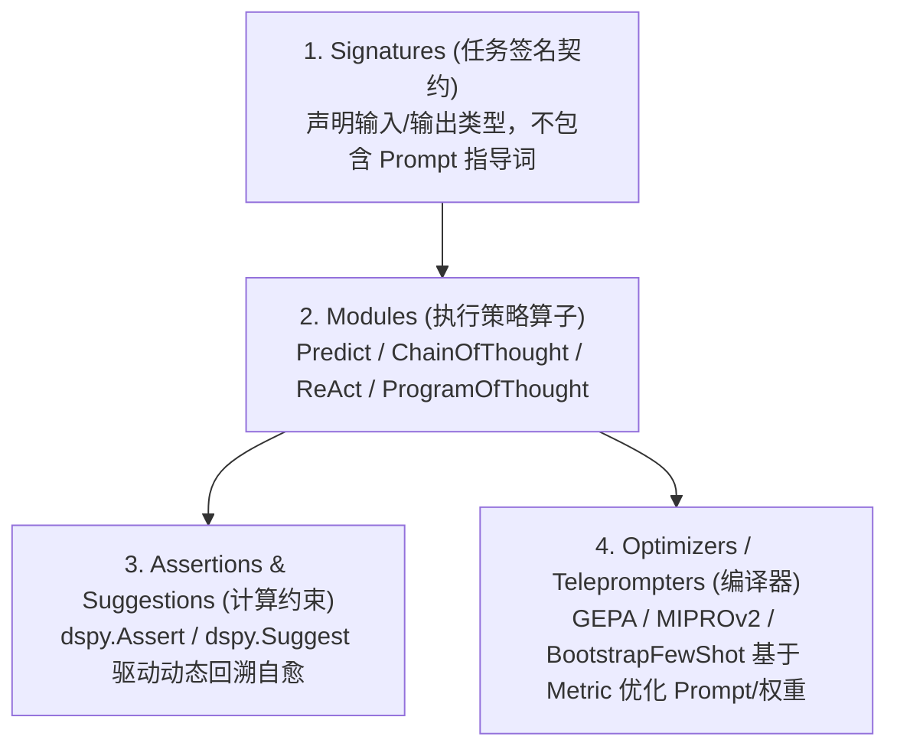

# DSPy 架构范式研究及其对 Botashka 的系统性启示

## 摘要

本报告对 Stanford NLP 的声明式大模型编程框架 **DSPy**（及 3.x 最新架构）展开一手技术调研，剖析其核心抽象（Signatures、Modules、Optimizers、Assertions），并对照 **Botashka** 的设计原则（Functional Core / Imperative Shell、EDN 数据优先、不可变 Run Event Log、分层 ActionPolicy）进行深度推演。

结论表明：DSPy 的核心价值在于**将 Prompt 从“手写业务代码”降级为“编译器的 Lowering（降级）产物”**，并实现了任务契约与推理策略的解耦；而其重度依赖 PyTorch 面向对象范式、内部可变状态、隐式执行循环与字符串正则解析则是 Botashka 必须坚决规避的工程陷阱。通过借鉴 DSPy 的设计思想，Botashka 可以利用自身不可变的 Run Event Log，打通从 System-2（慢思考发散探索）向 System-1（Laya/Jev 毫秒级决策模型）的“黄金轨迹自动蒸馏”通路。

---

## 1. DSPy 的核心范式与一手架构解析

DSPy（Declarative Self-improving Language Programs, Python）由 Stanford NLP 团队提出（代表性论文：*DSPy: Compiling Declarative Language Model Calls into State-of-the-Art Pipelines*, arXiv:2310.03714；*DSPy Assertions*, arXiv:2312.13382）。其核心主张是：**“Program, don’t prompt, your LLMs”**。

DSPy 将大模型应用开发抽象为四层标准组件：



### 1.1 Signatures（任务契约）
- **定义**：将对 LLM 的调用表达为类型化的输入/输出规格说明，而非自然语言提示词。
- **机制**：
  ```python
  class ExtractEvent(dspy.Signature):
      """Extract event details from text."""
      email: str = dspy.InputField()
      event_name: str = dspy.OutputField()
      date: str = dspy.OutputField()
  ```
- **价值**：把“要做什么”（What）从“怎样指示模型”（How to prompt）中彻底剥离，使上层逻辑具备跨模型迁移性。

### 1.2 Modules（策略算子）
- **定义**：满足某个 Signature 的具体推理执行策略。
- **机制**：同一个 `ExtractEvent` 签名，可以自由挂接不同的策略：
  - `dspy.Predict(ExtractEvent)`：零样本直接映射；
  - `dspy.ChainOfThought(ExtractEvent)`：自动插入 `rationale` 推理步骤；
  - `dspy.ReAct(ExtractEvent, tools=[...])`：展开为带有工具调用和观察反馈的思考循环。
- **价值**：接口与实现严格解耦，切换推理策略无需重写任务定义。

### 1.3 Assertions & Suggestions（带回溯的运行时约束）
- **定义**：在 LLM 生成结果上施加确定性计算约束（arXiv:2312.13382）。
- **机制**：
  - `dspy.Assert(condition, msg)`：硬性断言。如果条件不满足，框架捕获异常，将失败原因和历史上下文自动打包，驱动模型定向重试（Backtracking）；若超出重试上限则抛出硬错误。
  - `dspy.Suggest(condition, msg)`：软性建议。重试耗尽后仅记录警告，允许流程继续。
- **价值**：将代码检查器（Validators/Linters）与模型自愈循环紧密编织在一起。

### 1.4 Optimizers / Teleprompters（基于指标的编译器）
- **定义**：把 Prompt 的微调和 Few-shot 样例选择转化为类似神经网络权重优化的编译过程。
- **机制**：输入一段 DSPy 程序、一组训练样本（Trainset）和一个量化打分函数（Metric: `(example, prediction, trace) -> float`）。
  - **BootstrapFewShot**：模拟执行流水线，收集全部断言通过的“完整成功轨迹（Traces）”，自动筛选为最佳 Few-shot 注入 Prompt；
  - **MIPROv2 / GEPA**：在指令空间（Instruction Space）进行贝叶斯搜索或反射演化优化；
  - **Weight Fine-tuning**：将大模型跑通的高质量 Trace 蒸馏并微调到小型开源模型（如 Llama/Qwen/LFM）中。

---

## 2. Botashka 可深度借鉴的设计思想

结合 Botashka 的定位（Clojure/Babashka 开发的高可靠 Coding Agent），DSPy 提供了以下关键借力点：

### 2.1 思想一：Prompt 降级（Lowering）——从手写指令到编译器后端

在现有 Agent 实践中，提示词往往是散落在各个业务文件中的脆弱字符串，充斥着大量的格式规约（如“请输出合法的 JSON，不要输出 Markdown 代码块”）。

**对 Botashka 的启示**：
Prompt 绝不是业务逻辑，它只是**特定 LLM 协议后端的低级目标代码（如同汇编或字节码）**。

在 Botashka 中，领域层应当只声明纯不可变数据契约（EDN）：
```clojure
{:signature :task-routing
 :inputs    {:workspace-summary string?
             :active-goal       string?}
 :outputs   {:selected-action   keyword?
             :confidence        float?
             :rationale         string?}}
```
由 `model-client` 作为 Compiler/Adapter 负责完成 Lowering：
- 目标后端是 **Gemini v1beta** 时：降级为 `functionDeclarations` 与 `thoughtSignature`；
- 目标后端是 **Laya / Jev** 时：降级为单次前向传播的候选动作分类；
- 目标后端是 **LFM2.5-350M** 时：降级为带约束的少样本纯文本模板。

业务领域代码（`botashka.run`、`ActionPolicy`）永远只与纯数据契约交互，模型演进不污染领域层。

### 2.2 思想二：任务契约（Signature）与动作策略（ActionPolicy）解耦

DSPy 允许同一 Signature 挂接 `Predict`、`ChainOfThought`、`ReAct`。这一理念与我们在重构计划中提出的 **ActionPolicy Pipeline** 异曲同工：

$$\text{ActionPolicy} : \text{Run State} \longrightarrow \text{Command} \mid \text{nil}$$

通过高阶函数（Higher-Order Policies），我们可以为同一个任务动作自由组装不同的策略包装：
- **`direct-action-policy`**：基于确定性规则或本地 Laya 模型毫秒级直发；
- **`reasoning-action-policy`**：类似 DSPy `ChainOfThought`，强制模型在给出 Action 之前显式产出有界的推理证据事实；
- **`fallback-action-policy`**：首选策略置信度不足或失败时，平滑降级到慢思考生成式大模型。

### 2.3 思想三：Symbolic Gates 转化为自愈反馈闭环（统一 `dspy.Assert`）

DSPy 的 `dspy.Assert` 机制证明：**带有精确诊断信息的失败反馈，比盲目重新提问具有高得多的修复成功率。**

在 Botashka 中，我们已经定义了 **Symbolic Gates**（基于 `clojure.spec`、编译器和测试用例）。我们可以完全吸收这一反馈循环：
1. 当某个 WorkItem 执行完毕交付时，宿主运行 Gate；
2. 若 Gate 失败，提取结构化的诊断事实（例如 `(s/explain-data ...)` 或测试 failure diff）；
3. 将该失败事实作为标准事件追加至 Log：
   ```clojure
   {:type :gate-failed
    :data {:gate-id :spec-boundary-check
           :diagnostics [...]}}
   ```
4. ActionPolicy 检测到上一步是 `:gate-failed`，自动构造包含精确错误信息的纠偏输入，驱动局部自愈，而不是推倒重来。

### 2.4 思想四：基于不可变 Event Log 的黄金轨迹自优化（BootstrapFewShot 蒸馏）

这是 Botashka 与 DSPy 思想碰撞中最具爆发力的一点。

DSPy 的 `BootstrapFewShot` 需要花费大量计算和额外拦截器去捕获多步模块的中间变量；而 **Botashka 原生就拥有严格顺序、不可变的 Run Event Log**。

- **Golden Trajectory（黄金轨迹）自然沉淀**：
  只要一次 Agent Run 最终状态为 `:completed`，且所有外部集成门禁全部绿灯，其对应的有序事件序列就是一份完美的、经过现实环境检验的黄金执行记录。
- **向 System-1（Laya/Jev）自动蒸馏**：
  我们可以用纯 Clojure 函数遍历成功的历史 Run Logs，提取所有：
  $$\langle \text{RunState 局部事实摘要}, \text{选中的 Action}, \text{工具入参} \rangle$$
  三元组。这些纯净、无幻觉的决策事实，既可以直接用作小模型微调（Fine-tuning）的数据集，也可以作为 Few-shot 样例注入给本地端侧模型（如 LFM2.5-350M），实现智能体的**离线自演进与快思考固化**。

---

## 3. Botashka 必须坚决规避的 DSPy 工程缺陷（Anti-patterns）

DSPy 虽然理论先进，但在工程实现上背负了沉重的 PyTorch 路径依赖和 Python 历史包袱。Botashka 必须坚决扬弃以下反模式：

| 维度 | DSPy 的缺陷与陷阱 | Botashka 的对治原则 |
| :--- | :--- | :--- |
| **编程范式** | 照搬 PyTorch 深度学习面向对象设计：继承 `dspy.Module`、重载 `forward`、全局 `dspy.settings` 隐式上下文。类状态可变且调试困难。 | **纯函数式与数据优先 (Data First)**：所有 Signature 只是普通的 EDN Map / Spec；所有 Policy 只是无状态的高阶纯函数。 |
| **底层实现** | 严重依赖脆弱的文本模版拼接与正则表达式提取（如正则捕获 `Thought: ...`、`Action: ...`），极易因模型输出格式微调而崩塌。 | **严格类型化 API**：在 Imperative Shell 边界全面采用厂商原生结构化协议（Gemini `functionDeclarations`、OpenAI JSON Mode），零正则解析。 |
| **执行流透明度** | `dspy.ReAct` 等复合模块在库内部封装不可见的 `while` 循环，吞掉了内部状态转换，外界无法感知微观事件。 | **事实高于日志 (Facts over Logs)**：坚决杜绝黑盒内部循环。所有的状态推进必须是单步的、由宿主状态机显式消费，且每一步严格记录规范 Canonical Event。 |

---

## 4. 在 Botashka 中的具体 Clojure 落地设计构想

结合上述权衡，我们可以用纯 Clojure 数据结构定义出轻量、无框架污染的“DSPy 风格”核心原语：

### 4.1 纯数据化的 Signature
```clojure
(ns botashka.signature
  (:require [clojure.spec.alpha :as s]))

;; 声明任务签名
(def tool-routing-signature
  {:name :tool-routing
   :doc "根据当前运行状态与工作区发现，选择下一个工具动作"
   :inputs  {:workspace-summary string?
             :active-task        string?
             :available-tools    (s/coll-of string?)}
   :outputs {:selected-tool     string?
             :arguments         map?
             :confidence        float?}})
```

### 4.2 策略算子的高阶函数实现（替代 PyTorch Class）
```clojure
(ns botashka.policy
  (:require [botashka.signature :as sig]))

(defn direct-policy
  "零样本直接映射算子"
  [signature client]
  (fn [state]
    ;; 调用快速判决模型或规则
    ...))

(defn reasoning-policy
  "思维链增强算子：自动在输出前置插入 rationale 证据推导"
  [signature client]
  (let [augmented-sig (update-in signature [:outputs] assoc :rationale string?)]
    (fn [state]
      ;; 驱动模型先行推理并提取决策
      ...)))

(defn asserted-policy
  "带自愈门禁的策略装饰器：类似 dspy.Assert"
  [policy gate-fn max-retries]
  (fn [state]
    (loop [attempts 0
           current-state state]
      (let [command (policy current-state)]
        (if-let [violation (gate-fn command current-state)]
          (if (< attempts max-retries)
            (recur (inc attempts)
                   ;; 将违规事实追加为上下文反馈
                   (assoc current-state :last-gate-error violation))
            {:command :run/limit :reason :gate-retry-exhausted})
          command)))))
```

### 4.3 基于 Event Log 的轨迹提取器（替代 BootstrapFewShot）
```clojure
(ns botashka.optimizer
  (:require [botashka.run :as run]))

(defn extract-golden-examples
  "从已成功的终端运行日志中提取高质量的 <State, Action> 示范样例"
  [event-log]
  (when (= :completed (get-in (last event-log) [:data :status]))
    (->> event-log
         (partition-by :type)
         (filter #(#{:tool-proposed} (:type (first %))))
         (mapv (fn [proposals]
                 (let [prop (first proposals)]
                   {:state-turn (get-in prop [:data :turn])
                    :tool       (get-in prop [:data :tool])
                    :arguments  (get-in prop [:evidence :arguments])}))))))
```

---

## 5. 总结与建议行动项

1. **近端融合（Phase 1-2）**：
   在实现 `ActionPolicy` 与 `WorkItem` 规范时，采用 **Signatures as Data** 原则，把任务的输入/输出槽位与底层的 Prompt 拼装彻底解耦。
2. **中期引入（Phase 3-4）**：
   将 Symbolic Gates 的失败反馈机制标准化，模拟 `dspy.Assert` 的自愈重试流，利用 `clojure.spec/explain-data` 精准指导模型进行单点修复。
3. **远端沉淀（Phase 6+）**：
   建立历史 Run Logs 的离线挖掘管道，将经过编译/测试验证的成功 Trace 自动聚合成 Few-shot 知识库，驱动轻量级 System-1 模型（Laya / LFM2.5）在本地完成高频工具路由的冷启动与自增强。
