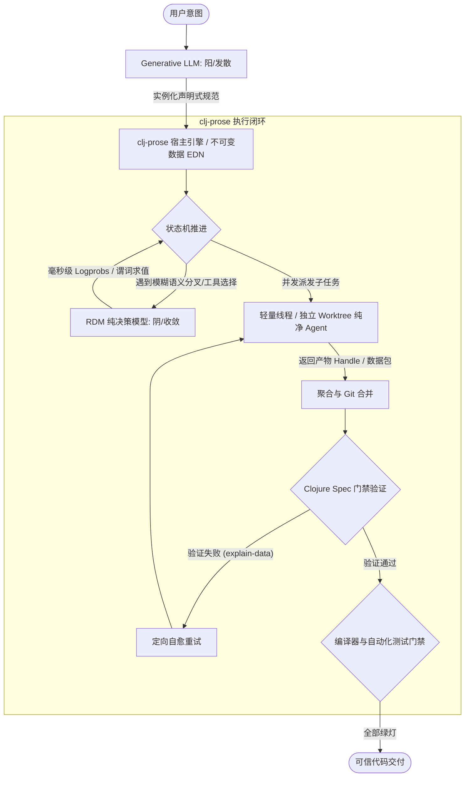

# 从长上下文迷思到确定性智能体架构：RLM、RDM、omp 与 clj-prose 深度解析

---

## 目录
1. [背景与核心痛点：长上下文与 Agent 的可靠性瓶颈](#1-背景与核心痛点长上下文与-agent-的可靠性瓶颈)
2. [范式转移一：Recursive Language Models (RLM) 与编码智能体](#2-范式转移一recursive-language-models-rlm-与编码智能体)
3. [范式转移二：Recursive Decision Models (RDM) 与快思考系统](#3-范式转移二recursive-decision-models-rdm-与快思考系统)
4. [真实系统审视：以 omp (oh-my-pi) 为例看工具路由与控制流瓶颈](#4-真实系统审视以-omp-oh-my-pi-为例看工具路由与控制流瓶颈)
5. [业界前沿：Agentic DSL（智能体领域专用语言）研究与流派](#5-业界前沿agentic-dsl智能体领域专用语言研究与流派)
6. [形式化破局：纯函数式语言、Clojure Spec 与 OpenProse](#6-形式化破局纯函数式语言clojure-spec-与-openprose)
7. [头脑风暴构想：clj-prose 与 RDM 融合的下一代智能体架构](#7-头脑风暴构想clj-prose-与-rdm-融合的下一代智能体架构)

---

## 1. 背景与核心痛点：长上下文与 Agent 的可靠性瓶颈

当前大模型（LLM）与 Coding Agent 面临的核心矛盾并非“模型智力不足”，而是**“缺乏可靠性与可信任度（Reliability & Trust）”**：
- **Mismanaged Geniuses（被误管的天才）假说**：模型具备极高的单点推理能力，但在长周期工程任务中极不稳定——今天能一句话生成完整项目，明天就能在微小重构中删库或引入严重回退。
- **被动长上下文加载的物理极限**：
  - 试图将几十万 Token 的代码库一股脑塞入 Context Window，必然遭遇**注意力稀释（Lost in the Middle / Context Rot）**；
  - 注意力机制计算开销随序列长度膨胀，且长上下文中的无效噪声严重拖累推理确定性；
  - 传统的单对话轮次工具调用（Chat Loop）中，每一个工具返回的结果都被持续堆积在当前会话的上下文里，导致主 Agent 迅速被垃圾信息淹没。

---

## 2. 范式转移一：Recursive Language Models (RLM) 与编码智能体

针对上述瓶颈，Raymond Weitekamp 与 Alex Zhang 等人提出了 **RLM（Recursive Language Models, arXiv:2512.24601）** 思想：**“Context 本身就是被计算的对象（Context as the object of computation）”**。

```
传统模式 (Attention-driven):
User Prompt + 巨大代码全文 ──> [塞入单个 Context Window] ──> 易发生注意力稀释与幻觉

RLM 模式 (Code-driven / Divide & Conquer):
External Context (驻留磁盘/Handle)
       │
       ▼ [根 Agent 在 REPL/沙箱中执行代码]
       ├── 代码探查上下文结构 (AST / 依赖图 / 目录树)
       ├── 动态决定如何切分 (Model-driven Partitioning)
       └── 递归调用独立纯净的子模型实例
               ├── Sub-Agent A (仅加载 Slice A 的 Handle，Context < 4k)
               └── Sub-Agent B (仅加载 Slice B 的 Handle，Context < 4k)
                       └── 结果落地磁盘，通过编译与测试断言 (Symbolic Gates)
```

### RLM 的五大核心判定准则 (Rubric)
1. **可执行环境（Executable Environment）**：Agent 工作在沙箱 REPL 或终端内。
2. **上下文外部化（Prompt Externalized）**：海量数据以句柄（Handle / Pointer）形式停留在文件系统或沙箱内存中，不直接注入 Prompt。
3. **由代码调用模型（Code Calls the Model）**：宿主代码主导控制流，模型只是代码调用的一个子例程。
4. **模型自主决定分解（Model Picks Decomposition）**：不是开发者硬编码写死 MapReduce 管道，而是模型根据代码库现状动态编写切分脚本。
5. **状态保持符号化（State Stays Symbolic）**：中间过程不依赖模糊的语言描述，而是以文件 diff、commit hash、退出码等符号化数据流转。

### RLM 与传统 Subagent 的本质区别
下级 Agent 最终确实需要将代码读入 Context Window 进行 Token 推理，但 RLM 解决了**系统级解耦**：
- **传值（Pass-by-Value）vs. 传引用（Pass-by-Reference）**：传统模式在 Prompt 里拷贝粘贴大段代码，RLM 传递轻量级文件句柄（Handle）。
- **单点爆炸 vs. 局部纯净**：把 1 个 1,000,000 Token 的灾难性会话，打碎成 100 个 10,000 Token、处于巅峰注意力和推理水准的独立短会话。
- **防止回流污染**：子 Agent 的产出直接写回磁盘或 Git 分支，不把大段修改文字汇报回根 Agent 的 Prompt。
- **真递归能力**：当子 Agent 发现分配给自己的 Handle 依然过于庞大时，能在本地发起自相似递归（Self-similar Recursion），继续拆分子子 Agent。

---

## 3. 范式转移二：Recursive Decision Models (RDM) 与快思考系统

在系统控制与高频动作场景下，RLM 进一步演化为 **RDM（Recursive Decision Models）**。

### 核心论点：“Decide, don't write”
- 行业过度依赖“生成式思维链（Generative CoT）”，让模型为每个微小动作生成长篇大论，带来了不可承受的推理延迟和幻觉风险。
- **RDM 假说**：**“复杂的推理，本质上是一连串极小、快速的离散决策（What if reasoning was actually many small decisions?）。”**
- **阴阳双元（Yin & Yang）分工**：
  - **Generative LLM（阳 - 发散 / Divergence）**：负责产生脑暴方案、展开候选分支。
  - **Decision Model（阴 - 收敛 / Convergence）**：基于 Jev / Strands Decider 等专用架构，**不输出文本，只在单次前向传播中输出概率分布与置信度（Logprobs）**，毫秒级快速剪枝。

### 硬件与本地模型实操（Apple Silicon M4 48G）
- **原生决策模型**：`StrandsAgents/strands-decider-2B`（替换了生成头为指针打分头，显存占用 2~4GB，单次决策数十毫秒）。
- **通用模型改造法**：利用本地引擎（MLX / llama.cpp / Ollama）加载 `Qwen-2.5-14B` 或 `32B (Q4)`，配置 `max_tokens: 1` 并提取 `logprobs`，直接从候选项 Token 概率中提取决策与置信度。

---

## 4. 真实系统审视：以 omp (oh-my-pi) 为例看工具路由与控制流瓶颈

结合 omp 的几十种工具（`read`, `glob`, `grep`, `lsp`, `edit`, `write`, `bash`, `task`, `eval` 等），可以清晰看到当前架构与前沿架构的差异：

| 维度 | 现有 omp (Flat Schema + Prompt Loop) | RDM 重构后的工具路由 | RLM 重构后的任务编排 |
| :--- | :--- | :--- | :--- |
| **工具发现** | 全部 Schema 塞入 Prompt，导致注意力稀释 | 层次化工具树（Inspect $\to$ AST $\to$ LSP），由决策模型逐层打分下潜 | 将所有工具暴露为本地 SDK 模块，由模型编写脚本调用 |
| **选择延迟** | 大模型生成一次 Tool Call 需数百毫秒至数秒 | 读取分类 Logprobs，毫秒级直接锁定动作 | 单次生成 Python/JS 脚本，在沙箱中高频批量执行 |
| **任务推进** | 依赖 LLM 单步对话反复向宿主发起请求 | 状态机驱动，微观动作由 RDM 瞬间剪枝完成 | 主模型在沙箱运行循环，独立派发纯净子 Agent |

## 5. 业界前沿：Agentic DSL（智能体领域专用语言）研究与流派

针对“聊天历史（Chat History）过于脆弱、难以版本化与工程化”的瓶颈，学术界与工业界（2025–2026）正在经历一场向 **Agentic DSL** 的集体转向。

正如软件工程大师 **Martin Fowler** 在专栏文章 *《DSLs Enable Reliable Use of LLMs》* 中指出的核心思想：
> **“大模型天生充满不确定性和幻觉，而 DSL 最大的价值在于它自带确定性的验证器（Deterministic Validator：解析器、类型检查器、Schema 校验）。DSL 是将不可靠的 LLM 生成与确定性系统连接起来的骨干。”**

当前业界在该领域主要形成了四大研究流派：

### 1. 声明式工作流编排 DSL（Declarative Workflow DSLs）
旨在将繁琐、易错的 Python 命令式 `while` 循环或难以维护的 JSON 转化为静态声明式语言：
- **IBM PDL (Prompt Declaration Language, arXiv:2507.06396)**：
  专门用于指定 Prompt 管道和多智能体交互的声明式编程语言，支持控制流（条件分支、循环）、类型约束和作用域变量，把 Agent 交互变成了一种可以被静态分析的规范代码。
- **Helium (arXiv:2603.16104)**：
  用精简的 DSL 原语抽象 Agentic 工作流，底层编译器自动将其映射为**惰性、符号化的 DAG（有向无环图）**，在系统底层进行批处理和分布式调度优化。
- **A Declarative Language for LLM Agent Workflows (arXiv:2512.19769)**：
  提炼了数据序列化、过滤、RAG 检索、API 编排等常见 Agent 模式，提出类似 SQL 的声明式编排 DSL，将开发范式从命令式代码重构为高内聚配置。

### 2. 上下文与记忆演进 DSL（Context & Evolution DSLs）
针对长上下文管理，形式化描述“Context 随时间和交互如何切片与流动”：
- **ACDL (Agentic Context Description Language, arXiv:2605.01920)**：
  提出一套形式化词汇表与组合规则，专门用于描述和推理 LLM 上下文在多步演进、动态分治中的生命周期。
- **PromptML**：
  将单次 Prompt 的内部结构（Context、目标、指令、元数据、工具约束）解耦成模块化的严格 DSL，消除自然语言拼接带来的歧义。

### 3. “生成-校验-自愈”闭环（Generate-Validate-Repair Loop）
- **核心范式**：`人类模糊意图 ──> LLM 生成 DSL 规范 ──> 确定性编译器/类型检查器校验 ──> 精确报错反馈 ──> LLM 靶向自愈`。
- **关键学术结论**：当 LLM 生成自然语言出错时，系统很难自动化纠错；但如果目标是一个**具备确定性语法的 DSL**，编译器的精准诊断信息（Parser Error / Type Mismatch）为 LLM 提供了信息密度极高的负反馈，修复成功率呈数量级提升。

### 4. 工业界落地形态
- **Dify DSL / ChatDify (arXiv:2611.01563)**：利用多 Agent 协作自动合成统一的 YAML 格式工作流 DSL，将非结构化需求转化为工业级可运行流水线。
- **OpenProse (`.prose.md`)**：以半形式化的 Markdown 形式定义 Handles、Loops 与 Gates，作为将黄金调试会话（Golden Sessions）固化为可复用程序的先驱尝试。

---

---

## 6. 形式化破局：纯函数式语言、Clojure Spec 与 OpenProse

### 1. 拆分与组合的两大核心难题
1. **怎么拆才能“正正好”？**
   - 依赖 **“契约先行（Contract First）”**：通过 AST 提取接口签名作为公共契约（Shared Contract），实现细节以独立 Handle 派发，屏蔽不必要的实现噪声。
2. **怎么合才不混乱？**
   - 依赖 **“符号化门禁（Symbolic Gates）”**：子 Agent 在独立的 `git worktree` 运行，通过编译器类型检查（Typecheck）、自动化测试覆盖和无上下文污染的 Skeptic Review 审查合并结果。

### 2. 函数式语言（Haskell / Clojure）的天然降维打击
- **纯函数与引用透明（Referential Transparency）**：彻底杜绝隐式全局状态与副作用，切片边界在数学上完全清晰。
- **强大的类型系统与属性测试**：Haskell 编译器能对模型填补的代码空槽（Hole）进行类型级判定；Clojure 的 `test.check` 可自动生成海量边界数据狂轰滥炸，杜绝幻觉。

### 3. OpenProse 及其局限
- **OpenProse (`.prose.md`)**：以声明式 Markdown 契约固化 Agent 的多阶段工作流，定义 Handles、Loops 与 Gates。
- **痛点**：Markdown 本质上仍由 LLM 自我解释执行，模型容易“自吹自擂”声称满足契约，缺乏机械级硬约束。

---

## 7. 头脑风暴构想：clj-prose 与 RDM 融合的下一代智能体架构

将 **Clojure / EDN 的代码即数据属性与 Spec 验证体系**，与 **RDM 极速离散决策机制** 结合，构想出 **clj-prose 架构**：



### 核心特性总结
1. **EDN 表达工作流（Homoiconicity）**：
   任务拓扑、阶段、门禁完全以纯不可变数据表示，支持原生 Tagged Literals（如 `#handle/slice`、`#handle/dir`），由宿主虚拟机直接调度，不再依靠 LLM 自言自语解释执行。
2. **RDM 作为语义谓词（Semantic Predicates）**：
   在 `clojure.spec` 约束和状态机路由中，RDM 充当毫秒级“AI 谓词函数”，只做选项概率裁决，不输出多余 Token。
3. **Spec 提供确定性自愈上下文**：
   当 Agent 产出违规时，`s/explain-data` 生成结构化、无歧义的错误路径与原因，精准反馈给下级节点实施单点修正。
4. **投机执行与仲裁（Speculation & Arbiter）**：
   利用 Clojure 的不可变数据结构和并发原语，同时并行探索多条修复路径，由 RDM 充当仲裁器选择最优分支，无副作用丢弃落选分支。

---

### 结语
从 **Recursive Coding Agents** 到 **Recursive Decision Models**，再到 **clj-prose** 的构想，一条清晰的智能体进化脉络正在浮现：
**不要试图用无限扩大的神经网络注意力去挑战软件工程的复杂度；而应以经典计算机科学的严谨基建（外部句柄、分治递归、不可变数据、形式化规范、编译器门禁）为骨架，让大模型只在局部负责代码生成，让决策模型在微观上极速变轨。这是让 AI 编码真正跨越可信门槛的必由之路。**
