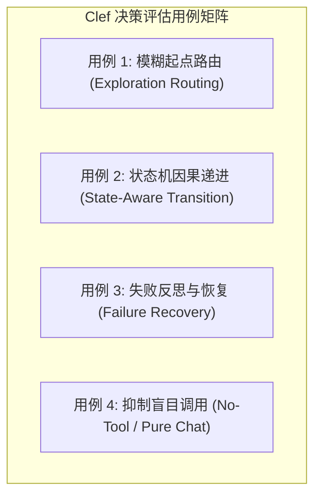

# Clef 决策模型选工具验证与集成计划

本文档规划将专用决策模型（Decision Model）——**Cloudflare Clef (9B / Clef-flash)** 引入 Botashka，作为 System-1 极速离散动作仲裁层的前期验证方案。

本计划遵循 **“先离线评估、再构造测试用例、最后插件化接入”** 的节奏，在未通过严格确定性测试前不改动任何核心代码。

---

## 一、 背景与设计动机

### 1.1 现状与痛点
当前 Botashka 在动作决策上完全依赖通用大模型（Gemini 3.1 Flash / Claude 3.7）：
- **全量自回归生成（Token-by-token decoding）**：哪怕只是判断“接下来该读文件还是跑测试”，都需要经过漫长的前缀生成和 JSON 序列化（耗时 1~3 秒）；
- **Token 浪费与成本**：在单轮定位 Bug 场景下，多次中间只读探索（`search_text` $\to$ `read_file`）反复消耗主模型的上下文配额；
- **脆弱的 Tool Call 解析**：通用小模型在复杂多轮下极易发生 JSON Schema 格式破碎或幻觉。

### 1.2 决策模型（Clef）的定位
Clef 是基于 Qwen 架构训练的非自回归决策模型（Non-autoregressive Decision Model）：
- **不生成长文本**：输入 `RunState` 与 typed `Tools Schema`，直接在一次 Forward Pass 计算各候选动作的对数几率（Logits），输出带校准概率（Confidence）的确定性选项；
- **毫秒级极速响应**：推理耗时仅 **30~50ms**（相比通用 LLM 提升 20~50 倍）；
- **系统一（System-1）快反射**：将 Agent 的动作拆解为“快反射（读/搜/验）”与“慢推理（设计/写复杂代码）”。

---

## 二、 现有 5 个工具的评估与充分性分析

当前 Botashka 注册了 5 个核心工具：
1. `list_files`：目录结构探索（只读）
2. `read_file`：特定文件文本读取（只读）
3. `search_text`：跨工作区文本模式搜索（只读）
4. `write_file`：文件内容覆盖与创建（变更）
5. `run_command`：Shell 进程命令执行（副作用/执行）

### 评估结论：
- **基础验证【够用】**：涵盖了只读探索、状态变更、系统命令三大基本维度；
- **深度区分【不够刁钻】**：缺少高混淆度的近义竞争工具、安全受限工具以及主动放弃（No-Tool）动作，难以完整压榨 Clef 的置信度校准能力。

---

## 三、 四类典型测试用例设计 (Benchmark Matrix)

测试采用纯数据驱动方式（给入固定 EDN 格式的 `state` 与 `tools`，断言 Clef 返回的 `choice` 和 `confidence`）。



### 用例 1：模糊起点的工具辨析（`search_text` vs `list_files`）
- **输入状态**：
  - 用户 Prompt：“这个项目里有没有处理 SSE 的代码？”
- **评估要求**：
  - 正确决策：高置信度选择 `search_text`（指向语义关键词 `"SSE"` / `"text/event-stream"`）；
  - 错误决策：盲目选择 `list_files`（大项目中浪费步数）或 `run_command`。

### 用例 2：依据报错结果的因果状态递进（State-Aware Transition）
- **输入状态**：
  - Turn 0: 用户说“修复 `agent_test.clj` 里的测试失败”；
  - Turn 1: 刚执行完 `run_command {:command "bb test"}`，返回报错：
    ```text
    FAIL in test-command-executor (agent_test.clj:34)
    expected: (= :completed status)
      actual: (= :error status)
    ```
- **评估要求**：
  - 正确决策：必须选择 `read_file`，目标为 `test/botashka/agent_test.clj`；
  - 错误决策：继续重复调用 `run_command`（死循环），或未经查看直接调用 `write_file`（盲猜）。

### 用例 3：执行失败反思与恢复（Failure Recovery）
- **输入状态**：
  - Turn 0: 试图调用 `read_file {:path "src/bus.clj"}`；
  - Turn 1: 工具返回错误事实：
    `{:error {:kind :not-found, :message "File not found: src/bus.clj"}}`
- **评估要求**：
  - 正确决策：立刻改选 `list_files {:path "src"}` 或 `search_text {:query "new-bus"}` 重新定位路径；
  - 错误决策：放弃任务报错，或对不存在的路径反复重试。

### 用例 4：纯解释对话与克制（Negative Case: `no_tool` / Abstain）
- **输入状态**：
  - 用户 Prompt：“请解释一下什么是 Functional Core, Imperative Shell？”
- **评估要求**：
  - 正确决策：所有 5 个工具的预测概率必须**低于阈值**（或直接命中预置的虚拟动作 `respond_to_user`）；
  - 错误决策：强行调用 `search_text` 或 `list_files`。

---

## 四、 阶段实施规划 (Roadmap)

### Phase 1: 离线环境与接口适配（零侵入）
- **目标**：在 M4 MacBook 上跑通 Clef 的推理通道。
- **任务**：
  1. 验证运行形式：
     - 选项 A（首选）：本地通过 `llama.cpp` 或 `mlx` 运行 Clef 9B GGUF/量化版本；
     - 选项 B（免部署）：通过 Cloudflare Workers AI REST API 进行调用；
  2. 确定输入格式映射：将 Botashka 的不可变 `RunState` 与 Malli 编译的 Tool Schema 转换为 Clef 所需的 Prompt/Payload 格式；
  3. 编写单机测试探针脚本 `scratch/clef_probe.clj`。

### Phase 2: 测试用例数据集构建与评分
- **目标**：建立静态基准评测集，量化评估 Clef 在编程场景下的准确率。
- **任务**：
  1. 在 `test/resources/fixtures/decision/` 下创建 4 类典型场景的 EDN 输入数据；
  2. 运行单向评测，输出评测指标：
     - **Top-1 命中率（Accuracy）**：目标 $\ge 90\%$；
     - **校准置信度（Confidence Spread）**：有效动作置信度 $\ge 0.85$，无工具时 $\le 0.4$；
     - **推理延迟（Latency）**：本地端到端 $\le 60\text{ms}$。

### Phase 3: 架构集成设计（双脑协同策略）
- **目标**：以插件化形式将 Clef 挂载到 Botashka 的决策体系。
- **集成方案**：
  - 在 `src/botashka/` 新增 `clef_policy.clj`；
  - 实现纯函数契约：`(defn clef-action-policy [run] ...)`；
  - **快慢脑协同流**：
    - 若 Clef 给出的最高置信度 $> 0.88$ 且属于只读探索工具 $\to$ 直接产出 `{:command :tool/execute, :origin :clef}`；
    - 若置信度不足或判定为写代码/推理任务 $\to$ 平滑降级返回 `nil`，让已有的 `default-action-policy` 交给 Gemini/Claude 生成；
  - **零侵入保证**：状态机核心 (`run.clj`)、命令执行器 (`command_executor.clj`)、事件总线 (`bus.clj`) 代码完全不改。

---

## 五、 验证标准与准入条件

在将 Clef 作为默认或可选 Policy 合并之前，必须满足以下硬性条件：
1. **基准测试全绿**：Phase 2 中定义的 4 类共计 10+ 个静态测试用例，Top-1 准确率达到 90% 以上；
2. **零循环死锁**：在工具返回失败时，具备明确的换工具恢复能力；
3. **退避机制正常**：面对非工具类问题，100% 能够退回主模型自然语言回复；
4. **现有自动化测试不变**：`bb test` 与 `clojure -M` 所有 30 个已有端到端测试持续 100% 通过。
