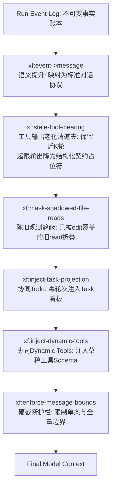
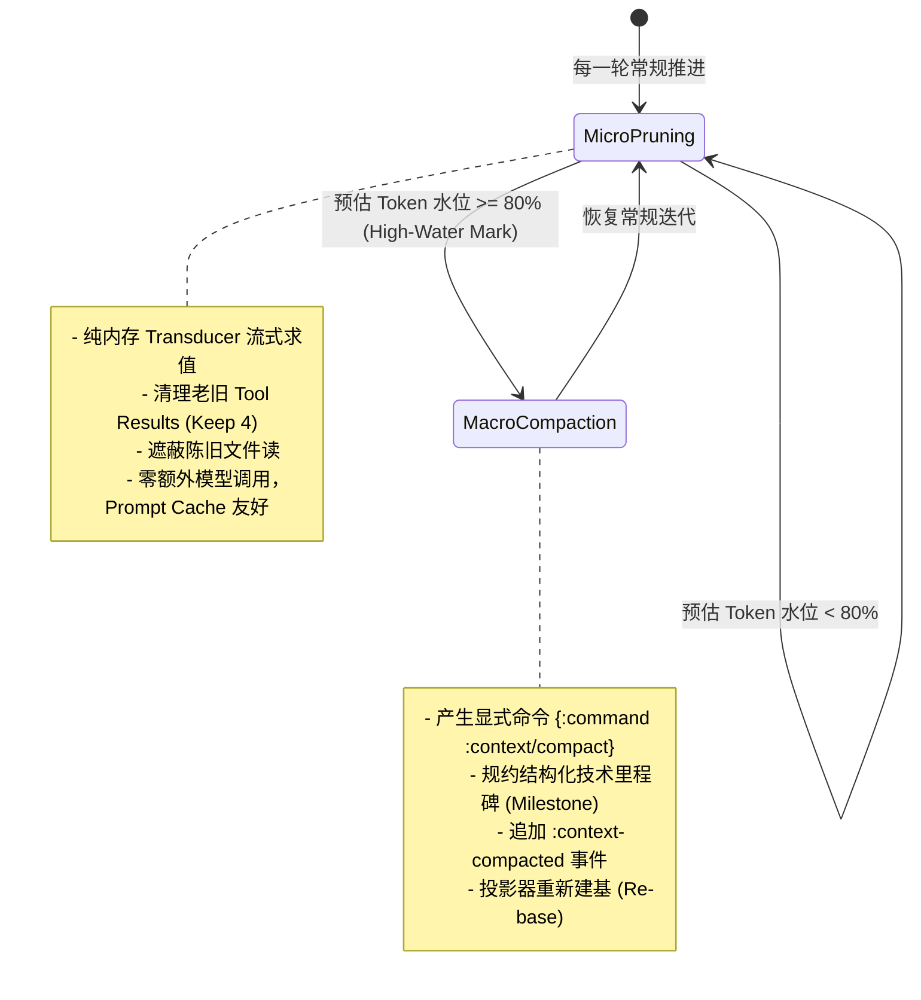

# Botashka 上下文管理与 Transducer 投影架构设计计划

## 1. 目标与设计哲学

Botashka 是一个从零构建、面向本地开发者的 Clojure/Babashka coding agent，严格遵循 **Functional Core, Imperative Shell (FCIS)**、**Data First** 以及 **Deep modules, small interfaces** 架构原则。

在长链路自主编程任务中，上下文（Context）是决定 Agent 智能深度、Token 经济性与执行稳定性的生命线。针对以往 Coding Agent 常见的“上下文全量追加导致的 Token 打爆”、“长文本注意力发散（Context Poisoning / Distraction）”以及“无序增删导致的 Prompt Cache 击穿”问题，本计划提出一套基于**“世界环境映射”**与**“纯函数 Transducer 流式投影”**的全新 Context 管理架构。

### 1.1 核心哲学与隐喻

#### 借鉴 Haskell `IO a = RealWorld -> (a, RealWorld)` 的实相观
在 Haskell 运行时底层，副作用计算的纯函数模型抽象为：
```haskell
newtype IO a = IO (State# RealWorld -> (# State# RealWorld, a #))
```
外部物理世界（磁盘文件、Git 提交树、操作系统进程、网络套接字、物理时钟）是一个持续演变、不可克隆的线性实相。每一次命令执行（Command Execution），都是物理世界的一次不可逆状态推进，并在系统内部沉淀为不可变事实。

#### 核心认知鸿沟与裁决
> **模型（LLM）本身是完全无状态且注意力有限的，它既不能直接持有外部物理世界，也无法吞下所有历史细节。**

因此，Botashka 确立如下三层核心映射关系：

```text
+------------------------------------------------------------------------+
|                          Physical World                                |
|   (Filesystem, Git Workspace, OS Processes, Clocks, Terminal)         |
+------------------------------------------------------------------------+
                               |
                   [Imperative Shell: execute!]
                               v
+------------------------------------------------------------------------+
|                    Run Event Log (Truth)                               |
|   [:run-started -> :tool-result -> :todo-updated -> :edit-applied]     |
+------------------------------------------------------------------------+
                               |
                  [Pure Context Transducers Pipeline]  <--- 核心设计域
                               v
+------------------------------------------------------------------------+
|                    Model Context Projection                            |
|   {:system "...", :messages [...], :tools [...]}                       |
+------------------------------------------------------------------------+
                               |
                      [Model Client Call]
                               v
+------------------------------------------------------------------------+
|                   Stateless LLM (Inference)                            |
+------------------------------------------------------------------------+
```

1. **状态唯一真理源 (Single Source of Truth)**：`Run Event Log` 是不可变事实流，忠实记录了物理世界在 Shell 中交互留下的客观痕迹；
2. **Context 不是持久状态 (Context is a Lens, Not State)**：Context **绝不是**内存中简单追加的 `(conj messages m)`，而是世界事实日志向有限模型视窗在特定轮次的**纯函数投影（Pure Projection Lens）**；
3. **计算的完全解耦 (Transducer-driven Transformation)**：采用 Clojure 的 **Transducer**，将上下文过滤、裁剪、折叠、掩盖与注入的算法逻辑，与具体的事件源（内存 Vector、core.async 队列、磁盘文件）彻底解耦，实现 100% 确定性、无副作用的纯核心计算。

---

## 2. 业界实践与横向对标 (State of the Art)

调研 2025~2026 年业界主流 Agent 系统，上下文工程已从早期的“粗暴全量拼接”演化为“分层治理与流式冷凝”：

| 系统 / 方案 | 核心工程机制 | 核心收益 | 局限性与风险 |
| :--- | :--- | :--- | :--- |
| **Anthropic Context Management API** (`clear_tool_uses`) | **In-Turn Pruning (工具擦除)**：将滑动窗口（如保留最近 4 次）之外的历史工具输出替换为轻量占位符（Placeholder），清除冗余 Thinking 块。 | 保持调用拓扑完整的同时，抹去 80%+ 冗余代码；**高度契合 Prompt Cache**。 | 强依赖专有 API；需严格保证 Tool Call 与 Result 契约配对一致。 |
| **OpenHands** (`LLMSummarizingCondenser`) | **Event-Stream Condensation (事件流冷凝)**：超出 `max_size` 阈值时触发折半，将前半段历史用模型摘要替换，追加 `AgentCondensationAction` 显式事件。 | 阻止二次方 Token 膨胀，将长程任务代价拉平为线性；完全事件驱动。 | 触发冷凝有延迟开销；纯文本摘要容易遗失精准代码行号与语法细节。 |
| **Claude Code & Codex CLI** | **95% 高水位自动 Compaction**：9 分区结构化技术摘要（Files Changed, Bugs Identified, Remaining Tasks, Workflows），辅以 `/compact` 手动指令。 | 结构化保留关键约束与代码模式。 | 易产生“压缩失忆症”（Lost in Compression）；若缺少外部状态机核对，待办任务容易遗漏。 |
| **Amp** | **人工显式 Handoff**：不执行无感自动压缩，由开发者在适当时机发起 Handoff，提炼阶段性决策开启新会话。 | 避免 Agent 擅自遗忘关键信息，保留开发者控制权。 | 无法应对无人值守的长链路自治编码场景。 |
| **omp** | **结构化工具契约 + 状态看板注入**：Read 工具强制切片与行锚定；Todo 不可查只可写，宿主每轮自动在 Prompt 嵌入当前任务树。 | 零无谓查询轮次，硬截断防爆保护。 | 需要宿主极强的状态机与护栏支撑。 |

### 业界核心教训与反模式规避

1. **避免上下文毒化与注意力发散 (Context Poisoning & Distraction)**：长任务中堆砌大量早期搜索结果或陈旧文件内容，会严重拉低后置推理精度，导致 Agent 基于旧代码产生幻觉；
2. **保护 Prompt Cache 命中率 (Cache-Friendliness)**：现代大模型（Anthropic, DeepSeek, OpenAI）重度依赖 KV Cache 降低延迟与成本。若在对话历史的前半截频繁做微小变动，会导致缓存彻底击穿；
3. **事实优于声明 (Facts over Claims)**：上下文压缩不能依赖 LLM 的天马行空自由总结，必须与客观事实日志（任务状态、已修改文件、测试通过凭据）严格绑定。

---

## 3. 基于 Transducer 的流式上下文投影引擎

### 3.1 架构拓扑：双层投影管线

Context 投影引擎将模型输入划分为**静态稳定前缀**与**动态事件流式折叠**两大部分：



### 3.2 核心 Transducer 构件设计

#### 1. `ct/events->messages`（事件升格转换器）
纯函数将领域事件映射为模型对话协议数据结构：
- `:user-submitted` $\rightarrow$ `{:role "user" :content prompt}`
- `:model-responded` $\rightarrow$ `assistant-message`
- `:tool-result` $\rightarrow$ `{:role "tool" :tool_call_id id :content raw-output}`
- 自动过滤内部编排事件（如 `:decision-requested`、`:run-started`），隔离宿主细节。

#### 2. `ct/prune-stale-tools`（工具输出老化清道夫 - In-Turn Pruning）
借鉴 Anthropic Context Management 思想的有状态 Transducer（Stateful Transducer）：
- **参数**：`:keep`（保留最近完整输出的调用次数，默认 4 次）；
- **行为**：
  - 维护一个环形滑动窗口，仅允许最近 $K$ 次工具调用的完整 payload 保留在上下文中；
  - 超过 $K$ 次的历史只读大输出（如超过 1,000 字符的 `read`、大规模 `grep`、`eval` 临时控制台输出），将其内容纯函数替换为轻量占位契约：
    ```clojure
    ;; 原始上万字符的 read 结果在 4 轮后被置换为：
    {:status :cleared
     :path "src/botashka/run.clj"
     :range [1 150]
     :footprint "150 lines read (content cleared to save context; use read again if needed)"}
    ```
- **核心价值**：**保持消息节点与 tool-call-id 的完整链条（不破坏模型协议与 Prompt Cache 前缀）**，同时削减 80%~90% 的废气 Token。

#### 3. `ct/mask-shadowed-file-reads`（陈旧文件观测遮蔽）
当文件在后续轮次中被变更，前序读取的内容在物理实相层面已经过时（Stale World）：
- **机制**：Transducer 在单次 pass 中记录后续的写操作（`:file-edited` 或通过 `edit` 成功的记录）。一旦发现某文件后续已被修改，前序对该文件的原始读切片立即被标记为：
  `"[Content of foo.clj superseded by subsequent edit at Turn N]"`；
- **核心价值**：防止模型在第 10 轮写代码时，被第 2 轮读到的陈旧函数签名误导。

#### 4. `ct/inject-task-projection`（权威任务看板自动注入）
深度协同 [`plan/tool-system-enhancement-and-todo-design.zh.md`](plan/tool-system-enhancement-and-todo-design.zh.md) Phase 2：
- 从 Event Log 纯规约出权威 Task Read Model；
- 将最新任务状态树流式注入到当前 Context 的 Guidance 区域（或最新的 user/assistant 消息尾部）；
- **收益**：模型无需调用任何查询工具，每一轮睁眼即见当前任务全景；彻底消灭 `todo_read` 工具。

#### 5. `ct/inject-dynamic-tools`（动态工具契约注入）
深度协同 [`plan/tool-system-enhancement-and-todo-design.zh.md`](plan/tool-system-enhancement-and-todo-design.zh.md) Phase 3：
- 动态检视 `runs/<id>/draft-tools/` 下通过 Auto-QA 的动态工具，通过 pure transformation 合并进 `:tools` 描述列表。

#### 6. `ct/enforce-message-bounds`（硬边界防御）
- 单条消息字符上限熔断（默认 16,000 字符），超限附带 `[TRUNCATED: N chars omitted]` 标记；
- 确保单个失控的命令输出绝对不会使整个 Agent 陷入超限崩溃。

---

## 4. 双层压缩机制：Micro-Pruning 与 Macro-Compaction

针对不同时间尺度的上下文膨胀，建立宏微双层防御：



### 4.1 Micro-Pruning（微修剪：每轮无感纯函数折叠）
- **触发性质**：每次调用 `build-model-context` 时纯函数求值；
- **状态不变量**：**不向 Event Log 写入任何事件**；
- **运行特征**：微秒级内存处理；通过占位符替换老旧结果，最大化保持 Prompt Cache 前缀稳定性。

### 4.2 Macro-Compaction（宏压缩：跨轮显式事实沉淀）
当即使执行了 Micro-Pruning，预估 Token 依然突破高水位警戒线（默认上下文窗口的 80% 或 80k tokens）：
1. **策略拦截**：`default-action-policy` 识别超限，产出决策 Command：`{:command :context/compact}`；
2. **结构化里程碑抽取**：Imperative Shell 调起摘要提炼（基于紧凑模板与客观事实日志）：
   - `:user-goal`：原始任务目标；
   - `:decisions`：已达成的架构决定与选型；
   - `:mutations`：已修改的文件及其验证结果；
   - `:active-tasks`：从 Event Log 继承的权威 Todo 状态；
3. **事件落地**：向 Event Log 追加 `:context-compacted` 事件，附带结构化 Milestone 数据与被折叠的序号范围 `[from-seq to-seq]`；
4. **投影重新建基 (Re-basing)**：投影 Transducer 遇到 `:context-compacted` 事件时，自动跳过折叠点之前的原始消息，直接以该技术里程碑作为上下文基底继续推进。历史原始事件安全留存于磁盘日志中，供离线审计。

---

## 5. 多模型协同治理：Clef 与 SLM 在 Context 工程中的定位

在以“纯函数 Transducer 投影”与“世界事实账本”为核心的 Context 架构下，**Clef（非自回归极速决策模型）** 与 **SLM（本地轻量语言模型，1.5B~7B）** 可以作为主模型（Frontier LLM）的**“上下文门禁（Gatekeeper）”**与**“上下文代谢器（Metabolism Engine）”**。

如果让所有探索动作、工具路由、上下文摘要都由 Frontier LLM（Claude 3.7 / Gemini 3.1）全量承担，会面临**长任务探索废气污染、Context 膨胀过快、Prompt Cache 击穿、成本与延迟双重爆炸**的问题。

```mermaid
flowchart TD
    subgraph S1 [快脑门禁: Clef - 30~50ms]
        C_In[当前微状态 RunState] --> C_Judge{Clef Logits 决策}
        C_Judge -->|高置信探索动作| DirectExec[短路执行: 规避主模型 Context 膨胀]
        C_Judge -->|低置信/拒调用| Abstain[阻断工具污染与废气灌入]
        C_Judge -->|动态目录路由| CatalogPrune[Top-3 候选工具裁剪]
        C_Judge -->|复杂任务/代码变更| Handoff[交还 System-2 深思考]
    end

    subgraph Metabolic [本地代谢层: SLM - 1.5B~7B]
        RawLogs[超限工具回显 / 历史折叠事件] --> SLM_Worker[本地 SLM 异步提炼]
        SLM_Worker --> StructuredMilestone[结构化技术里程碑 Milestone]
        SLM_Worker --> SemanticFilter[日志语义压缩: 3000行->15行报错核心]
        SLM_Worker --> ShadowInvalid[语义失效假设标记]
    end

    subgraph Transducer [纯函数 Context 投影管线]
        StructuredMilestone --> XF[Context Transducer 管道]
        SemanticFilter --> XF
        DirectExec --> XF
        CatalogPrune --> XF
        ShadowInvalid --> XF
    end

    subgraph S2 [深战略脑: Frontier LLM]
        XF --> HighSNRContext[高信噪比最小充分上下文\n(Cache-friendly & Task-injected)]
        HighSNRContext --> LLM[Claude 3.7 / Gemini 3.1\n专注复杂系统设计与最终代码变更]
    end
```

### 5.1 Clef：极速门禁与源头控流 (System-1 Context Gatekeeper)

参考 [`plan/clef-decision-model-tool-selection.zh.md`](plan/clef-decision-model-tool-selection.zh.md)，Clef 基于 Forward Pass 在一次矩阵计算中直接输出对数几率（Logits）与校准置信度（Confidence），端到端耗时仅 **30~50ms**。它在 Context 治理上提供三大源头控流能力：

1. **短路探索链路，阻断 Context 几何膨胀 (Bypassing Round-trips)**：
   - **痛点**：排查未知代码时，常见的探索序列是 `search_text` $\to$ `read_file` $\to$ `run_command (test)`。传统做法每一步都把当前全量 Context 发送给主模型，主模型不仅耗费 2~3 秒生成简单的工具调用 JSON，更让主模型 Context 随探索步数线性增加数千 tokens；
   - **Clef 的作用**：Clef 仅依据极度精简的 `RunState` 摘要（数十 tokens），在 30ms 内直接产出 `{:command :tool/execute, :tool :read_file, ...}`。探索链路在底层闭环，主模型在只读探索阶段完全静默，**阻断了“探索步数 $\times$ 全量上下文”的几何级膨胀**。

2. **负向动作克制 (Abstain)：防止上下文毒化 (Anti-Poisoning)**：
   - **痛点**：当用户只是询问概念（如“什么是 FCIS？”）或闲聊时，通用模型常有过度调用工具的倾向，盲目执行 `list_files` 或 `search_text`，将庞大的无用文件列表硬塞入后续消息流中，造成严重的 Context Poisoning；
   - **Clef 的作用**：Clef 具备概率校准的 `no_tool` 判定。当所有工具置信度均不足时，坚决阻断工具触发，直接退回纯自然语言回复，**从根源上阻止了与任务无关的世界事实垃圾进入 Event Log 和 Context**。

3. **动态 Tool Catalog 裁剪 (Dynamic Tool Schema Pruning)**：
   - **痛点**：随着工具计划（Phase 3 动态草稿工具合成、未来 MCP 扩展）落地，系统可用工具可达数十个。把全量 Tool Schema 塞入 System Prompt 会消耗 3k~10k tokens，且降低模型对单一工具指令的遵循度；
   - **Clef 的作用**：Clef 充当 Tool Router。先在 30ms 内对当前任务所需的候选能力打分，输出 Top-K（如 3 个）最相关的候选子集；Transducer 据此**只将这 3 个相关工具的 Schema 投影进 Context**，实现静态前缀的大幅瘦身。

---

### 5.2 SLM：信息离心机与本地代谢器 (Local Context Metabolism Engine)

本地运行的 1.5B ~ 7B 语言模型（如 Qwen 2.5 Coder 1.5B/3B/7B、Phi-4-mini）具备生成与归纳能力，本地私有、零外部 API 成本、推理迅速。它是执行 Context Transducer 背后繁重“重塑与压缩工作”的理想载体：

1. **专职负责 Macro-Compaction（宏压缩技术里程碑提取）**：
   - **痛点**：当对话达到 80k tokens 高水位时，若让商业大模型做总结，既贵（单次几美分）、又慢（5~10 秒），且大模型往往写出宽泛的自然语言段落，容易丢失精准代码行号与待办状态（“压缩失忆症”）；
   - **SLM 的作用**：在 Imperative Shell 中起一个后台代谢线程，由本地 3B/7B SLM 专门消化被折叠的旧事件流，严格按照结构化 Schema 提取 EDN 技术里程碑：
     ```clojure
     ;; SLM 本地提炼并追加的紧凑事实
     {:user-goal "Fix regression in agent-test.clj"
      :decisions ["Adopted anchored line patch instead of overwrite"]
      :mutated-files {"src/botashka/run.clj" :passed-smoke}
      :active-tasks [{:task "Run bb test" :status :in-progress}]}
     ```
     主模型不需要为历史总结付出任何计算成本与等待延迟。

2. **工具超长输出的语义精炼 (Semantic Pruning)**：
   - **痛点**：`run_command` 执行完整构建或测试时，可能产生 3,000 行 stdout。纯字符截断（如取前 1,000 字符）往往会直接丢弃末尾最关键的 Exception 堆栈和原因；
   - **SLM 的作用**：Transducer 可接入本地 SLM 作为语义过滤器——将 3,000 行终端输出在本地压缩为 15 行“关键失败原因、报错文件与行号”，再放入 Event Log 或 Context 视图中，保留关键信号的同时剔除 98% 废气。

3. **语义陈旧性标记 (Semantic Invalidation / Shadowing)**：
   - 纯路径匹配只能发现“同一个文件被再次编辑”这种物理陈旧；
   - 但如果用户在 Turn 1 提出的假设在 Turn 4 被证伪（例如“原来不是环境变量引起的，是锁竞争导致”），前序对环境变量的冗长讨论已成为误导项（Context Clash）。本地 SLM 可辅助标记这些已失效的“假设分支”，供 Transducer 直接予以折叠掩盖。

---

### 5.3 三者分工与协同矩阵

| 层次 | 角色 | 模型类型 | 在 Context 管理中的职责 | 延迟 / 成本 |
| :--- | :--- | :--- | :--- | :--- |
| **System-1 (快反射门禁)** | **Clef** | 专用决策分类模型 (9B logits) | **减少进入 Context 的事件数量**：跳过全量上下文往返、阻断无关工具污染、裁剪候选工具 Schema 集合。 | 30~50ms / 零外部开销 |
| **Worker (本地代谢器)** | **SLM** | 本地轻量语言模型 (1.5B~7B) | **压缩 Context 存量信息的体积**：离线提取结构化 Macro-Compaction 里程碑、超长日志语义提炼、陈旧假设标记。 | 200~500ms / 本地零成本 |
| **System-2 (深战略大脑)** | **Frontier LLM** | 通用前沿模型 (Claude/Gemini) | **核心推演与高质量代码输出**：永远只面对经两者过滤后、由 Transducer 纯函数投影出的**最高信噪比、严格结构化、且高度保鲜的最小充分事实（Minimum Sufficient Facts）**。 | 1~3s / 商业计费 |

---

## 6. 与 Tool System 增强计划的协同矩阵

本计划与 [`plan/tool-system-enhancement-and-todo-design.zh.md`](plan/tool-system-enhancement-and-todo-design.zh.md) 各阶段紧密咬合：

| 工具计划阶段 | 工具侧核心特性 | Context Transducer 协同机制 |
| :--- | :--- | :--- |
| **Phase 1: 核心工具现代化** | - `read`：行切片 (`:range [start end]`)、12,000 字符硬截断。<br>- `edit`：行锚定 patch，返回差异 preview。<br>- `ask`：结构化交互确认。 | - **输入源头节流**：`read` 切片从源头阻止大文件灌入；<br>- **老旧结果降维**：`edit` 的 preview digest 在 4 轮后自动精简为单行指纹；<br>- **决策事实锚定**：`ask` 的确认记录转换为显式约束，防重复确认。 |
| **Phase 2: Todo 状态子系统** | - Todo 纯事件派生（Read Model）；<br>- 禁止 Lone-Call，失败连带自动标 `:blocked`。 | - **零轮次注入**：通过 `ct/inject-task-projection` 自动嵌入最新看板，完全废除 `todo_read` 工具；<br>- **事实优于声明**：Context 投影永远展示客观校验后的任务状态，粉碎模型虚假汇报。 |
| **Phase 3: 持久 Eval 与动态工具** | - 基于 SCI 的持久 `eval`；<br>- `runs/<id>/draft-tools/` 草稿库。 | - **易逝探查折叠**：`eval` 的临时输出在 2 轮后自动替换为 `:evaluated` 摘要；<br>- **动态 Schema 注入**：结合 Clef 路由与 `ct/inject-dynamic-tools` 动态扩充当前上下文中的 `:tools` 签名。 |
| **Phase 4: 自愈与工具自进化** | - Auto-QA 校验；<br>- 错误诊断反馈与 2 轮自愈预算。 | - **自愈上下文聚焦**：Auto-QA 失败诊断作为专用 Tool Failure 注入；一旦自愈成功并晋升，前序自愈报错自动在上下文中折叠，不污染后续编码。 |

---

## 7. 数据契约与核心代码轮廓草案 (Clojure Design Draft)

遵循 **Functional Core, Imperative Shell**，上下文管理的核心转换纯函数位于 `botashka.context` 与 `botashka.context.transducers`：

```clojure
(ns botashka.context
  "Pure functional core for context projection, pruning, and compaction pipelines."
  (:require [botashka.context.transducers :as ct]))

(def default-context-config
  {:keep-recent-tool-results 4       ; 最近 4 次工具调用保留完整详情
   :max-single-message-chars 16000   ; 单条消息字符上限
   :high-water-mark-tokens   80000   ; 触发宏压缩的高水位线
   :use-clef-tool-pruning?   true    ; 是否启用 Clef 候选工具切片
   :slm-compactor-enabled?   true})  ; 是否启用本地 SLM 提取技术里程碑

(defn- derive-task-state
  "Purely derives the task tree projection from events."
  [events]
  ;; 对应 tool plan phase 2 的事件规约逻辑
  )

(defn context-transducer
  "Returns a composable transducer transforming a raw Run Event sequence
   into a clean, bounded, and task-projected message vector for the model."
  [{:keys [keep-recent-tool-results current-tasks]}]
  (comp
    ;; 1. 将规范事件映射为标准模型消息
    ct/events->messages
    ;; 2. 擦除老化工具输出 (Anthropic-style in-turn clearing)
    (ct/prune-stale-tools {:keep keep-recent-tool-results})
    ;; 3. 掩盖已被后续编辑过时的文件观察
    ct/mask-shadowed-file-reads
    ;; 4. 自动注入任务读模型投影 (Zero-turn injection)
    (ct/inject-task-board current-tasks)
    ;; 5. 字符与硬边界截断
    ct/enforce-message-bounds))

(defn build-model-context
  "Purely derives the complete LLM request payload from the immutable run state."
  ([run]
   (build-model-context run default-context-config))
  ([run config]
   (let [current-tasks (derive-task-state (:events run))
         effective-cfg (assoc config :current-tasks current-tasks)
         xf (context-transducer effective-cfg)
         projected-messages (into [] xf (:events run))]
     {:system (:system run)
      :messages projected-messages
      :tools (derive-active-tools run)})))
```

---

## 8. 分阶段落地路线图 (Implementation Roadmap)

```text
Phase 1: 纯函数 Transducer 管道基建 (Foundation)
  ├── 创建 botashka.context.transducers 命名空间
  ├── 实现 events->messages 与 prune-stale-tools (保留近 4 次输出)
  └── 确定性单元测试：验证占位符替换与调用链完整性
Phase 2: 状态联动与陈旧观测遮蔽 (Alignment)
  ├── 实现 mask-shadowed-file-reads (感知 edit 覆盖)
  ├── 协同 Todo Phase 2 实现 inject-task-board (零轮次看板投影)
  └── 重构 botashka.run/build-model-context 接入新 Transducer 管道
Phase 3: 多模型协同与动态能力治理 (Multi-Model & Dynamic Tooling)
  ├── 接入 Clef 候选工具裁剪 (Top-K Schema 注入) 与探索短路
  ├── 协同 Phase 3 实现 inject-dynamic-tools (动态扫描 draft-tools)
  ├── 实现 eval 临时求值输出的快速折叠
  └── 自愈错误诊断在成功后的自动折叠与归档
Phase 4: 本地 SLM 宏压缩与跨轮重基 (SLM Macro-Compaction & Re-basing)
  ├── 引入 :context-compacted 领域事件与 Milestone 契约
  ├── 接入本地 SLM 异步提炼结构化 EDN 技术里程碑
  ├── 实现基于 Token 高水位的 action-policy 拦截与压缩决策
  └── 实现 Transducer 遇到 Compacted 事件时的 Re-basing 机制
```

---

## 9. 不变量与架构纪律 (Invariants & Discipline)

1. **绝对纯粹性 (Pure Core)**：`botashka.context` 内所有函数禁止 I/O、禁止读取系统时钟或随机数；相同 Event Log 输入必须产生 100% 字节级相同的 Model Context 输出；
2. **Prompt Cache 优先 (Cache Preservation)**：Micro-Pruning 绝不在消息流中间执行随机删改；工具清除必须采用等位占位符（Placeholder），严格维系 Tool Call ID 与 Tool Result 配对不变量；
3. **真理单向流动 (Unidirectional Truth Flow)**：
   $$\text{Physical World} \xrightarrow{\text{Shell}} \text{Event Log} \xrightarrow{\text{Transducer}} \text{Context} \xrightarrow{\text{LLM}} \text{Command}$$
   Context 绝不可逆向污染 Event Log，压缩事件由显式 Command 与 Shell 产生；
4. **测试经由数据观察**：所有的上下文策略均通过构造不可变 Event 向量，直接断言返回的 messages 数据结构，无需启动 Mock Server 或真实网络连接。
