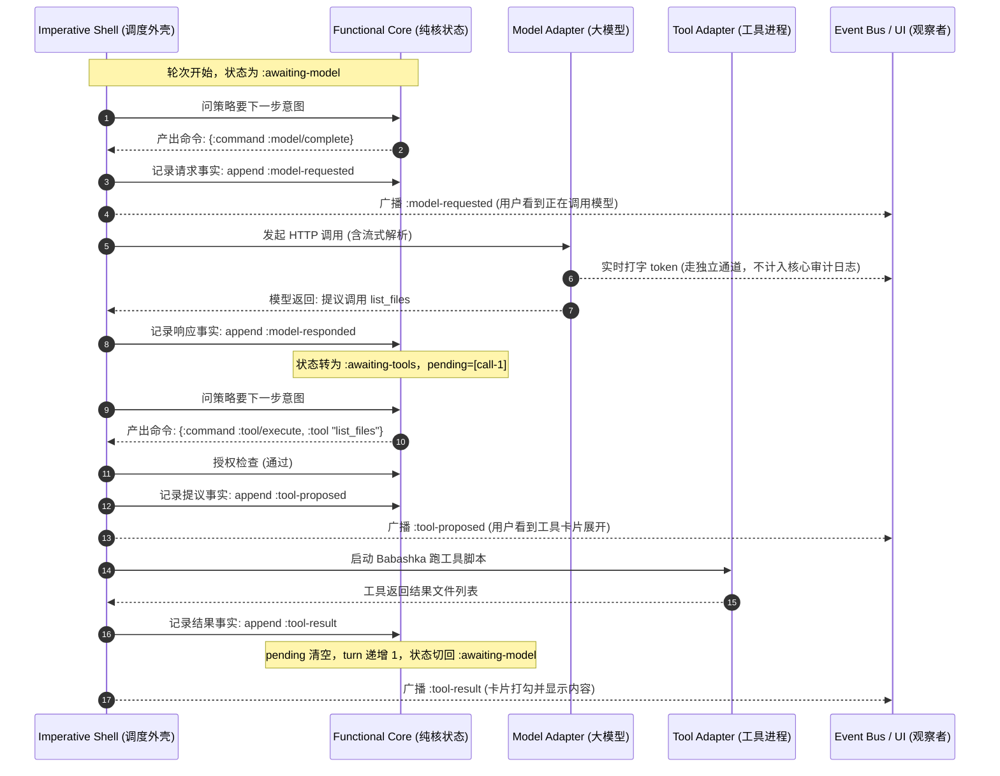

# Botashka 运行编排重构指南：重新理顺 Functional Core 与 Imperative Shell

> **说明**：本文是 `plan/fc-is-run-orchestration-refactor.zh.md` 的通俗重述版。旨在用更流畅、更符合直觉的工程语言，讲透这次重构**为什么做、改哪里、怎么改**。
>
> **状态**：设计规划阶段，尚未实施。**严禁直接 commit 到主分支**。

---

## 一、 为什么要做这次重构？

在之前的架构讨论中，团队一度出现了一种误解：“Shell 调用了状态机的纯函数（Reducer），是不是破坏了 FC/IS？我们是不是该造一个全新的 `step` 单步引擎或者引入全局 Atom 来管理状态？”

答案是：**完全不是，不要推翻重来。**

### 1. 澄清两个核心概念

* **什么是真正的 FC/IS（函数式核心与命令式外壳）？**
  * **Functional Core（纯核）**：只负责纯数据转换。给它当前状态与发生的事件，它算出一个全新的不可变状态；给它当前状态，它决定下一步想发什么命令（Command）。**绝不碰网络、文件、系统时钟和外部进程。**
  * **Imperative Shell（外壳）**：负责脏活累活。它读取真实时钟、调用大模型 API、拉起 Bash 进程跑工具、等待人类在网页上点“批准”。跑完之后，它把外部客观事实包装成事件（Event），**然后调用纯核的函数把事件记入账本，推演出下一份状态**。
  * **结论**：外壳调用纯核推演状态，正是经典 FC/IS 的规范写法！当前 `agent/run!` 用 `(loop [run initial-run] ...)` 推进状态，既简单又高效，**完全不需要造什么 `step` 框架**。

* **Command 与 Event 的本质区别**：
  * **Command（命令）是意图（Intent）**：“我想调一下 `read_file`”，它是一张纯数据请示单，**本身没有任何副作用**。
  * **Event（事件）是事实（Fact）**：“在 10:00:01，工具 `read_file` 执行完毕，返回了 100 行文本”，它是不可抵赖的客观事实。
  * 执行 Command 才是副作用；记录 Event 则是将外部事实同步回纯核。

### 2. 既然大方向没错，现在到底哪里痛？

现在的代码跑得通，但随着 Fast-path（快速决策模型）和 Web 控制台的加入，出现了**四个明显的架构坏味道**：

1. **纯意图数据里混进了“活的函数”**：
   快速决策策略发出的 `:decision/complete` 命令里，居然直接夹带了一个 `:decide-fn` 执行函数。这导致纯数据不再“纯粹”，连序列化和重放都会受影响。
2. **不可变状态里塞进了“副作用闭包”**：
   `run` 状态树里的 `:tools` 字段，直接保存了带有进程调用能力的 `:run (fn ...)` 闭包。状态本应是只读账本，现在却随时能从里面掏出函数去执行 I/O。
3. **授权检查容易被“绕过去”**：
   `agent/run!` 暴露出一个极其底层的参数 `:command-executor!`。一旦外界传入了这个执行器，`agent/run!` 就会把外面传进来的 `:authorization-policy`（安全授权策略）忘得一干二净。Web 控制台为了兼顾两者，不得不写大量重复的拼装代码。
4. **前端/日志报错会把整个 Agent 搞崩溃**：
   事件通知（`on-event`）或流式打字（`on-token`）如果抛出了异常，执行器没有做保护隔离，要么直接导致 Agent 运行中断，要么把前端断开错误误报成“模型网络错误”。

本次重构的目标非常明确：**不改状态机本质，只把数据与执行依赖彻底理清，让纯核归纯核、外壳归外壳。**

---

## 二、 现状问题深度剖析（对准代码看痛点）

为了让大家在动手前对代码了然于胸，我们把痛点一一对应到源码：

### 痛点 1：函数闭包泄露到数据流中
* **源码位置**：`src/botashka/clef_policy.clj:113`
* **问题代码**：
  ```clojure
  ;; 策略在生产纯 Command 时，直接把一个 HTTP 调用函数塞进了数据里！
  {:command :decision/complete
   :decider decider
   :criteria criteria
   :state state-summary
   :decide-fn decide-fn}  ;; ❌ 破坏了命令的纯数据契约
  ```
* **后果**：命令本应是可打印、可检查、可持久化的纯 EDN，现在却捆绑了运行时环境。

### 痛点 2：Run 状态持有了工具执行器
* **源码位置**：`src/botashka/run.clj:42` 与 `src/botashka/command_executor.clj:36`
* **问题所在**：
  `run/new-run` 接收整个 `tools` 注册表（由 `tools/code-tool-registry` 产出），而这个注册表里每个工具都带有一个 `:run (fn [args] ...)` 闭包（内部调用子进程）。
* **后果**：
  状态机状态 `run` 理应是一个不可变的数据快照，但它现在持有外部世界的把柄。

### 痛点 3：授权（Auth）与外壳装配逻辑撕裂
* **源码位置**：`src/botashka/agent.clj:25-30` 与 `src/botashka/server.clj:218-228`
* **问题代码**：
  ```clojure
  ;; agent.clj
  (let [executor (or command-executor!  ;; 如果外界传了 command-executor!
                     (command-executor/default-command-executor
                      (cond-> {}
                        authorization-policy (assoc :authorize authorization-policy) ;; 这里的装配就全被跳过了！
                        on-event (assoc :on-event on-event)
                        bus (assoc :bus bus))))]
  ```
  因为这个漏洞，`server.clj` 不得不在自己的业务线程里手工造一遍 `default-command-executor`，手工把 `web-authorization-policy` 塞进去，然后再传给 `agent/run!`。
* **更糟的是（重复解析与职责混杂）**：
  `server.clj` 里的 `web-authorization-policy` 一方面要检查是否是敏感工具（纯逻辑），另一方面又在自己函数里生成 UUID、创建 Promise、发起 WebSocket 广播、阻塞等待 300 秒（副作用）；并且还自己抄了一套 `extract-tool-details` 来解析 JSON 参数。

### 痛点 4：观察者（Observer）故障反向污染核心逻辑
* **源码位置**：`src/botashka/command_executor.clj:74-78` 与 `src/botashka/model_client.clj:250`
* **问题所在**：
  在追加事件时，`on-event` 是裸调用的；流式解析 SSE 时，`on-token` 也是裸调用的。如果前端 WebSocket 客户端突然关闭导致写入异常，这个异常会被外层的模型客户端捕获，并判定为 `{:error {:kind :network-error}}`。一个界面刷新问题，直接被当成了大模型服务宕机！

---

## 三、 重构架构蓝图与核心切面

重构后，整个系统的数据流动可以用一张清晰的示意图概括：

```
                    ┌───────────────────────────────────────────────┐
                    │               Functional Core (纯核)           │
                    │                                               │
                    │  1. 状态演进: run/append-event (只管算新状态)    │
                    │  2. 动作选择: action-policy (状态 -> 纯Command)│
                    │  3. 授权判定: auth-policy (Command -> 结果数据) │
                    │  4. 协议转换: tool-result-message / handoff   │
                    └───────┬───────────────────────────────▲───────┘
                            │ (纯意图数据)                   │ (纯事实数据)
                    Command │                               │ Event Descriptions
                            ▼                               │
                    ┌───────────────────────────────────────┴───────┐
                    │              Imperative Shell (外壳)           │
                    │                                               │
                    │  1. 取系统时钟、生成随机 UUID                   │
                    │  2. 执行外部真实 I/O (大模型、Bash 子进程)       │
                    │  3. 人机交互等待 (挂起线程、WebSocket 审批)    │
                    │  4. 安全投递观察事件 (Bus / on-event / on-token)│
                    └───────────────────────────────────────────────┘
```

### 1. 核心接口统一：收敛 `agent/run!` 入口

我们彻底弃用破坏封装的 `:command-executor!` 公开参数。调用者不再需要关心执行器怎么组装，只需要提供**外部能力（`:effects`）**和**观察通道（`:sinks`）**：

```clojure
;; 重构后的调用示例（简洁直观）：
(agent/run!
  {:prompt "帮我查一下 README.md 里的标题"
   :tools registry                      ;; 传入工具定义
   :action-policy policy                ;; 可选：自定义策略
   :authorization-policy auth-policy    ;; 传入纯授权策略
   
   ;; 外部副作用适配器（测试时可随意 mock 单项，生产环境使用默认值）
   :effects {:complete!           model-client/complete!
             :complete-streaming! model-client/complete-streaming!
             :decide!             clef-client/decide!
             :clock               #(str (java.time.Instant/now))
             :request-approval!   web-approval-adapter}
   
   ;; 观察者投射（UI、日志只读消费，坏了绝不影响核心）
   :sinks {:bus bus
           :on-event #(println "事件发生:" (:type %))}})
```

**巨大收益**：
* 授权策略（Auth）和总线广播（Bus）由 `agent/run!` 在外壳层**统一、强制组装**，任何测试或业务方都不可能意外绕过授权！
* 单元测试要测无网络环境时，只需要在 `:effects` 里传一个 fake 的 `:complete!` 即可，不用再手写一整套庞大的 `command-executor` 模拟器。

### 2. 工具声明与工具执行能力彻底解耦

* **在进入纯核前（`run/new-run`）**：
  把 `registry` 瘦身为纯数据映射表（只保留 `:name`、`:description`、`:parameters`、`:returns`、`:schema`）。
  `run` 状态树里只保存这些结构化元数据，用于喂给大模型做 Prompt，或者供策略挑选候选工具。
* **在命令执行外壳中**：
  真正的执行函数映射表 `{:tool-name (fn [args] ...)}` 保留在 Shell 内部。外壳接到 `:tool/execute` 命令后，按名字找到对应的函数拉起子进程。**闭包不再渗透到 `run` 数据中。**

### 3. 命令归一化（Normalize）与授权解耦

* **纯函数参数解析归位**：
  把原来散落在执行器和 `server.clj` 的参数解析代码统一收拢到 `run.clj` 的 `normalize-tool-command` 中。它是一个纯函数：
  输入命令与显式指定的 Call ID，输出统一的规范结构，解析失败直接产出结构化的 `:invalid-arguments` 错误数据。
* **授权策略变成纯数据裁决**：
  `web-authorization-policy` 变成一个纯函数，只回答“能不能干”：
  ```clojure
  (defn web-authorization-policy [run command]
    (if (contains? sensitive-tools (:tool command))
      {:decision :ask :reason "该操作具有破坏性，需要人工确认"}
      {:decision :allow}))
  ```
* **审批等待下沉到外壳（Approval Adapter）**：
  当外壳发现策略返回了 `{:decision :ask}` 时，外壳去调用注入的 `:request-approval!`。
  Promise 挂起、WebSocket 发送 `action/approval-required`、等待 300 秒超时等脏活，全在这个 Adapter 里完成。如果超时或者被拒绝，外壳统一构造 `:action-rejected` 事实。

### 4. 观察者故障安全屏障（Safe Projection）

为所有的观察者消费加上防护罩，保证系统的健壮性：
```clojure
(defn- safe-notify! [sink-fn item]
  (try
    (when sink-fn (sink-fn item))
    (catch Exception e
      ;; 记录警告日志到标准错误，但绝不往外抛异常中断主流程
      (binding [*out* *err*]
        (println "[WARN] 观察者投射异常被安全隔离:" (.getMessage e))))))
```
流式 Token 发送、事件推送全部走这个屏障。哪怕网页突然关掉、前端 WebSocket 破裂，后端 Agent 依然能把这轮任务稳稳执行完毕并正确入账。

---

## 四、 关键执行时序与轮次会计（Turn Accounting）

在 Agent 的一次生命周期中，外部事件究竟以什么顺序产生？多工具调用时轮次（Turn）怎么算？这里给出一清二楚的时序说明。

### 1. 标准模型工具交互时序图



### 2. 为什么多工具调用（Parallel Tool Calls）不会混乱？

当大模型一次性返回了 3 个工具调用 `[A, B, C]` 时：
1. `:model-responded` 把它们整齐地放进 `:pending-tool-calls` 队列中。
2. 循环每次取出队首的一个工具生成 `:tool/execute` 命令去执行。
3. **轮次递增规则**：
   * 执行完 A 时，从队列删掉 A，队列还剩 `[B, C]`。因为队列不为空，**当前 Turn 保持不变**。
   * 执行完 B 时，队列还剩 `[C]`，**Turn 依然不变**。
   * 执行完 C 时，队列彻底清空！此时，**Turn 恰好只增加 1**，状态转回 `:awaiting-model`。
4. 这种数学上的因果性完全由 `run/apply-event` 纯函数保证，重构绝对不会破坏它。

---

## 五、 五步走实施计划（安全迁移，绝不翻车）

为了保证每一步都有确凿的验证反馈，重构必须按部就班地进行：

### Phase 1：写出能抓住缺陷的确定性失败测试
* **目标**：不改业务代码，先把现有的漏洞用单测形式固定下来。
* **要做的事**：
  1. 写一个测试：注入自定义外部能力时，断言授权策略仍然能被强制执行（在老代码上必挂）。
  2. 写一个测试：当 `on-event` 或 Token 回调抛出异常时，断言 Agent 能够忽略错误并成功拿到最终结果。
  3. 写一个测试：当审批策略返回 `:ask` 时，模拟用户拒绝与超时，断言工具绝不会被执行。

### Phase 2：纯数据回归纯核
* **目标**：清洗 Command 和 Run 状态，移除所有可执行闭包。
* **要做的事**：
  1. 修改 `clef_policy.clj`，把 `:decide-fn` 从命令中彻底删掉；执行函数通过外壳注入。
  2. 修改 `run.clj`，让 `(:tools run)` 只保留工具 Schema 纯数据；工具处理函数剥离留在外壳。
  3. 将 `normalize-tool-command`、`tool-result-message`、`host-observation-message` 等消息与协议组装规则移入 `run.clj`。
* **验收条件**：所有纯状态转移与重放测试全部绿灯，不依赖任何子进程与网络。

### Phase 3：收敛 `agent/run!` 入口与授权重构
* **目标**：提供单一、统一的外壳装配入口。
* **要做的事**：
  1. 重构 `agent/run!` 参数，正式引入 `:effects` 和 `:sinks`，删除公开的 `:command-executor!`。
  2. 改造 `server.clj`：敏感工具判定保留为纯授权策略；等待 WebSocket 审批重构为标准的 Approval Adapter。
  3. 彻底删除 `server.clj` 里的重复 executor 拼装代码。
* **验收条件**：Web 控制台人机审批功能完美运行，测试无法绕过授权。

### Phase 4：观察者屏障与真实 Smoke 验证
* **目标**：加固防护罩，全链路端到端验证。
* **要做的事**：
  1. 给 `command-executor` 加上 `safe-notify!` 保护屏障。
  2. 运行确定性测试套件：`bb test`。
  3. 运行真实 CLI 链路：`bb run -g 'Read README.md and state its exact title.'`，确保工具调用、时钟打印、 trace 轨迹图全正常。
  4. 启动 Web 控制台：`bb web`，在浏览器里点击批准/拒绝，确认人机协同无异常。

### Phase 5：清理过时代码与同步文档
* **目标**：不留技术债。
* **要做的事**：
  1. 检索全局，删除所有遗留的废弃函数与临时 Alias。
  2. 更新 `CONTEXT.md` 和架构文档中与当前真实实现不一致的描述。

---

## 六、 常见疑问解答（FAQ）

### Q1：为什么坚决不用前人提议的单步 `step` 方案？
**答**：所谓 `step`，其实是把“决定动作、做 I/O、追加事件、演进状态”强行揉在了一个大函数里。它名义上叫单步，实际上是个既有纯计算又有副作用的“混合怪兽”。现在的 `(loop [run initial-run] ...)` 在外壳中按顺序清晰展开，每一小步发生什么一目了然，不需要造一层虚假的新概念。

### Q2：为什么不让 Executor 一次性返回一组事件（Vector of Events）？
**答**：在某些架构中，人们喜欢 `(execute command) -> [Event1, Event2]`。但这在大模型编程 Agent 场景下是灾难性的：
如果调用大模型需要耗时 5 秒，或者执行工具需要 10 秒，如果等执行完才批量返回事件，那么在等待的 10 秒里，界面上**完全看不到 `:tool-proposed`（正在执行什么）**！
必须保持**“执行前立即追加并广播提议事实，执行完毕后再追加结果事实”**的增量时序，才能保证终端和 Web 界面看到实时进展。

### Q3：为什么说把 `:command-executor!` 换成 `:effects` 架构杠杆最高？
**答**：以前测试想要 mock 一个大模型回复，必须手写一个庞大的 executor 函数，自己去处理 clock、UUID、事件追加。现在换成 `:effects`，测试只需要写：
```clojure
:effects {:complete! (constantly {:choices [{:message {:content "mocked!"}}]})}
```
授权逻辑还在、事件日志还在、状态演进还在。一处改动，让所有测试代码和业务装配代码都变薄了，这就是真正的**架构杠杆（Leverage）**。
