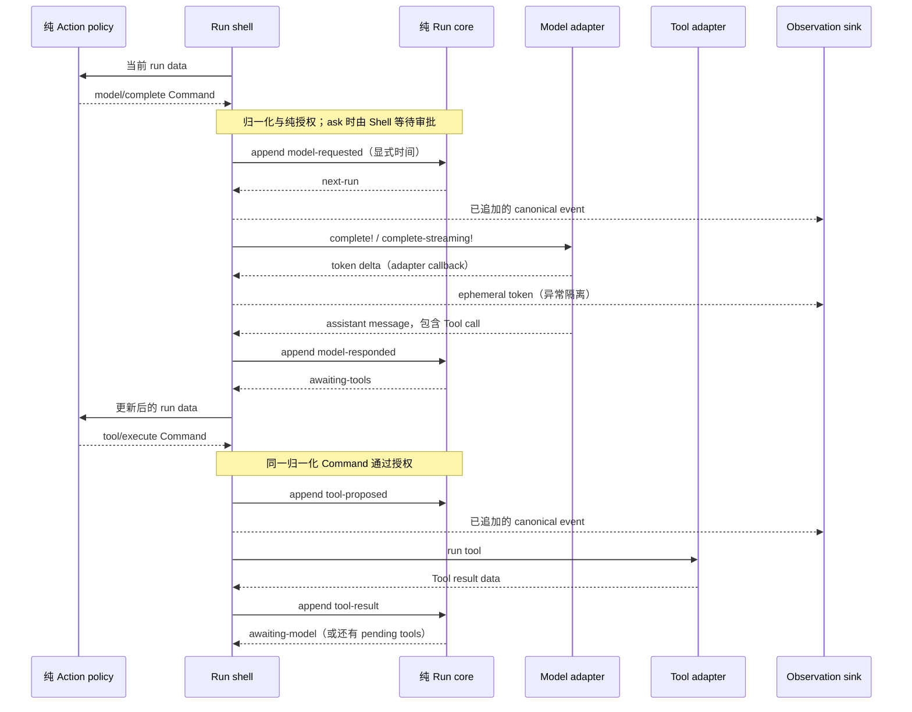

# Run orchestration 的 FC/IS 重构计划

状态：拟议计划，尚未实施。本文以当前源码为基线，不以前一轮架构审查的推断为基线。

## 1. 目标与前提纠正

本次目标是让 **Command、Run event、派生 run state 都保持可检查的纯数据**，让动作选择、授权判断、事件构造和状态转换留在 Functional Core，让网络、工具执行、时钟、ID、审批等待与 observation 发布留在 Imperative Shell。

先纠正前面讨论中的四个说法：

1. **Command 不是副作用本身，而是描述副作用的纯意图；执行 Command 才是 effect。**
2. **Shell 调用纯函数完全符合 FC/IS。** Shell 可以执行 I/O、获取结果、调用纯事件构造器、再调用纯 reducer；只要 core 不反向调用 shell。
3. **短的 `agent/run!` 循环不等于 shallow module。** 它封装完整 agent run 的启动、循环、停止与 terminal result，删除它会把这些知识分散到 callers。
4. **当前代码已经能测试纯状态机，也已经支持 `[run command] -> next-run` 的单次执行。** 不需要为了“可测试”或“深度”再添加一个 `step` alias。

因此，本次不是合并三个 namespace，也不是把纯 core 替换成一个 effectful 黑盒，而是深化现有 run orchestration module 的 interface：移走泄漏的执行依赖，收拢真实重复的领域规则，保留清楚的 effect seam。

## 2. 当前实现的证据

| 位置 | 观察到的实现 | 重构含义 |
| --- | --- | --- |
| `src/botashka/run.clj`：`new-run`、`append-event`、`apply-event`、`default-action-policy` | 都是纯函数；event 构造器也已集中在这里 | 保留主干，不改名为 `decide` / `evolve` |
| `src/botashka/agent.clj`：`run!` | 局部不可变 run 经 executor 顺序推进；注入 executor 会跳过默认 executor 的依赖装配 | 保留不可变循环；收敛唯一的 shell 装配入口 |
| `src/botashka/clef_policy.clj`：`clef-action-policy` | 返回的 `:decision/complete` Command 携带 `:decide-fn` | policy 当前没有调用模型，但 Command 已混入函数值；把 adapter 移到 shell 输入 |
| `run/new-run` 的 `:tools`，以及 `command_executor.clj`：`run-tool` | run state 保存整个 registry，包含各工具的 `:run` 闭包；executor 从 state 取执行能力 | state 只保留工具声明；执行能力另传 shell |
| `command_executor.clj`：`normalize-tool-command` | 同时做 JSON/来源归一化和随机 UUID 生成 | 纯归一化接收显式 ID；随机生成留在 shell |
| `command_executor.clj`：`tool-result-message`、`host-observation-message` | 纯 Conversation 规则位于 effectful 编排文件 | 迁入现有 core，缩短理解 origin 语义的阅读路径 |
| `server.clj`：`extract-tool-details`、`web-authorization-policy` | 再次解析同一 Command；敏感工具判断与 promise、broadcast、等待混合 | 共享纯归一化；纯授权判断与 effectful 审批 adapter 分开 |
| `command_executor.clj`：`append-observed-event`、`on-token` | 先纯追加事件，再通知；通知异常未隔离 | 保留追加优先的顺序；projection 异常不能改写 run 结果 |
| `model_client.clj`：`complete-streaming!` | 外层捕获 Exception 并归为 network error | token projection 回调须在进入 adapter 的 catch 范围前完成异常隔离 |
| `bus.clj`：`new-bus` | 输入使用 sliding buffer，canonical 与 stream 共用此输入 | bus 是可丢失的 observation projection，不是 canonical log，也不是提交确认 |
| `test/botashka/agent_test.clj` | 已覆盖纯状态转换、模型工具往返、直接工具、拒绝、错误、上限、stream 与 bus | 迁移已有行为测试；只补尚未覆盖的消费者风险 |

`docs/architecture-overview.md` 中的“canonical 不丢包”“一行挂接即可获得 crash safety”“审批后可以持久恢复”等表述超出了当前实现。重构时应同步校正；本次不实现这些能力。

## 3. 不变量与非目标

### 3.1 必须保持的不变量

- Action policy：`run-state -> Command | nil`，不进行网络、工具调用或审批等待。
- Authorization policy：`run-state + normalized-command -> allow / deny / ask`，不进行 I/O。
- Event 是观察到的事实。`:model-requested` 表示宿主开始请求流程，不代表外部模型已经接受；`:tool-proposed` 不代表工具已执行。
- `apply-event`、`append-event` 和事件构造器只依赖显式 data。
- Command 不保存函数、client、promise、channel、atom；run 的事实/read model 不保存工具 handler。
- 同一 run 顺序执行一个 Command；`:run-id` 一致，`:seq` 从 0 连续递增。
- `:at` 由 shell 获取，再作为 data 交给 core；不要求系统 wall clock 严格单调，严格单调的是事件序号。
- 请求事实在阻塞 I/O 前追加，结果事实在 I/O 完成或返回结构化失败后追加。
- token 属于 ephemeral stream，不写 canonical log、不消耗 canonical 序号。
- 模型 Tool call 保留原 call ID 与 Conversation 配对；host/decision 动作不伪造 assistant Tool call。
- 多 Tool call 按 pending 顺序执行，全部处理后才将该模型工具轮次计为一个 turn；host/decision 的现有 turn 语义不变。
- authorization 判定与实际执行看到的是同一归一化 Command，不能通过替换模型/工具 adapter 意外跳过授权。
- observer 的异常不能撤销已追加的事实，也不能变成 provider/network/tool failure。
- 所有状态更新返回新的 immutable value；不在 atom 的 `swap!` 函数中执行 I/O。

### 3.2 本次不做

- 不增加 `step`、单步调试、暂停/恢复、递归 agent、取消、预算或 retry。
- 不增加 event store、durability、exactly-once、通用 Command interpreter、handler protocol 或生命周期框架。
- 不改 workspace 限制、工具 stdio transport、Malli 契约或模型 wire protocol。
- 不合并 Web/CLI 的显示投影，不重做 Web session 全局状态。
- 不改默认工具路由、confidence 阈值、policy 优先级或 arbiter 算法。
- 不增加无实际 adapter 的 seam；现有真实模型/工具与确定性测试 adapter 已足够。

## 4. 三种组织方式与推荐

| 方式 | interface 与 ownership | 收益 | 代价 | 结论 |
| --- | --- | --- | --- | --- |
| 保留不可变 state threading | Shell executor 接收 run 与 Command，执行 effect，并调用纯 core 返回 next-run | 保留实时事件顺序；无新增 state owner；迁移范围小 | executor 仍了解纯 run data 与 event 语义 | 推荐作为内部组织 |
| executor 一次返回 event vector | 外部 Shell 收到整个 vector 后统一应用 | executor 不接触 run state | 请求事实只能在调用返回后进入 canonical log；异常可能丢失整批事实 | 不采用 |
| executor 增量调用 event sink | executor 不接触 run；run shell 为每次 callback 分配 envelope、更新状态 | event 提交 ownership 更集中 | 需要新的 callback 契约，通常还需 run-owned atom；对当前串行执行没有已证明的额外 leverage | 不采用本次；不能仅为“更纯”引入 |

**推荐组合：保留内部不可变 state threading，收敛 `agent/run!` 的唯一装配入口。**

在这个 module 内，`botashka.run` 是纯 implementation，`botashka.command-executor` 是 shell implementation；文件分开不等于 callers 必须跨越这些内部 seam。

- **depth**：callers 只需提供 run 输入、纯策略与必要 adapter，不再重复装配 executor/auth/sinks。
- **locality**：origin、归一化、拒绝与事件含义由纯 core 描述，effects 与顺序由 shell 执行。
- **leverage**：真实 provider、测试模型与 discovered tools 使用同一 `agent/run!` interface。
- **deletion test**：删除 `step` alias 只减少间接调用，删除 run orchestration 却会把启动/停止/授权/观察知识搬给每个 caller；因此保留后者、不增加前者。

## 5. 拟议数据契约与职责

下面是实施时需要冻结的 interface，不是已经存在的调用示例。

### 5.1 唯一的 run 入口

保留 `agent/run!`。caller 继续提供 `:prompt`、`:messages`、`:system`、`:tools`、`:max-turns`、`:run-id`、`:action-policy`、`:authorization-policy`、`:on-event`、`:event-chan`、`:close-chan?`、`:bus`。

新增一个 shell-only `:effects` 输入，用于覆盖真实 adapter：

```clojure
(agent/run!
  {:prompt "列出当前目录中的文件"
   :tools registry
   :action-policy policy
   :authorization-policy authorization-policy
   :effects {:complete! complete!
             :complete-streaming! complete-streaming!
             :decide! decide!
             :clock clock
             :new-call-id! new-call-id!
             :request-approval! request-approval!}})
```

- `:effects` 不写入 Command、run state、Event 或 Conversation。
- 默认真实 adapter 在命名明确的 shell 装配函数中绑定一次；policy 不 require 模型 client。
- 模型 adapter 以一组绑定：默认模式提供普通与 streaming 函数；caller 覆盖模型组时必须提供自己的 `:complete!`，`:complete-streaming!` 可选，不能混入默认模型函数。只覆盖 clock/decision 不替换模型组。缺少自定义 streaming 时即使用普通调用，不能因开启 observer 而意外访问真实网络。
- 完成 cutover 后删除 public run option `:command-executor!`。测试改为注入真实变化的 effect adapter，而不是替换整个授权/记录流水线。
- executor 构造函数保留为内部 shell implementation；不保留旧 option shim，不建立平行执行路径。
- observer 的配置只在 `agent/run!` 入口收集、由内部 executor 使用，caller 不再重复注入同一个 bus/auth。
- 保留现有 callback/channel 选择约定：显式 `:on-event` 优先，否则用 `:event-chan` 构造 callback；bus 与该 callback 分别通知。同一配置不重复投递同一事件。

### 5.2 工具声明与执行能力分离

`agent/run!` 在进入 core 前，将已有 registry 一次投影为纯工具声明 map：仅保留 `:name`、`:description`、`:parameters`、`:returns`、`:schema` 中已存在的 data 字段。

- run 的 `:tools` 保留原来的名称索引，供 policy 查候选、`build-model-context` 查 schema。
- 原 registry 留在 shell，executor 从显式 dependency 取得 handler。
- 不要求 `tools/code-tool-registry` 新建第二套 registry，不重复 discovery，也不在每个 Command 上复制 registry。
- 对第三方自定义 Malli predicate/function schema，不宣称任意 registry 都能 EDN round-trip；本次契约以项目自描述的 data schema 和测试 data fixture 为准。

### 5.3 Command 的纯归一化

保留两种真实意图来源：模型 Tool call 与 host/decision 直接工具 Command；它们不是兼容 alias。

纯 core 的归一化函数接收原 Command 和显式的缺省 call ID，返回包含一致 tool name、call ID、origin、raw arguments、decoded arguments 或 structured argument failure 的 data。

- 仅缺失 call ID 的直接工具 Command 由 shell 生成 ID；模型 call ID 不重新生成。
- 归一化不创建 UUID，不调用 handler，不看环境。
- JSON 错误转为 `:invalid-arguments` data，不把 Exception 对象写入 event。
- 授权判断、审批展示、工具执行、proposal/result 构造共享这份归一化结果，不分别 parse 一次。
- 正常直接 EDN arguments 不为归一化先 JSON encode 再 decode；只有需要 Conversation/原始协议呈现时编码。
- 原始模型 arguments 和 thought signature 保持，不用“修正”参数掩盖 malformed proposal。

新增的纯规则优先放在现有 `botashka.run`，因为它已经拥有事件与 Conversation 语义；不先新增只转发的 `command` / `events` namespace。若实现后出现明确独立变化轴，再另作 module 决策。

### 5.4 授权判断与审批等待

统一 Authorization policy 输出为 data map：

```clojure
{:decision :allow}
{:decision :deny :reason "禁止此动作"}
{:decision :ask :reason "需要人工批准"}
```

纯 policy 接收同一 run data 与归一化 Command。`server.clj` 的敏感工具集合判断保留为纯 policy，返回 `:ask`，不广播、不创建 promise、不等待。

Shell 收到 `:ask` 后调用 `request-approval!` adapter，传入选定的 Command 与审批原因；adapter 返回最终 allow/deny data。

- Web adapter 继续负责 UUID、promise、5 分钟等待、`:action/approval-required` 与 `:action/approval-settled` 消息以及呈现状态。
- 超时、拒绝或缺少可用审批 adapter 均不能执行目标 capability。
- `:ask` 没有审批 adapter 时按 deny 处理并给出 `:approval-unavailable` 原因；审批 adapter 不能默认返回 allow。Web 等待与呈现状态清理使用 `finally`，adapter 自身失败也不能触发目标 capability。
- 同一 Command 完成审批后不重新调用 policy 请求第二次审批。
- 迁移所有 `:allow` / boolean / map 混用的 policy fixture，删除旧输出兼容判断。
- 现有工具拒绝仍表现为 `:tool-proposed` 与 `:tool-result`，`:error-kind :action-rejected`；其他 Command 拒绝仍是 terminal `:rejected`。
- 保持当前审批先于 `:tool-proposed` 的显示顺序，不为了本次重构新增 approval canonical events。

### 5.5 事件意义在 core，发生顺序在 shell

| Functional Core | Imperative Shell |
| --- | --- |
| Action policy、Authorization policy | 配置默认 adapter、获取 clock 与 ID |
| Command 归一化、来源与参数规则 | 等待审批，调用模型/decision/tool adapter |
| response/result -> event description | 决定在实际 effect 前后何时调用构造器 |
| Tool result -> Conversation message | 发布 canonical observation 与 ephemeral token |
| envelope、append、apply、terminal projection | 启动/循环/关闭自己拥有的 channel |

`tool-result-message` 与 `host-observation-message` 迁入纯 core；成功/错误/拒绝的 result data 交给同一纯规则构造事件。Shell 不需要手工拼装 origin 或错误字段。

**不强求 Shell 只有一条调用语句。** 授权、前置事件、effect、结果事件的顺序本身就是必须可读的 shell implementation。

## 6. 事件时序与失败语义

### 6.1 正常模型工具往返



展示动作的单次 executor 调用不是一个模型 turn：一次模型请求、一次工具执行、下一次模型请求是不同 Command；同一 Command 也可能产生多个 Event。不能把“列目录并回答”固定描述为两次 executor 调用，启动和结束也有各自 Command。

### 6.2 canonical 追加顺序

每次记录事实使用同一个 shell 路径：

1. Shell 获取当前事件的 clock 值。
2. 纯 event constructor 产生 description。
3. `append-event` 为该 description 生成 envelope、追加并应用 transition。
4. Shell 持有返回的新 immutable run。
5. 各 observation sink 独立通知；异常隔离在这一层。

这只是内存里的有序追加，不是 durable commit。bus 接收、UI 显示、channel 入队都不能被当作 canonical 提交确认。

### 6.3 失败分类

| 情况 | canonical / terminal 行为 | 不能发生的事 |
| --- | --- | --- |
| 工具参数 JSON 非法、工具不存在、handler 返回错误或抛出执行异常 | structured Tool result，`:outcome :error`，按现有状态机继续 | 执行非法参数、遗漏模型 call ID 配对 |
| 工具被拒绝 | `:action-rejected` Tool result，不调用 handler | 改为成功空结果、跳过授权 |
| 模型 adapter 返回结构化错误 | `:model-failed`，最终 `:provider-error` | 记录成功空 assistant response |
| decision adapter 返回错误 | 保留 `:decision-responded` 作为请求已返回的事实，新增明确的 `:outcome :error` / `:error-kind` summary，保留错误 evidence；纯 policy 回退主模型 | 把连接失败伪装成高置信度 `no_tool` |
| 注入的模型/decision adapter 抛执行异常 | 在 adapter 调用的窄 catch 中转为对应 failure data，再交给纯构造规则 | 把 core、clock、sink 的异常一起标为 network error |
| observation callback 抛异常 | 已追加的 log 与终态不受影响；向本地诊断输出不含 payload 的 sink/type/seq 信息 | 将投影失败变成 model/tool failure、向外导出完整 evidence |
| clock、ID、纯 core 或 shell 自身编程错误 | 失败显式向调用者传播；finally 释放本 shell 拥有的资源 | 默默重试 Command、伪造 effect 成功或声称能自动恢复 |

仅隔离普通 observation Exception，不吞掉 JVM fatal Error；本地诊断只含 sink 标识、event type/seq 与异常类别，不含原始 payload 或异常消息中的潜在 secrets。诊断失败不得触发递归报告或再次执行 Command。

Observer 异常隔离不解决 observer 永久阻塞。现有同步 `:on-event` / `:event-chan` 仍有背压；本次不加入调度器、队列或 timeout 体系。bus 的跨 topic 展示顺序也不因此获得全序保证。

当前自定义 Action policy 在非终态返回 `nil` 时，`agent/run!` 会返回 `terminal-result`，其中可能缺少终态。这是现存契约缺口，不在本次擅自改成 pause、failed 或自动完成；本计划不依赖此路径，验收策略必须显式产出 terminal Command。

## 7. 实施阶段与切换顺序

以下阶段是一个重构中的依赖顺序，不是长期共存的两套实现。

### Phase 1：冻结行为与失败用例

目标：建立真实 seam 的反馈，不能只测试纯函数转发。

1. 保留已有纯 run 与完整 agent run 的行为测试。
2. 为尚未覆盖的实际缺口先写确定性失败测试：注入执行依赖不得绕过授权、审批拒绝/超时不得调用工具、canonical/token observer 抛异常不改变结果。请求事实先于阻塞 adapter 的时序作为行为保持测试，不声称当前路径已经失败。
3. 使用 promise/latch 控制 adapter 的开始/释放，不用 sleep 假装验证顺序；确保失败时也释放 worker/关闭 channel。
4. 冻结原 event 顺序、call ID、origin、turn 语义与真实输出，不冻结 executor 装配细节。

完成条件：缺口测试在旧实现上暴露具体问题；行为保持测试明确保护现有正确时序；已覆盖路径不重复加测试。

### Phase 2：纯数据 cutover 与规则回归 core

目标：Command、state 与 effect dependencies 真正分开。

1. `clef-action-policy` 删除 `:decide-fn` 配置及 Command 字段、删除对 `clef-client` 的依赖；模型调用函数进入 shell `:effects`。
2. 在进入 `new-run` 前生成纯工具声明投影；executor 从 shell registry 调用 handler。
3. 将 Command 归一化拆成显式 ID 输入的纯函数；移除同一 Command 的重复 JSON decode。
4. 将 origin 对 Conversation 的影响、工具成功/错误/拒绝事件组装放回 `botashka.run`。
5. 默认 decision adapter 由 shell 明确绑定，删除动态 `resolve` 与伪 `no_tool` fallback。
6. 迁移 pure policy/core tests，校验固定 event 序列得到同一派生 Conversation、pending calls、turn 与 terminal status。

完成条件：纯 core tests 不需要网络、子进程或执行器 fixture；实际 Command 和 run data 不携带可执行能力。

### Phase 3：唯一入口与授权 cutover

目标：真实 adapter 与测试 adapter 都经过同一授权/记录 shell。

1. `agent/run!` 增加 `:effects`；默认构造 executor 只发生一次。
2. 删除 `:command-executor!` run option，迁移所有 callers/tests，不保留 alias/shim。
3. executor 使用同一份归一化 Command 调用纯 authorization policy，并在 `:ask` 时执行审批 adapter。
4. `server.clj` 拆开纯 Web policy 与 effectful approval function，保留现有 WebSocket 消息与等待时限。
5. 删除 server 自己构造 executor、重复注入授权和 bus 的装配；入口负责统一配置。
6. 迁移 `bb.edn`、`chat.clj`、`scratch.clj` 与 decision policy fixture；这些 caller 的正常真实模型路径保持可用。

完成条件：不存在一条因为注入执行依赖而跳过 authorization 或 event observation 的 run 路径。

### Phase 4：观察失败隔离与真实 changed-path 验证

目标：保持实时事件流，又不让 observation 定义执行结果。

1. 所有 canonical 通知在纯追加后发出；各 sink 的异常彼此隔离。
2. token callback 使用同样的隔离规则，不将 projection exception 交给 model adapter 的网络错误 catch。
3. catch 范围仅围绕实际 adapter invocation；core/clock/ID 的失败不归为 provider/tool 失败。
4. event channel 的关闭放进 `finally`；遵守 `:close-chan?`，不关闭 caller-owned bus。
5. 执行相关确定性检查，然后执行 CLI 和 Web changed-path smoke。
6. 删除已被同一 public interface 行为覆盖的装配/私有函数存在性测试；不要删除真正的异步时序、审批与 streaming 行为测试。

完成条件：第 8 节的验收场景成立，全部 caller cutover，无 obsolete executor 路径。

### Phase 5：文档同步与完成条件

1. 更新 `CONTEXT.md` 中 Command executor 的依赖职责、工具声明/执行能力的区分；它仍是现有术语，不新增平行 glossary。
2. 更新 `docs/architecture-overview.md` 的实际 interface、授权与 observation 语义；删除未实现的无丢包/durability/resume 保证。
3. 更新 `plan/run-event-log-refactor.zh.md` 的当前符号与 module 所属，保留纯 core 的决策和 durability 非目标。
4. 更新 `scratch.clj` 的 reload 顺序与真实/fixture 调用；删除 throwaway smoke 文件。
5. 在本计划记录实际运行的命令、结果和未覆盖的限制；不能把计划验收写成已经通过。

## 8. 验收矩阵

| 场景 | 输入与 adapter | 通过条件 |
| --- | --- | --- |
| 纯 replay | 显式初始配置 + 固定 canonical events | 纯 reducer 得到与在线相同的 Conversation/pending/turn/status；重放不执行外部 capability |
| 模型工具往返 | 模型先提出 `list_files`，再总结 | tool call ID 配对；proposal/result 顺序；最终回答使用实际 Tool result |
| 多工具一轮 | 模型同时提出两个 calls | 按 pending 顺序处理；第一项完成不提前增加 turn；第二项处理后增加一次 |
| host 直接工具 | scripted policy + 测试工具，禁止模型调用 | 不伪造 assistant call；origin 正确；result 进入 host observation |
| fast-path 成功 | 固定 decision data 选 `list_files` + 真实工具 | decision 请求不携带函数；执行后生成有效 handoff，主模型不因缺少配对重复工具 |
| fast-path 回退 | `no_tool`、低 confidence、无法提取必需参数、decision error | 不猜参数；回退主模型；错误不伪造 `no_tool` |
| 强制拒绝 | 注入模型/工具 effects，policy deny | handler 调用次数为 0；canonical rejection 与既有 Conversation 契约成立 |
| ask / approve / deny | 纯 policy + 可控制审批 adapter | 等待前 handler 不运行；批准后仅执行一次；拒绝与超时均不运行 |
| 请求事实的实时性 | adapter 阻塞直到 fixture 释放 | 释放前 sink 已收到 requested/proposed；log 未出现 result |
| observation failure | canonical 或 token callback 抛异常 | 实际 effect 正常完成；terminal result 与无故障 sink 场景一致；诊断可观察 |
| 自定义模型隔离 | 自定义 `complete!`、开启 bus、未提供 streaming adapter | 仍使用自定义模型；不得意外调用默认 streaming/network adapter |
| adapter failure | 模型错误、工具异常、decision 错误 | 分类正确，无成功伪装，无把纯 core/sink 异常混为网络错误 |
| terminal/上限 | 模型直接回答、provider failure、max-turns | `:run-finished` 最后且与 public status 一致；无 terminal 后追加 |
| 资源 ownership | channel 开/关配置，异常退出 | 自有 channel 关闭；`:close-chan? false` 保留；caller-owned bus 不被 run 关闭 |

### 拟执行的检查与 smoke

这些是实施后的命令，不是本次计划制定中已执行的验证。

```sh
# 已有相关 deterministic namespace
clojure -M -e "(require 'botashka.agent-test) (clojure.test/run-tests 'botashka.agent-test)"

# Babashka 的现有 agent + Web checks
bb test

# 真实 CLI 主模型 -> 工具 -> 主模型
bb run -g 'Read README.md and state its exact title.'

# 真实 fast-path changed path
bb run -f -g 'List the files in the workspace root.'

# 实际 Web surface：浏览器提交请求并分别批准/拒绝敏感工具
bb web -p 7891
```

若新增独立纯 core test namespace，将它纳入现有 test task，而不是用通用扫描或重复运行整套检查。自动化检查在对应实现完成后运行，不在本次只写计划时执行。

真实模型 smoke 依赖可用的本地模型入口与凭据，fast-path smoke 还依赖 Clef；依赖不可达时可以完成 deterministic seam 验证，但必须如实标注真实 provider 路径未验证。

写入审批 smoke 使用临时 Workspace：拒绝时确认文件未改变；批准时确认实际文件内容。CLI 用真实 discovered `read_file` / `list_files`，不能以纯 fixture 替代实际工具 changed path。

## 9. 文件迁移清单

| 文件 | 改动范围 |
| --- | --- |
| `src/botashka/run.clj` | 纯工具声明/Command 归一化、Conversation/event/result 规则；保留 reducers 与 turn 语义 |
| `src/botashka/agent.clj` | 唯一 effects 装配、纯 state 初始化与 run options cutover、资源 finally |
| `src/botashka/command_executor.clj` | 显式 registry/decision dependencies、纯 authorization + approval effect、顺序记录与 sink 隔离 |
| `src/botashka/clef_policy.clj` | 删除模型 adapter 依赖与 Command 函数字段，保留纯选择与回退 |
| `src/botashka/server.clj` | 纯授权判断与审批 adapter 分离；删除重复 executor 装配与 Command parse |
| `src/botashka/chat.clj`、`bb.edn`、`scratch.clj` | 若受新配置影响迁移 callers/probes；不改显示风格与 policy thresholds |
| `test/botashka/agent_test.clj`、`server_test.clj` | effect injection cutover、缺失行为覆盖；删除 private-function existence 测试 |
| `CONTEXT.md`、`docs/architecture-overview.md`、`plan/run-event-log-refactor.zh.md` | 同步真实契约，移除与当前实现不符的保证 |

`model_client.clj`、`tools.clj`、`tool_runtime.clj`、`workspace.clj`、`bus.clj`、浏览器资源默认不改。只有具体 seam 验证证明迁移必须触及它们时才扩大范围；本计划不要求 transport 或 UI 结构重构。

## 10. 决策摘要

**深化现有 module，不新增 `step` module；保持纯 Event/State core，保留顺序 shell，统一 run interface 的依赖与授权 ownership。**

真正值得承担的 cutover 是 `:command-executor!` -> `:effects`：它移除的是可以替换整条授权/记录流水线的入口，而不是移除模型与工具的真实 adapter seam。

事件流是否采用增量 sink，是独立的 ownership 决策，不是 FC/IS 的纯度要求。本次选择已有不可变 state threading，避免为了接口外观引入 run atom、callback interpreter 或 durability 的虚假承诺。

## 11. 本次计划核对记录

- 直接核对当前 run core、executor、agent、Web/CLI caller、decision adapter/policy、bus 与相关测试，并对照 `CONTEXT.md` 和现有 event-log / action-policy 设计。
- 对三种组织方式分别进行了独立设计分析；选择保留 immutable state threading 与统一 run 入口。未采纳增量 sink 方案的额外 state owner，也未采纳自动放行审批、吞掉 Throwable 或改变 proposal/approval 顺序的建议。
- LSP 查询该 Clojure executor 的 references 返回无可用 language server；迁移清单使用实际源码与 repository references 检索补齐。
- 本次只写重构计划，没有修改运行代码，也没有执行 deterministic tests 或真实 provider smoke；这些验收仍属于实施阶段。
