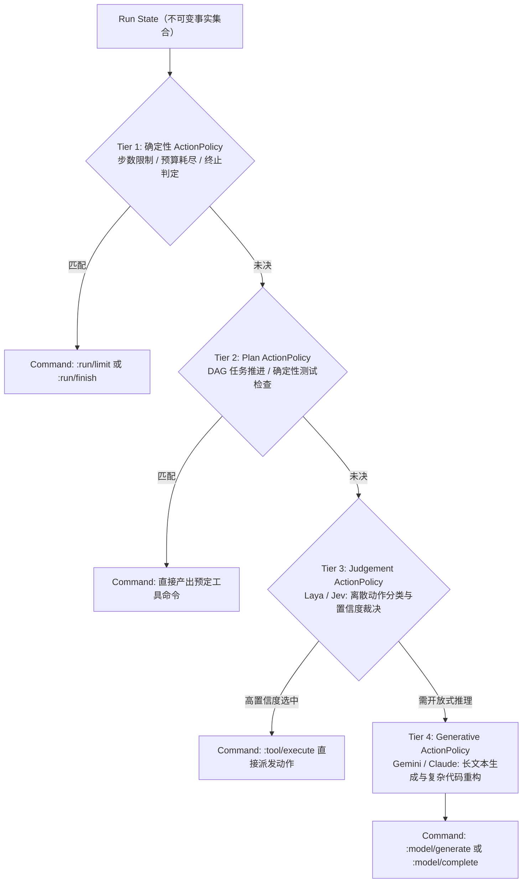
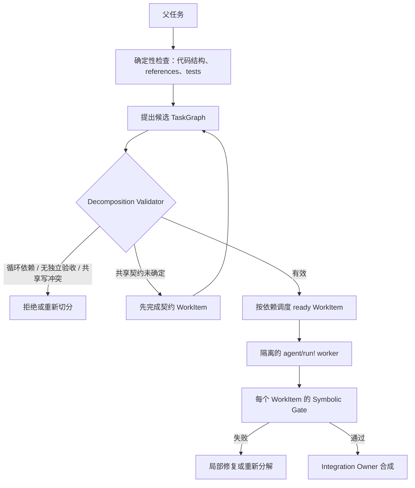

# Botashka 重构计划：分层动作策略（ActionPolicy）与递归智能体（Recursive Agent）

## 1. 目标与背景

当前 Botashka 的状态机核心虽然已经实现了 Functional Core 与 Imperative Shell 的物理拆分，但在**控制权分配**与**决策机制**上仍然受到 2024 年传统“Chat Loop”模式的局限：

1. **`model-driver` 名不副实与控制权倒置（Inversion of Control）**：
   - 现有的 `model-driver` 仅是一个被动“蹦床”（Trampoline），只在 `:awaiting-model` 和 `:awaiting-tools` 之间机械调度；
   - 真正决定“用哪个工具”、“传什么参数”、“何时终止”的全部决策权，被打包甩给了远程生成式大模型（LLM）的 `tool_calls`。
   - 这违背了 RLM（Recursive Language Models）的核心准则：**“Code Calls the Model”**——宿主代码主导控制流，模型仅为代码调用的子例程。
2. **缺乏快慢思考分工（Missing Fast-path Decision）**：
   - 所有的细粒度微观决策（工具路由、边界判定、参数填充）都直接打给云端 2~4 秒延迟的生成式大模型，容易发生注意力稀释与幻觉；
   - 缺乏如 **Laya**（Convai 322M~421M 纯前向决策模型）或 **Jev** 这样的非自回归 System 1 决策模型，以及轻量化端侧参数填充器（如 **LFM2.5-350M**）的接入位置。
3. **递归能力未显式闭环**：
   - 缺乏通过外部句柄（Pass-by-reference）分治任务的原生机制，尚未将 `agent/run!` 的自相似性（Self-Similarity）转化为可调用的子智能体能力。

本计划旨在将 **Driver** 重构为语义明确的 **ActionPolicy（动作策略）体系**，解耦动作选择、动作授权、参数提取与内容生成，并为可靠的递归分治建立可验证的数据契约。`agent/run!` 只解决可重入执行容器；任务分解、子任务契约、产物验收与合成才是递归智能体的核心问题。

---

## 2. 核心架构设计

### 2.1 动作策略管道（ActionPolicy Pipeline）

将原有的单一 `model-driver` 升级为符合强化学习与控制理论定义的纯动作策略：

$$\text{ActionPolicy} : \text{Run State} \longrightarrow \text{Command} \mid \text{nil}$$

**ActionPolicy 只回答“下一步想做什么”**。它不执行命令，也不判断 effect 是否被允许。授权由独立的 `AuthorizationPolicy` 决定，副作用由 `CommandExecutor` 执行。多个策略仅有明确优先级时使用短路组合；若它们会同时提出候选，则必须显式产出 `ActionProposal` 并交给 `ActionArbiter` 仲裁。

通过动作策略组合构建自上而下的分层决策流水线：



术语必须保持正交：

| 术语 | 唯一职责 |
| :--- | :--- |
| **ActionPolicy** | 从当前 run state 选择一个 next command，或返回 `nil` |
| **ActionSelector** | ActionPolicy 内部采用的选择算法 |
| **ActionProposal** | 某个策略提出的候选动作、来源、置信度与证据 |
| **ActionArbiter** | 多个候选动作并存时选择唯一生效动作 |
| **AuthorizationPolicy** | 判断已选动作是否允许执行；不得被 ActionPolicy 绕过 |
| **CommandExecutor** | 执行获准命令并记录观察到的事实 |
| **DecisionModel** | Laya、Jev 等 ActionSelector 的可选 adapter；不是控制流 owner |

仅在策略有严格优先级时使用短路组合：

```clojure
(defn first-applicable-action-policy [& policies]
  (fn [run]
    (some #(% run) policies)))
```

若多个策略可同时提出动作，则不得用求值顺序隐藏冲突，而应显式建模并仲裁：

```clojure
{:action {:command :tool/execute ...}
 :proposed-by :judgement
 :confidence 0.94
 :evidence {...}}
```

### 2.2 命令语义解耦 (Decoupled Commands)

目前命令集将“决定干什么”与“写什么内容”全部耦合在 `:model/complete` 中。需将其正交拆解为：

| 命令类型 | 意图说明 | 适用场景 / 对应执行器 |
| :--- | :--- | :--- |
| `{:command :tool/execute :tool ... :arguments ...}` | **直接执行指定工具** | 由规则、计划或 Laya 决策模型选定，**不经过 LLM 生成 `tool_calls`** |
| `{:command :model/decide :candidates [...]}` | **离散动作决策（System 1）** | 调用 Laya / Jev 等决策模型或本地 Logprobs 进行毫秒级分类 |
| `{:command :model/generate :prompt ...}` | **内容发散与合成（System 2）** | 仅在需要写复杂代码、解释或总结时调用生成式 LLM |
| `{:command :model/complete :request ...}` | **传统全包模式（兼容项）** | 保持与 OpenAI/Gemini 原生 Chat Completion 的向下兼容 |
| `{:command :run/finish :result ...}` | **任务正常交付终止** | 满足成功断言或模型完成回答 |
| `{:command :run/limit}` | **资源上限终止** | 达到步数或深度配额 |

### 2.3 递归智能体范式 (Recursive Coding Agent)

`agent/run!` 的纯函数式边界（显式输入、不可变状态、终态结果、无隐式全局 application state）使它适合作为可重入 worker，但这只解决**递归执行容器**。正确分解、子任务契约、产物验收和可靠合成仍是递归智能体的核心：

```text
[根 Agent]
   │
   ├─► 调用普通工具 (read_file, list_files)
   │
   └─► 遇到庞大任务切片 ──► 调用工具 delegate_task
                                 │
                                 ▼
                    [子 Agent: agent/run!] (独立状态机, Context < 4k)
                    - 外部句柄: 工作在独立 Git Worktree / 路径切片
                    - 配额继承: depth = parent.depth - 1, max-turns = 6
                    - 符号门禁: 编译检查与自动化测试断言
                                 │
                                 ▼
                    交付结果: 仅返回 Commit SHA / 简短 Diff 事实
                    (子会话的 50 步历史绝对不回流污染父级上下文！)
```

### 2.4 分解的单位：有契约的 WorkItem，而非自然语言 Prompt

子 Agent 不应接收类似“重构认证模块”的开放 Prompt。父级必须先创建有边界、所有权、输入、验收和预算的 `WorkItem`；子上下文由该数据生成，而不是由父级自由转述。

```clojure
{:id "extract-token-validation"
 :goal "将 token 验证规则提取为纯函数，并迁移全部调用者"
 :scope {:read-handles ["src/auth/token.clj" "src/auth/session.clj"]
         :write-paths ["src/auth/token.clj" "test/auth/token_test.clj"]
         :forbidden-paths ["src/http/server.clj"]}
 :inputs {:symbols ['auth.token/validate-token]
          :facts []
          :artifacts []}
 :contract {:preserve []
            :produce []
            :errors []}
 :dependencies ["define-auth-contract"]
 :acceptance [{:kind :test :command "bb test"}]
 :budget {:max-turns 6 :max-depth 1}
 :deliverable {:kind :patch :base-revision "abc123"}}
```

分解必须按 **seam 与共享契约** 切分，而不是按文件数或任意 Prompt 切块。先定义跨切片稳定的数据形状、导出符号、错误语义、事件、文件所有权和验收命令；再将实现细节下放给独立 worker。共享契约只能由父级或唯一的 integration owner 修改。

### 2.5 何时允许分解

分解不是默认动作。只有存在明确隔离收益且其大于协调、整合与验证成本时才允许委派。首版使用确定性 gate，而不是让模型估算抽象“复杂度”。

| 允许分解的必要证据 | 拒绝分解的信号 |
| :--- | :--- |
| 工作区存在彼此独立、局部可读的区域，单一上下文会引入明显噪声 | 改动集中在一个短函数或单个紧耦合模块 |
| 每个候选切片都有独立、可观察的 acceptance gate | 验收只能在整体完成后进行 |
| 并发 worker 的 write set 不相交，或有唯一 integration owner 管理共享文件 | 多个 worker 需要写同一个核心文件或共同发明接口 |
| 子任务可通过路径、symbol、artifact handle 和契约表达，不必复制父级上下文 | 子任务描述必须复制大部分父级 conversation 或工作区内容 |
| 子任务的专业搜索空间确实不同，如协议调研、独立 adapter、只读审查 | 后续任务依赖尚未确定的前置接口 |

并行执行前必须证明：$W_i \cap W_j = \varnothing$；否则任务串行化，或将共享写入收敛到 integration owner。

### 2.6 TaskGraph：模型可提议，宿主必须验证

生成式模型可以提出 `TaskGraph`，但 runtime 不得直接 spawn worker。先由确定性 validator 审查图；有效图才可调度 ready node。



最小 validator 不变量：

```clojure
(defn valid-task-graph? [graph]
  (and (acyclic? graph)
       (every? has-bounded-scope? (:tasks graph))
       (every? has-acceptance-gate? (:tasks graph))
       (no-concurrent-write-conflicts? graph)
       (all-dependencies-exist? graph)
       (single-integration-owner? graph)
       (budgets-decrease-recursively? graph)))
```

### 2.7 合成：合并 Artifact 与 Evidence，不合并 Conversation

子 Agent 的标准交付物是有身份和可验证证据的 artifact，不是完整聊天记录、思考过程或未界定的文字报告：

```clojure
{:task-id "provider-adapter"
 :status :completed
 :base-revision "abc123"
 :artifact {:kind :patch
            :digest "sha256:..."
            :paths ["src/..."]
            :handle "artifact://..."}
 :contract-results [{:gate :provider-tests :status :passed :evidence {...}}]
 :interface {:exports [] :events []}
 :facts []
 :summary "Implemented normalized provider failure handling."}
```

父级只消费 artifact handle、修改路径、契约结果、导出接口、有限事实和短摘要；子 Agent 的 conversation、工具 stdout/stderr 和长推理不得自动回流。这样才是真正的 pass-by-reference，而不是把子会话换一种格式拷回父 Prompt。

`Integration Owner` 是唯一能将 worker artifact 写入共享目标的角色。它按依赖拓扑顺序：验证 `task-id`、base revision 与 digest；拒绝越界文件；应用 artifact；运行每节点的窄 gate；最后运行整体 integration gate。编译器、测试和 spec 决定成功与否，模型置信度不能代替 gate。

失败归属规则：若失败只涉及某个 worker 的 write set 且契约仍成立，退回该 worker 做局部修复；若失败暴露错误共享契约、隐藏跨模块依赖、共享写冲突或系统级语义冲突，必须回到父级重新分解。worker 不得自行扩大 scope。

---

## 3. 详细实施步骤 (Phases)

### Phase 1: ActionPolicy 与直接动作派发

**目标**：移除 `model-driver` 的单一模型假设；让 host、确定性规则、计划和模型都能选择 command，同时保持“每个 run state 至多一个获准 command”的不变量。

1. 将 `botashka.run/model-driver` 重命名为 `default-action-policy`；将 `agent/run!` 的 `:next-command` 输入改为 `:action-policy`，迁移全部 caller 与测试，不保留兼容 alias。
2. 定义 `ActionPolicy`、`ActionProposal`、`ActionArbiter` 与独立的 `AuthorizationPolicy` data/function contract；ActionPolicy 不得执行或授权 effect。
3. 将 host 直接选择的 `{:command :tool/execute ...}` 变为一等 command。它不能伪造 assistant tool call；event 必须带明确 action origin（`:host`、`:plan`、`:judgement` 或 `:model`），仅 `:model` origin 保留 Gemini tool-call pairing。
4. 实现 `first-applicable-action-policy`；仅用于已声明严格优先级的策略链。候选同时有效时，要求显式 `ActionArbiter`。
5. 验收：`scripted-action-policy` 可在没有 HTTP、模型 mock 或子进程的情况下驱动多步状态机；授权拒绝、直接工具命令、模型工具命令与 terminal command 都有确定性测试。

### Phase 2: 先实现非递归 TaskGraph 与 WorkItem Validator

**目标**：在创建任何 subagent 前，证明任务能被安全地表示、验证、串行调度和验收。

1. 定义稳定 EDN contracts：`TaskGraph`、`WorkItem`、`Artifact`、`GateResult`、`IntegrationResult`。每个 WorkItem 必须拥有 goal、read/write scope、输入 handles、共享 contract、dependencies、acceptance gate、budget 和 deliverable。
2. 实现纯 `valid-task-graph?`：拒绝环、缺失依赖、无限 budget、没有 scope、没有 acceptance gate、并发 write-set 重叠、没有唯一 integration owner 的图。
3. 编写串行 host-owned scheduler：仅执行依赖满足的 ready node；此阶段 node 可由确定性 fake executor 完成，**不调用 `agent/run!`，不递归，不并行**。
4. 验收：给定相同 TaskGraph 与 GateResult 序列，得到相同调度和失败归属；所有非法图在 spawn 前被拒绝。

### Phase 3: 快慢模型 Seams，但不预设模型选择

**目标**：分离动作判决、参数填充与文本生成，并以测量而非宣传决定 Laya/LFM2.5 是否进入默认路径。

1. 将 command 拆为 `:model/decide`、`:model/generate`、`:tool/execute`；保留 `:model/complete` 仅作为当前 Gemini chat-tool loop 的显式兼容 command。
2. 建立两个独立 adapter seam：
   - `JudgementClient` 接收事实摘要和候选 action IDs，返回 `{:selected-id ... :confidence ... :evidence ...}`；Laya/Jev 是候选实现；
   - `StructuredGenerationClient` 在确定需要非确定性参数或结构化内容时生成受 schema 限制的数据；LFM2.5-350M 是候选实现，不承担 judgement 语义。
3. `JudgementActionPolicy` 只在候选集、阈值、失败回退规则均由 host 明确给定时运行；低置信度必须回退到生成策略、请求人类或返回未决，不能猜测执行。
4. 先建立固定 tool-routing / parameter-filling corpus，比较 deterministic baseline、Laya、LFM2.5 和当前生成模型的准确率、置信度校准、延迟、内存和 failure mode；未达到预先声明门槛的 adapter 不进入默认策略链。
5. 验收：替换 client adapter 不改变 core event / command contracts；模型离线、低置信度和 malformed output 都有可观察的非成功路径。

### Phase 4: 深度一的隔离 Worker，先只处理已验证 WorkItem

**目标**：验证外部句柄、最小上下文和 artifact handoff；不把任意“spawn subagent”暴露为模型可自由调用的工具。

1. host scheduler 从已验证 TaskGraph 取 ready WorkItem，根据该 WorkItem 的 scope、contract、artifact handles 与 budget 构造独立 `agent/run!` options；不把父 conversation 复制给 worker。
2. 首版固定 `:max-depth 1`，worker registry 不提供委派能力；只支持串行、read-only 或拥有独占 write set 的 work item。
3. worker 输出必须是 `Artifact + GateResult + bounded summary`；不得将 `:messages` 或完整 event log 作为父级模型 context。
4. `delegate_task` 若被引入，只能引用已验证的 `work-item-id`，不得接收任意 `slice_path` 加自由 Prompt 来绕过 TaskGraph validator。
5. 验收：父级只收到 artifact handle、paths、interface facts、gate evidence 和短摘要；故意提供长子会话时，父级上下文大小不随子日志线性增长。

### Phase 5: 可变更 Worker 的 Worktree、Artifact 合成与 Symbolic Gates

**目标**：让受控 coding worker 能够修改代码，但不能自行认定成功或直接污染共享工作树。

1. 对每个可变更 WorkItem 创建隔离 Git worktree，记录 base revision、允许 write paths 和 artifact digest。
2. worker 完成后只交付 patch/commit handle、接口事实和 per-node GateResult；只有 Integration Owner 能按拓扑顺序将已验收 artifact 应用到目标树。
3. Integration Owner 在每次应用前验证 task ID、base revision、digest 与 scope；应用后运行该节点窄 gate；全部节点通过后运行 integration gate。
4. 失败只涉及一个 write set 且共享 contract 有效时，交回原 worker 局部修复；失败涉及共享 contract、隐藏依赖或系统语义时，回到 TaskGraph 重新分解。worker 不得自行扩大 scope。
5. 验收：越界 patch、stale base、失败 gate 和错误 digest 都无法修改目标树；整体 gate 成功才形成可交付结果。

### Phase 6: 受预算约束的递归

**目标**：只有深度一委派和合成稳定后，才允许 worker 产生下一级 TaskGraph。

1. 将递减的 `:max-depth`、turn/deadline budget、workspace handle 和 cancellation scope 写入 WorkItem；子级 budget 必须严格小于父级，深度为零时不再提供分解能力。
2. 子级只能提出新的 TaskGraph；它同样必须经 parent-owned validator 审核，不能直接 spawn 任意 agent。
3. 递归结果仍遵循 Artifact + GateResult handoff 与单一 Integration Owner 原则。
4. 验收：超深、超预算、取消、子级 graph 无效与子级 gate 失败都能确定性终止，且不泄漏 worktree 或未合成修改。

### Phase 7: 最后才引入并行与投机

**目标**：仅为验证过的独立 WorkItem 提高吞吐，不改变 mutation 的安全语义。

1. 只有 validator 证明 write set 不相交、输入 artifacts 已冻结、取消和结果聚合语义明确时才并行。
2. 投机候选使用独立 worktree；`ActionArbiter` 或确定性 gate 选择一个 artifact，未选分支必须取消和清理。
3. 验收：同一 TaskGraph 的串行与并行可观察结果等价；取消不会留下存活 worker、未清理 worktree 或未授权修改。

---

## 4. 关键原则与架构不变量

1. **代码调用模型，而非模型控制代码（Code Calls the Model）**：host 的 ActionPolicy、TaskGraph scheduler 和 gate 决定控制流；模型只提供可替换的计算结果。
2. **动作选择、授权与执行必须分离**：ActionPolicy 选择、AuthorizationPolicy 允许或拒绝、CommandExecutor 执行并记录事实；任何模型不可绕过授权。
3. **模型可提出分解，确定性代码必须验证分解**：没有通过 TaskGraph validator 的 WorkItem 不得创建 worker。
4. **按 seam 和契约切分，不按 Prompt 或文件数切分**：每个 WorkItem 必须具有小 scope、稳定共享 contract、独立 acceptance gate 和明确所有权。
5. **Artifact 与 evidence 交接，不传递 conversation**：父级消费有身份的 patch/commit handle、接口事实、gate evidence 和有界摘要；不自动消费子会话或长工具输出。
6. **单一 Integration Owner**：worker 不能直接合并；编译器、spec、测试和基于 revision/digest 的检查决定可交付性，模型自述和置信度不能替代 gate。
7. **引用传递而非值拷贝（Pass by Reference）**：代码库、worktree、artifact 和诊断通过 handle 传递；禁止将大段工作区或子历史复制到 Prompt。
8. **决断优先于写作（Decide, Don’t Write）**：能由规则或符号 gate 解决的，不调用模型；离散候选可由 judgement model 裁决；只把开放式生成交给慢模型。
9. **递归与并行必须可预算、可取消、可清理**：每一级严格缩减 depth/budget；mutation 默认串行，只有证明无共享写冲突时才并行。
