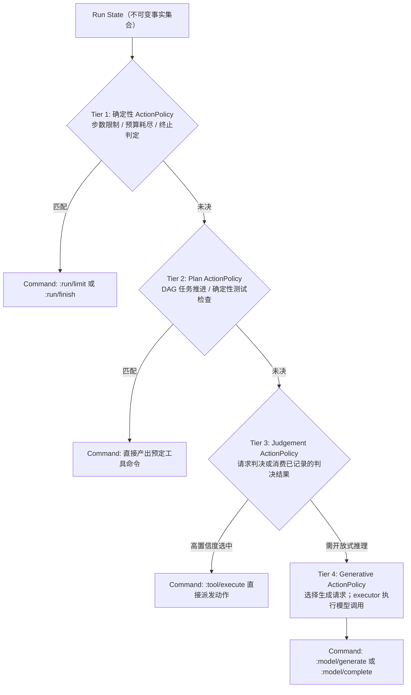
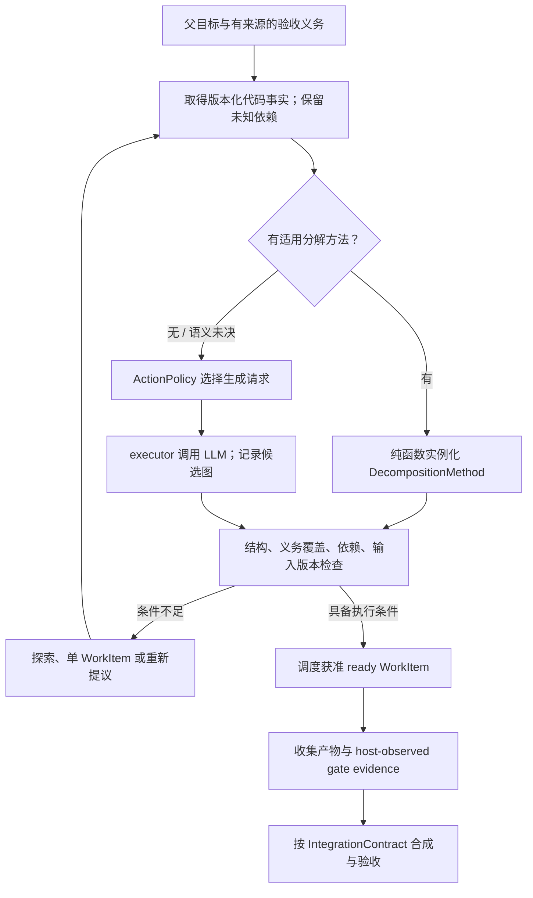

# Botashka 重构计划：分层动作策略（ActionPolicy）与递归智能体（Recursive Agent）

## 1. 目标与背景

当前 Botashka 已采用不可变 run state 与 Functional Core / Imperative Shell 分离；默认执行路径由生成式模型提出工具调用。模型提出动作并不意味着它拥有执行权限：宿主仍负责控制流、授权与执行。本次重构要解决的是动作选择对 chat/tool-call 协议的耦合，并为任务分解与合成建立可检查的契约。

1. **动作选择来源需要泛化**：确定性规则、任务计划、judgement model 和生成式模型都应能提出下一步 command，不必伪造 assistant message。
2. **分解来源与执行机制必须分开**：已知任务可用预定义分解方法；未知任务可让 LLM 提议，但模型输出不能直接获得 spawn、扩大 scope 或修改共享契约的权限。
3. **递归的难点不是调用 `agent/run!`**：真正的风险是遗漏父目标、错误依赖、过时输入、局部成功但整体失败，以及合成时隐式改变接口。

本计划采用 **ActionPolicy（动作策略）+ 规则优先的分解方法 + 显式合成契约**。它是拟议设计，不代表当前程序已经实现 TaskGraph、subagent、worktree 或这些验收机制。

**确定性表示可复现，不自动表示正确。** TaskGraph 无环、WorkItem 符合 schema、测试通过分别提供结构、覆盖和行为证据，均不构成任意 coding task 正确分解或完整满足需求的通用证明。

---

## 2. 核心架构设计

### 2.1 动作策略管道（ActionPolicy Pipeline）

将原有的单一 `model-driver` 升级为符合强化学习与控制理论定义的纯动作策略：

$$\text{ActionPolicy} : \text{Run State} \longrightarrow \text{Command} \mid \text{nil}$$

**ActionPolicy 只回答“下一步想做什么”**。它不执行命令，也不判断 effect 是否被允许。授权由独立的 `AuthorizationPolicy` 决定，副作用由 `CommandExecutor` 执行。需要模型时，ActionPolicy 选择请求 command，executor 调用模型并记录结果事件，随后纯策略消费该结果；模型请求不得隐藏在策略、分解方法或 validator 内。多个策略仅有明确优先级时使用短路组合；若它们会同时提出候选，则显式产出 `ActionProposal` 并交给 `ActionArbiter` 仲裁。

通过动作策略组合构建自上而下的分层决策流水线：



术语必须保持正交：

| 术语 | 唯一职责 |
| :--- | :--- |
| **ActionPolicy** | 从当前 run state 选择一个 next command，或返回 `nil` |
| **ActionSelector** | ActionPolicy 内部采用的选择算法 |
| **ActionProposal** | 某个策略提出的候选动作、来源、置信度与证据 |
| **ActionArbiter** | 多个候选动作并存时选择唯一生效动作 |
| **AuthorizationPolicy** | 判断已选动作是否允许执行；不得被 ActionPolicy 绕过 |
| **CommandExecutor** | 执行获准命令并记录观察到的事实 |
| **DecisionModel** | Laya、Jev 等 ActionSelector 的可选 adapter；不是控制流 owner |

仅在策略有严格优先级时使用短路组合：

```clojure
(defn first-applicable-action-policy [& policies]
  (fn [run]
    (some #(% run) policies)))
```

若多个策略可同时提出动作，则不得用求值顺序隐藏冲突，而应显式建模并仲裁。以下是契约示意，不是实际模型预测：

```clojure
{:action {:command :tool/execute
          :tool "read_file"
          :arguments {:path "README.md"}}
 :proposed-by :judgement
 :confidence 0.94
 :evidence {:decision-id "read-project-title"}}
```

### 2.2 命令语义解耦 (Decoupled Commands)

目前命令集将“决定干什么”与“写什么内容”全部耦合在 `:model/complete` 中。需将其正交拆解为：

| 命令类型 | 意图说明 | 适用场景 / 对应执行器 |
| :--- | :--- | :--- |
| `{:command :tool/execute :tool ... :arguments ...}` | **直接执行指定工具** | 由规则、计划或 Laya 决策模型选定，**不经过 LLM 生成 `tool_calls`** |
| `{:command :model/decide :candidates [...]}` | **候选裁决** | executor 调用 judgement adapter；类型化选择与置信度不构成语义正确性证明，延迟由实际评测确定 |
| `{:command :model/generate :prompt ...}` | **开放式生成** | 生成代码、候选分解、integration 改动或基于事实的报告；结果仍须独立验证 |
| `{:command :model/complete :request ...}` | **传统全包模式（兼容项）** | 保持与 OpenAI/Gemini 原生 Chat Completion 的向下兼容 |
| `{:command :run/finish :result ...}` | **任务正常交付终止** | 满足成功断言或模型完成回答 |
| `{:command :run/limit}` | **资源上限终止** | 达到步数或深度配额 |

### 2.3 递归智能体范式 (Recursive Coding Agent)

`agent/run!` 是执行模型、工具等 effect 的可重入 shell，不是纯函数。它的显式输入和不可变 run state 适合作为 worker 容器，但不会自动带来正确分解或可靠合成。

父级从分解方法、已观察的代码事实或模型候选中构造 WorkItem；宿主验证依赖、覆盖、所有权、输入版本与预算后才启动 worker。子级使用同一套方法与契约继续细分时才形成递归，而不是自由 Prompt 加任意 spawn。

worker 的输入是版本化 workspace / artifact handles 和必要契约；输出是 Artifact、host-observed GateResult 和有界摘要。不存在无需测量即可保证的固定上下文长度；子 conversation 不自动进入父级 context，递归预算和取消由宿主明确管理。

### 2.4 分解的单位：有契约的 WorkItem，而非自然语言 Prompt

父级创建 WorkItem 不等于父级凭空自由转述任务。它应从已选 `DecompositionMethod`、代码事实和父级验收义务中实例化有界任务；模型生成的内容只是候选，不能自行改写父目标或验收标准。子上下文由这些数据生成。

| WorkItem 字段 | 契约 |
| :--- | :--- |
| `:id`、`:goal`、`:obligation-ids` | 唯一身份、局部目标、负责的父级验收义务；义务保留用户要求和已有契约的来源 |
| `:scope`、`:owner` | read handles / read set、允许 write paths、禁止路径、唯一 worker owner；共享写入由 Integration Owner 管理 |
| `:inputs` | 输入 workspace revision、artifact IDs / digests、共享契约版本和必要事实的来源；不是可变路径上的不明内容 |
| `:requires` | 开始前必须成立的事实或上游产物条件；条件未知或输入过时的节点不是 ready node |
| `:produces` | 可被下游引用的类型化产物及其 contract；不能仅写“完成重构” |
| `:assumptions` | 依赖的 revision、外部条件及尚未确认的依赖；未知不得视为已满足 |
| `:contract` | 需保持的行为、共享 interface 版本、输出和错误语义 |
| `:dependencies` | 实际 producer / consumer 依赖和前置检查；由 requires / produces 与代码事实支持 |
| `:acceptance` | 由父级或 Integration Owner 持有的 gate IDs、判据、允许的命令；worker 不得为过关而弱化验收 |
| `:budget` | depth、turn、deadline 与祖先子树预算分配；兄弟节点总分配不得超出父级剩余配额 |
| `:deliverable` | 产物类型、生成基线、修改路径与证据交付要求 |

分解必须按 **seam 与共享契约** 切分，而不是按文件数或任意 Prompt 切块。先定义跨切片稳定的数据形状、导出符号、错误语义、事件、文件所有权和验收命令；再将实现细节下放给独立 worker。共享契约只能由父级或唯一的 integration owner 修改。

### 2.5 何时允许分解

分解不是默认动作。只有存在明确隔离收益且其大于协调、整合与验证成本时才允许委派。首版使用确定性 gate，而不是让模型估算抽象“复杂度”。

| 允许分解的必要证据 | 拒绝分解的信号 |
| :--- | :--- |
| 工作区存在彼此独立、局部可读的区域，单一上下文会引入明显噪声 | 改动集中在一个短函数或单个紧耦合模块 |
| 每个候选切片都有独立、可观察的 acceptance gate | 验收只能在整体完成后进行 |
| 并发 worker 的 write set 不相交，或有唯一 integration owner 管理共享文件 | 多个 worker 需要写同一个核心文件或共同发明接口 |
| 子任务可通过路径、symbol、artifact handle 和契约表达，不必复制父级上下文 | 子任务描述必须复制大部分父级 conversation 或工作区内容 |
| 子任务的专业搜索空间确实不同，如协议调研、独立 adapter、只读审查 | 后续任务依赖尚未确定的前置接口 |

并行写入不相交 $W_i \cap W_j = \varnothing$ 只是必要条件，不是独立性的充分证明。还要检查写入与其他节点 read set 的关系、共享契约版本、冻结输入和外部资源；跨文件改变事件含义与修改事件消费者仍有语义依赖。未知关系先探索或串行，强耦合改动保留在一个 WorkItem，不为提高并行度强行切开。

### 2.6 分解来源、DecompositionMethod 与 TaskGraph 验证

#### 2.6.1 规则骨架优先，局部语义判断按需调用模型

不存在替任意 coding task 自动找到正确切分的通用确定性算法。分解来源分工如下：

| 来源 | 决定什么 | 适用范围与限制 |
| :--- | :--- | :--- |
| 固定工作流 / 分解模板 | 实例化预先定义的步骤和依赖 | 已知重命名、迁移、依赖升级；不覆盖未知需求 |
| HTN（Hierarchical Task Network）方法 | 根据前置条件选择方法，将复合任务递归展开为基本任务 | 领域知识明确的任务；规则和世界状态错误时，确定性搜索仍会产生错误方案 |
| LSP / 静态依赖分析 | 提供影响范围、references、producer / consumer 与耦合证据 | 辅助构图，不能单独理解产品意图；macro、动态调用和运行时配置可能留下未知依赖 |
| 生成式 LLM | 理解未知语义，提出分解或共享契约候选 | 无适用方法或需要新设计时使用；可能漏需求、漏依赖或划错边界 |
| Jev / Laya 类 judgement | 在已有候选方法中选择、评分、拒绝或建议继续探索 | 不负责凭空发明可靠契约；类型安全和置信度不能代替行为证据 |

HTN 借鉴的是“任务类型 + 前置条件 + 子任务模板 + 顺序约束”的领域方法，不是把文件平均切块。参见 [SHOP 的官方 HTN 说明](https://www.cs.umd.edu/projects/shop/description.html)。未知子任务可采用 [orchestrator-workers](https://www.anthropic.com/research/building-effective-agents) 的候选规划，但其动态性不构成正确性保证。[Jev 官方说明](https://typesafe.ai/blog/introducing-system-one-models-and-jev)的 schema 保证不能扩展成任意语义判断不会出错。

#### 2.6.2 DecompositionMethod 数据契约

首版只实现一个经过 fixture 验证的方法，不引入通用 HTN 引擎、规则框架或学习方法库。

| 字段 | 契约 |
| :--- | :--- |
| `:id`、`:version`、`:task-kind` | 方法身份、版本和适用任务类型；实例化结果记录所用版本 |
| `:applicable-when`、`:required-evidence` | 对显式事实求值的前置条件和证据要求；未知结果不能当作 true |
| `:subtask-templates` | 带 scope、requires、produces、budget 和验收义务的子任务模板 |
| `:ordering` | producer / consumer 和领域前置条件支持的顺序约束；不是任意执行偏好 |
| `:shared-contracts` | 切分前必须固定的 interface、版本及 owner；不可由多个 worker 共同发明 |
| `:coverage` | 父级 obligation IDs 到子任务交付和最终 integration gate 的映射 |
| `:integration-contract-id` | 产物如何组合、验证和交付的既定 IntegrationContract |
| `:refusal-rules` | 无独立验收、未知关键依赖、共享写冲突或预算不足时拒绝分解，转为探索或单 WorkItem |

方法的条件求值和实例化保持纯粹。多个适用方法采用显式稳定优先级或候选仲裁；候选不足时不让 judgement model 猜一个，不匹配时也不默默扩大方法适用范围。

#### 2.6.3 分解算法与 effect seam

1. **固定父级验收义务**：从用户要求、已有测试和契约中提取有来源的 obligation IDs；不允许子任务删掉或弱化这些义务。
2. **获得代码事实**：通过命名明确的 shell seam 获取 LSP / 静态分析、测试和 workspace 证据，并记录输入快照；未知依赖保留为 unknown。
3. **优先实例化已知方法**：纯函数依据证据匹配和展开方法，直到得到基本 WorkItem。无匹配方法或存在产品语义不确定性时，ActionPolicy 选择生成请求，executor 调用 LLM 并记录候选 TaskGraph；模型提议不能直接启动 worker。
4. **构建真实依赖与所有权**：依据 requires / produces、引用关系和共享契约添加边；必须共同演进的强耦合改动不拆开；不能只用图聚类或最小割判断任务是否覆盖目标。
5. **验证结构、声明覆盖与输入有效性**：条件不足就执行探索任务、缩回单 WorkItem 或重新提议；确需人类判断的产品取舍才请求人工决定。
6. **调度前重查事实**：只有依赖已验收、输入版本仍有效且 scope / budget 获准的节点可启动；上游变化会使受影响节点重新验证，而不是沿用旧候选。



#### 2.6.4 Validator 的保证边界

| 检查层次 | 能提供的证据 | 不能据此宣称什么 |
| :--- | :--- | :--- |
| 结构与执行约束 | task IDs 唯一、无环、依赖存在、scope / budget 有界、owner 明确、授权与输入版本有效 | 分解必然符合业务语义，或者未知依赖不存在 |
| 已声明义务覆盖 | 每项父义务有负责的 WorkItem 和验收；每项下游输入有 producer；最终 gate 覆盖已声明交互 | 原始义务清单没有遗漏；模型生成的契约一定正确 |
| 行为与语义验收 | 准确代码快照上的 contract tests、changed-path smoke、必要的设计 / 人类审查结果 | 有限测试等价于完整正确性证明 |

未知关系必须触发额外证据获取，不得在 validator 内转成默认通过。worker 的改动若涉及验收契约变化，须返回父级明确决定并更新契约版本；不得修改自己的 gate 以逃避失败。成功交付指满足预先确定的验收标准并保留证据，未覆盖的语义风险必须如实报告。

### 2.7 IntegrationContract：合并产物，不合并聊天记录

#### 2.7.1 交付与证据必须绑定身份和准确快照

worker 交付 Artifact、host-observed GateResult 与有界摘要。父级只消费 artifact handle、修改路径、输入契约版本、有限事实和证据索引；子 conversation、长推理、工具 stdout/stderr 不自动进入父 context。

Artifact 至少标识 `task-id`、生成时的 base revision、输入 artifact IDs / digests、共享契约版本、实际修改路径、产物 digest 与 handle。实际修改路径由宿主检查，不能仅信任 worker 声明。

GateResult 标识 gate ID / version、实际执行的命令或纯判据、被验证的代码 tree / artifact digest、相关运行条件、结果和诊断 handle。worker 的“测试通过”自述不是执行证据；在子工作树通过的 gate 也不能冒充最终合成快照上的验收。

#### 2.7.2 IntegrationContract 数据契约

| 字段 | 契约 |
| :--- | :--- |
| `:id`、`:version`、`:owner` | 合成规则身份、版本和唯一 Integration Owner |
| `:inputs` | 需要接收的 WorkItem 产物、类型、生成基线、输入 artifact / contract 版本以及可信证据要求 |
| `:merge-mode` | 明确采用数据聚合、代码 staging 合成，还是新建语义 integration WorkItem；不得隐式互换 |
| `:ordering` | 基于真实依赖的拓扑顺序；消费上游产物的节点从已验收的上游快照开始 |
| `:compatibility` | 冻结的共享 interface、版本约束及输入失效规则；不存在“路径不冲突就兼容”的假设 |
| `:scope` | 允许修改的路径、隔离集成工作树、预期目标 revision 和发布权限 |
| `:gates` | 每节点窄 gate 与最终跨模块 integration gate；证据绑定实际被验证的快照 |
| `:conflict-policy` | 结构化冲突、归属证据、局部修复或重新规划规则；不得默默使用 ours / theirs 或模型重写掩盖冲突 |
| `:promotion-rule` | 验收通过且精确变更获得授权后才更新目标树；目标 revision 或最终 digest 变化须重新检查 |

#### 2.7.3 三类合成算法

**A. 数据型产物：确定性聚合。** 文件清单、references、诊断和带来源的发现，按既定 key 排序、去重并保留来源。矛盾发现标为冲突，不由 LLM 随意选一项冒充事实。最终报告可由模型生成，但报告必须以聚合后的证据为输入，不能变成新的执行事实。

**B. 代码型产物：版本化 staging + 验收。**

1. 检查 artifact 身份、digest、实际 scope、输入版本和上游 GateResult。
2. 依赖节点必须在已验收的上游快照上生成；上游 interface 或必要输入变化后，旧的下游结果失效，须重新验证或执行。
3. 真正独立的分支可基于冻结输入和共同祖先进行三方合成。base revision 不等于当前 HEAD 本身不代表 stale；失效判据是必需输入、共享契约或审批基线已改变。
4. 在隔离的集成工作树按拓扑顺序应用产物；文本冲突停下并记录，不能自动丢弃一侧。Git 的三方合并不验证业务语义，参见 [Git merge 官方文档](https://git-scm.com/docs/git-merge)。
5. 在实际合成快照运行每节点窄 gate 与最终跨模块 gate；最终 evidence 指向该快照，不能复用仅针对旧子树的通过记录。
6. 只有获准的最终变更才能更新目标树。失败保留诊断和 staging 产物，不修改用户目标树；用户原有未提交改动不属于可覆盖或回滚范围。

例：A 把错误结果字段从 `:error` 改为 `:failure`，B 在另一文件继续读取 `:error`。两个 patch 可以没有文本冲突，局部测试也可能没有覆盖交互；producer / consumer 契约检查和最终 changed-path smoke 才能提供跨模块错误的证据。没有相应 gate 时，不能宣称合成正确。

**C. 语义冲突：显式 Integration WorkItem。** 需要 glue code、interface 调整或方案仲裁时，创建带 scope、版本化输入、owner 和验收的 integration WorkItem。LLM 可以提出或实现修复，但不能默默将两份 patch 重写成第三份并宣布成功。共享契约错误时回到父级重新分解，不能靠无界修补维持错误任务图。

#### 2.7.4 局部修复与重新分解

只有失败原因有证据地局限于原 write set、输入仍有效且共享契约成立时，才退回原 worker 局部修复。错误共享契约、新依赖、共享写冲突、系统级语义问题或无法归属的失败回到父级；不得只根据报错文件所在路径猜责任。

修复或契约版本变化后，按依赖图标记受影响产物和 gate evidence 失效，并重新验证受影响节点。worker 不得自行扩大 scope 或削弱验收标准。

### 2.8 第一个可验证切片：一个方法 + 一个合成契约

完成 ActionPolicy cutover 后，选择本次“动作选择与模型协议解耦”作为首个任务类型，实例化一个 `public-interface-cutover` 分解方法和一个对应的版本化合成契约，不先建设通用规划引擎。

该方法以真实 references 和已有测试为输入，先固定直接工具 command、origin 与模型 tool-result pairing 的共享契约，再迁移生产者和消费者，最后验证完整交互。若分析表明改动必须共同修改同一核心文件，就保留单 WorkItem；不预设一定值得委派。

父级验收义务至少包括：确定性策略可直接执行工具、不伪造 assistant tool call、现有 Gemini 工具往返成立、不能绕过授权、所有 caller 完成迁移。子任务不能通过删改义务取得成功。

以相同初始 workspace、父级义务、允许的预算和 gate 比较单 Agent 基线与规则分解方案。先使用确定性 fixture 验证约束，再做实际 changed-path smoke；只在观测到更小上下文负担且没有新增遗漏或集成回退时扩展方法。记录结果而不是预设多 Agent 更好。

至少包含以下 consumer-visible 反例：遗漏父义务、下游输入无 producer、静态分析未确认关键依赖、上游契约变更使旧产物失效、不同文件无文本冲突但跨模块行为错误。通过这些场景再推进隔离 worker 和递归，而不是先添加 Laya 或大而通用的 HTN 框架。

---

## 3. 详细实施步骤 (Phases)

### Phase 1: ActionPolicy 与直接动作派发

**目标**：移除 `model-driver` 的单一模型假设；让 host、确定性规则、计划和模型都能选择 command，同时保持“每个 run state 至多一个获准 command”的不变量。

1. 将 `botashka.run/model-driver` 重命名为 `default-action-policy`；将 `agent/run!` 的 `:next-command` 输入改为 `:action-policy`，迁移全部 caller 与测试，不保留兼容 alias。
2. 定义 `ActionPolicy`、`ActionProposal`、`ActionArbiter` 与独立的 `AuthorizationPolicy` data/function contract；ActionPolicy 不执行或授权 effect，需要模型时只返回请求 command，executor 执行并记录结果。
3. 将 host 直接选择的 `{:command :tool/execute ...}` 变为一等 command。它不能伪造 assistant tool call；event 必须带明确 action origin（`:host`、`:plan`、`:judgement` 或 `:model`），仅 `:model` origin 保留 Gemini tool-call pairing。
4. 实现 `first-applicable-action-policy`；仅用于已声明严格优先级的策略链。候选同时有效时，要求显式 `ActionArbiter`。
5. 验收：`scripted-action-policy` 可在没有 HTTP、模型 mock 或子进程的情况下驱动多步状态机；授权拒绝、直接工具命令、模型工具命令与 terminal command 都有确定性测试。

### Phase 2: 一个分解方法、合成契约与非递归 TaskGraph

**目标**：在创建任何 subagent 前，先验证规则实例化、声明覆盖、版本化输入和合成责任；不把确定性误当作通用正确性证明。

1. 按 2.8 的真实任务定义一个 `DecompositionMethod` 和对应 `IntegrationContract`，使用相同父级义务与 gate 的单 Agent 基线；暂不实现通用 HTN 引擎或方法学习。
2. 定义 `TaskGraph`、`WorkItem`、`Artifact`、`GateResult`、`IntegrationResult` 的稳定 EDN contracts；保留 requires、produces、assumptions、obligation IDs 与输入版本。
3. 实现纯结构 / 覆盖检查和方法实例化；外部事实由 shell 提供。拒绝缺失义务、无 producer 的输入、环、未知关键前提、冲突所有权和越界预算，返回有原因的拒绝或探索请求。
4. 实现串行 host-owned scheduler，只有依赖和输入有效的 ready node 可执行；此阶段确定性 fixture executor 提供节点结果，**不启动 subagent，不递归，不并行**。
5. 验收：相同冻结事实与结果序列得到可复现调度；2.8 的反例在恰当环节被拒绝或验收捕获，不能只测试 graph 能解析或执行不抛异常。有限测试结果不宣称业务义务完整。

### Phase 3: 快慢模型 Seams，但不预设模型选择

**目标**：分离动作判决、参数填充与文本生成，并以测量而非宣传决定 Laya/LFM2.5 是否进入默认路径。

1. 将 command 拆为 `:model/decide`、`:model/generate`、`:tool/execute`；保留 `:model/complete` 仅作为当前 Gemini chat-tool loop 的显式兼容 command。
2. 建立两个独立 adapter seam：
   - `JudgementClient` 接收事实摘要和候选 action IDs，返回 `{:selected-id ... :confidence ... :evidence ...}`；Laya/Jev 是候选实现；
   - `StructuredGenerationClient` 在确定需要非确定性参数或结构化内容时生成受 schema 限制的数据；LFM2.5-350M 是候选实现，不承担 judgement 语义。
3. `JudgementActionPolicy` 在候选集、阈值、拒绝与回退规则明确时选择判决请求并消费结果；LLM 生成未知 TaskGraph、judgement 选择既有方法都通过 executor seam 记录。低置信度或无适用候选时探索、回退、请求必要人工判断或返回未决，不能猜测执行。
4. 先建立固定 tool-routing / parameter-filling corpus，比较 deterministic baseline、Laya、LFM2.5 和当前生成模型的准确率、置信度校准、延迟、内存和 failure mode；未达到预先声明门槛的 adapter 不进入默认策略链。
5. 验收：替换 client adapter 不改变 core event / command contracts；模型离线、低置信度和 malformed output 都有可观察的非成功路径。

### Phase 4: 深度一的隔离 Worker，先只处理已验证 WorkItem

**目标**：验证外部句柄、最小上下文和 artifact handoff；不把任意“spawn subagent”暴露为模型可自由调用的工具。

1. host scheduler 从已验证 TaskGraph 取 ready WorkItem，根据 scope、共享契约、有效上游快照、artifact handles 与预算构造独立 `agent/run!` options；不复制父 conversation，不给未知输入放行。
2. 首版固定 `:max-depth 1`、串行且只读，worker registry 不提供委派能力；代码修改须等 Phase 5 的隔离 worktree 和批准的 mutation workflow 就绪。
3. 输出是 `Artifact + host-observed GateResult + bounded summary`，遵循 IntegrationContract；不得将 `:messages` 或完整 event log 作为父级 context，失效输入上的旧结果不得用于下游。
4. `delegate_task` 若被引入，只能引用已验证的 `work-item-id`，不得接收任意 `slice_path` 加自由 Prompt 来绕过 TaskGraph validator。
5. 验收：父级只收到 artifact handle、paths、interface facts、gate evidence 和短摘要；故意提供长子会话时，父级上下文大小不随子日志线性增长。

### Phase 5: 可变更 Worker 的 Worktree、Artifact 合成与 Symbolic Gates

**目标**：让受控 coding worker 能够修改代码，但不能自行认定成功或直接污染共享工作树。

1. 对可变更 WorkItem 创建隔离 Git worktree，记录真实 base revision、输入 artifact / contract 版本、允许 write paths 与 artifact digest；保留既有 mutation preview / approval 要求。
2. worker 只交付 patch/commit handle、接口事实和准确快照上的 GateResult；只有 Integration Owner 能按 IntegrationContract 在隔离 staging 树合成。
3. 依赖节点从已验收的上游快照开始；独立分支可基于冻结输入和共同祖先三方合成。文本冲突记录并停下，语义 glue code 是新的 Integration WorkItem，不默默调用模型重写合并。
4. 验收证据绑定真实合成 tree digest、gate 版本与执行条件；最终跨模块 gate 通过且精确变更获准后才更新目标树。仅子树 gate 通过或 Git 无冲突不视为完成。
5. 验收：越界路径、错误 digest、必要输入失效、文本冲突、跨模块行为回退和未授权发布都不修改目标树。根据有证据的责任归属局部修复或重新规划，重新验证受影响产物，不覆盖用户原有改动。

### Phase 6: 受预算约束的递归

**目标**：只有深度一委派和合成稳定后，才允许 worker 产生下一级 TaskGraph。

1. 子级 `:max-depth` 严格递减；turn 与 deadline 分配不超过祖先剩余预算，兄弟节点共享受 host 管理的子树总配额。局部上限递减不能替代总成本限制，取消作用域须覆盖后代。
2. 子级优先实例化既有 DecompositionMethod，未知语义才提出 TaskGraph；所有候选同样经 parent-owned 检查，不得直接 spawn 或修改父级义务。
3. 各级保持版本化 Artifact / GateResult handoff 与唯一 Integration Owner，继承对应 IntegrationContract；上游变化同样使后代必要输入失效。
4. 验收：超深、兄弟总预算超配、取消、无效 graph、输入失效和 gate 失败可终止且清理资源；深度归零时不提供分解能力，目标树不保留未获准修改。

### Phase 7: 最后才引入并行与投机

**目标**：仅为验证过的独立 WorkItem 提高吞吐，不改变 mutation 的安全语义。

1. 只有 write / read 关系、共享契约和外部资源依赖明确、输入冻结、预算 / 取消 / 聚合语义已定义时才并行；write set 不相交本身不足以授权并行。
2. 投机候选使用独立 worktree；候选仲裁和验收后仅交付一个获准 artifact，未选分支取消并清理，仲裁置信度不能代替 integration gate。
3. 验收：在相同冻结输入的确定性 corpus 上，串行与并行满足相同父级义务和 artifact contracts，不要求模型文本、时间戳或事件交错字节相同；取消不留下存活 worker、worktree 或未授权修改。

---

## 4. 关键原则与架构不变量

1. **代码调用模型，而非模型控制代码（Code Calls the Model）**：host 的 ActionPolicy、TaskGraph scheduler 和 gate 决定控制流；模型只提供可替换的计算结果。
2. **动作选择、授权与执行必须分离**：ActionPolicy 选择、AuthorizationPolicy 允许或拒绝、CommandExecutor 执行并记录事实；任何模型不可绕过授权。
3. **规则优先，模型提议，宿主检查**：已知任务由 DecompositionMethod 实例化，未知任务由 LLM 提候选；没有满足结构、声明覆盖、输入有效性和授权条件的 WorkItem 不得启动。
4. **按 seam 和契约切分，不按 Prompt 或文件数切分**：每个 WorkItem 必须具有小 scope、稳定共享 contract、独立 acceptance gate 和明确所有权。
5. **Artifact 与 evidence 交接，不传递 conversation**：父级消费有身份的 patch/commit handle、接口事实、gate evidence 和有界摘要；不自动消费子会话或长工具输出。
6. **合成必须有契约和唯一 owner**：IntegrationContract 定义输入版本、应用顺序、冲突处置与 gate；证据绑定准确合成快照，模型自述、schema 正确或无文本冲突均不能代替跨模块验收。
7. **引用传递而非值拷贝（Pass by Reference）**：代码库、worktree、artifact 和诊断通过 handle 传递；禁止将大段工作区或子历史复制到 Prompt。
8. **决断优先于写作（Decide, Don’t Write）**：能由规则或符号 gate 解决的，不调用模型；离散候选可由 judgement model 裁决；只把开放式生成交给慢模型。
9. **递归与并行必须可预算、可取消、可清理**：严格递减 depth，祖先管理子树总预算；mutation 默认串行，并行还需证明读写、契约和外部资源依赖可协调。
10. **不得把声明覆盖当作语义完整**：validator 检查已声明的父义务与 producer / consumer 关系，不保证义务无遗漏；未知依赖保留并探索，有限测试不作为通用正确性证明。
11. **语义合成是显式工作，而不是偷偷重写**：新 glue code 或冲突修复进入有 scope 与验收的 Integration WorkItem；错误共享契约则重新分解。

## 5. 与现有路线图的关系

本计划补充分解与合成设计，不绕过[现有实施路线图](botashka-from-code-tools-to-coding-agent.zh.md)的工具契约、授权、workspace 限制、批准的 mutation 和真实 smoke 前提。只读分解可先验证；可变更 worker 在这些前提满足后才执行。模型基准与 TaskGraph 不构成运行任意生成工具、自动提交或自动推送的许可。
