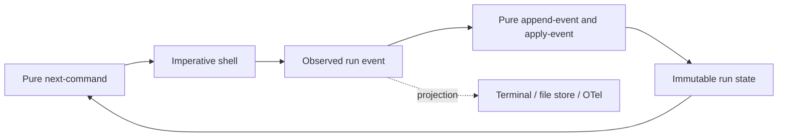

# Run event log 重构设计

## 问题

当前 `botashka.agent` 在多个私有函数中构造并拼接 `:log` vector：用户输入、provider response、tool call/result、final answer、step limit 各自决定 event shape 和 append 时机。它能完成 REPL probe，却没有一个 run-event-log owner，也没有统一的 event envelope、evidence policy、时间/耗时、发布或未来 exporter 的位置。

这会阻碍后续工作：

- 持久化时不知道哪个位置必须原子追加；
- 终端、文件、OTel、Phoenix UI 等消费者会迫使 `agent` 知道更多输出机制；
- provider/tool 的时间、失败和取消只能零散地补；
- event schema 演进会散落到 control-flow functions；
- 直接把 OpenTelemetry SDK、span 或 Prometheus labels 混进 agent loop，会将可观测性失败变成 agent failure。

## 决策

将单个 Agent run 建模为**由 canonical run events 驱动的纯状态机**。



事件是已发生的 host facts；命令是尚未执行的意图；状态是由事件纯派生的 read model。shell 只执行 `next-command` 返回的一个 effect，并将观察到的结果追加为下一个 event。provider、tool、clock 与 ID generation 都在 shell，不能进入 pure transition。

## 纯 core interface

当前实现在 `botashka.agent`，暂不拆出更多 namespace：

| 函数 | 职责 | 纯度 |
| --- | --- | --- |
| `new-run` | 从显式 options 构造 unstarted run | 纯 |
| `append-event` | envelope event、追加 events、应用 transition | 纯 |
| `apply-event` | `run + event -> next-run` | 纯 |
| `next-command` | 从 derived state 决定唯一允许的下一条 command | 纯 |
| `provider-request` | 将 conversation 与 registry 变为 provider request | 纯 |
| `run!` | 解释 command、调用 provider/tool、取得时间与 ID | 非纯 shell |

`run` 的最小状态：

```clojure
{:id "run-..."
 :status :awaiting-provider
 :turn 0
 :messages [...]
 :pending-tool-calls [...]
 :events [...]}
```

不使用 atom、动态绑定或 global recorder 保存 canonical state。单 run 目前是顺序执行，局部 immutable value 足够。若以后同一 run 需要多线程协调，可用一个 atom 安装整个 immutable run snapshot；传给 `swap!` 的 transition 必须纯粹，不能执行 I/O。

## 事件与命令

事件 envelope：

```clojure
{:run-id "01J..."
 :seq 7
 :at "2026-10-31T10:12:13.456Z"
 :type :tool-result
 :data {:turn 1 :call-id "call_..." :tool "read_file" :outcome :ok}
 :evidence {:tool-message {:role "tool" ...}}}
```

`:data` 是 allowlisted projection summary；`:evidence` 是受配额与 capture policy 约束的 local RCA material。projection 不得自动读取 evidence。credentials、authorization headers、environment variables 永不保存。

第一批事实：

```text
:run-started
:user-submitted
:provider-requested
:provider-responded
:tool-proposed
:tool-result
:limit-reached
:run-finished
```

第一批命令：

```clojure
{:command :provider/complete :request ...}
{:command :tool/execute :tool-call ...}
{:command :run/limit}
{:command :run/finish}
```

命令不是 event。shell 完成或失败后才追加对应事实；不能在 provider/tool 执行前伪造 `:provider-responded` 或 `:tool-result`。

## Conversation 与 context

provider-compatible `:messages` 是纯 run state 的派生部分。`apply-event` 根据 `:user-submitted` evidence、`:provider-responded` 中的 assistant message 与 `:tool-result` 中的 tool message 重建它。

当前下一次 LLM request 使用该 conversation。未来 context management 可以从 run events 的 `:data` 选择已脱敏事实，但不得默认把完整 event log 或 `:evidence` 注入 prompt。

## Observation 与持久化

terminal、文件、OTel、Phoenix、Prometheus 都是 event projection，不定义状态机，也不能改变 terminal result。

当前不实现 observer、macro、async publisher 或 persistence。未来确有跨进程保存/恢复需求时，Run store 必须消费已构造 events，并单独定义：写前/写后语义、提交单位、磁盘失败策略、恢复和外部 effect 幂等性。内存 event vector、atom 或 STM 不提供这些 durability 语义。

## 非目标

- 不引入 Grain、通用 event-store protocol、processor framework、read-model cache 或 workflow engine；
- 不引入多租户、CAS checkpoint、SQLite/Postgres、队列或 async publisher；
- 不将 OTel trace、文本日志、provider conversation 或 UI projection 作为 canonical event log；
- 不在没有明确需求时建立第二个 namespace 或抽象层。

## 验收不变量

- 给定同一 initial run、时钟值和 event 序列，`append-event`/`apply-event` 产生同一 state；
- event 的 `:run-id` 一致，`:seq` 连续；
- `next-command` 对每个非终态 run 至多产生一个 command；
- `:tool-result` 只在 shell 完成 tool invocation 后出现；
- `:run-finished` 是 terminal run 的最后事件，其状态等于 public result；
- pure state-machine tests 不需要网络、subprocess、atom 或 `with-redefs`；
- 真实 smoke 仍能经 discovered code tools 读取 `README.md` 并回答标题。
