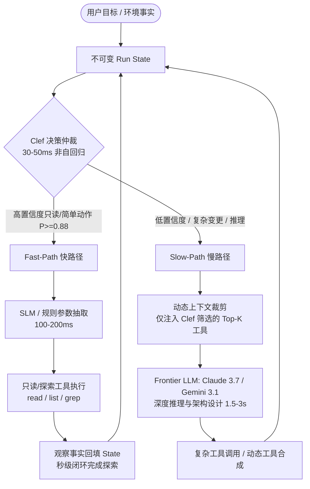
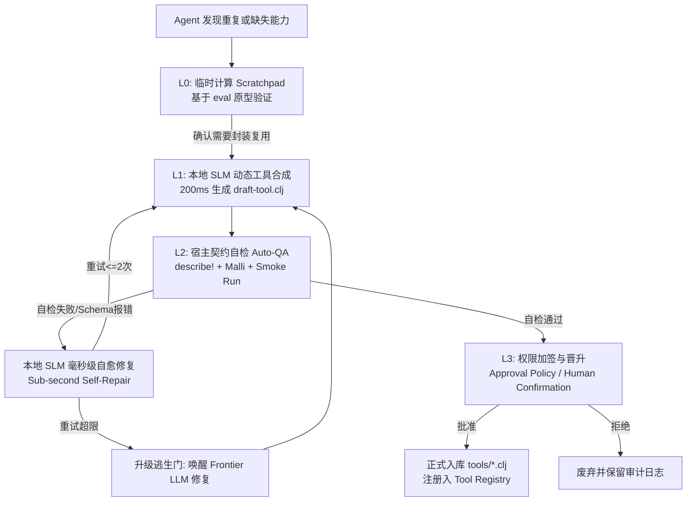
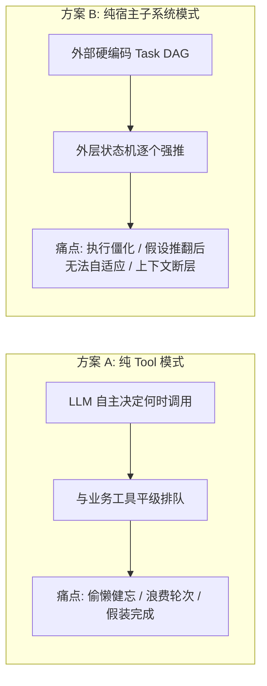

# Botashka 工具系统增强与 Todo 架构设计计划

## 1. 目标与背景

Botashka 是一个从零构建、面向本地开发者的 Clojure/Babashka coding agent。本项目坚持 **Functional Core, Imperative Shell**、**Data First** 以及 **Deep modules, small interfaces** 架构原则。

参考 [omp 工具体系](https://omp.sh/docs/tools) 的设计实践（严格的能力分级、受控变更加签、动态能力目录、代码即计算、结构化交互与自进化），本计划旨在为 Botashka 制定下一阶段的工具系统增强路线。

在引入专用决策模型 **Clef** 与本地端侧小语言模型 **SLM (Small Language Model)** 的双脑演进背景下，本计划重点解决以下核心架构问题：
1. **能力全景对齐与两级分流**：如何对齐 omp 的核心能力，并通过 Clef 解决工具扩充（内置 + 动态生成）带来的 Prompt 膨胀与工具辨析退化；
2. **动态生成与自进化机制**：如何借助本地 SLM 的极速代码生成与微调能力，实现低成本、毫秒级闭环的工具动态合成与自愈修复；
3. **Todo 的本质权衡与架构落地**：深入剖析 Todo 作为“Agent 可调用的 Tool”与“宿主编排子系统（Subsystem）”的冲突与权衡，利用 Clef/SLM 落实“状态第一、零轮次浪费”的共生架构。

---

## 2. 现状与能力全景对齐 (omp vs. Botashka)

omp 将工具按影响类别划分为 `Read`、`Write`、`Exec` 与 `Mixed`，并默认通过受限模式与审批策略（`allow` / `prompt` / `deny`）控制执行权限。

下表对照 omp 核心能力与 Botashka 现状，明确演进策略：

| 领域分类 | omp 核心能力 | Botashka 现状 (`tools/*.clj`) | 演进策略与适配决策 |
| :--- | :--- | :--- | :--- |
| **代码与资源探索**<br>*(Read)* | `read` (切片/行范围/多格式提取)<br>`glob` (快速路径查找)<br>`grep` (正文正则检索)<br>`ast_grep` (结构化语法匹配)<br>`lsp` (语言服务跳转与引用) | `read_file.clj` (全量截断读取)<br>`list_files.clj` (目录遍历)<br>`search_text.clj` (字面量搜索) | **高优先级现代化与快反射分流**：<br>1. 将 `read_file` 升级为支持行范围 (`:50-120`)、防爆保护的 `read`；<br>2. 补充 `glob` 与正则 `grep`；<br>3. 借助 Clef 建立只读探索的 Fast-Path，免唤醒远端主模型。 |
| **变更与受控变更**<br>*(Write)* | `edit` (行锚定精准 patch)<br>`write` (整体覆盖/持久资源写)<br>`ast_edit` (语法重写预览) | `write_file.clj` (全量文件覆写) | **核心替换**：<br>淘汰脆弱的全文件覆写；引入行锚定或统一 diff 的 `edit` 工具，结合 Approval Token 实行严格的 preview/approve/apply 流程。 |
| **运行时与计算**<br>*(Exec)* | `bash` (持久终端/异步/超时管控)<br>`eval` (持久内核 Python/JS/Ruby)<br>`debug` (DAP 断点与单步调试) | `run_command.clj` (单次命令执行) | **原生 Clojure 计算增强**：<br>1. 加固 `bash` 的流式截断与超时熔断；<br>2. 引入基于 SCI 的进程内持久化 `eval` 内核，配合 SLM 实现快速代码试算。 |
| **协同与控制**<br>*(Read/Exec)* | `ask` (结构化表单确认)<br>`todo` (多步骤进度清单)<br>`task` (子代理任务分发) | *无* (依赖纯 prompt 与单循环) | **双脑协同重构**：<br>1. 引入 `ask` 消除探索歧义；<br>2. 确立“状态第一、SLM 侧车同步”的 Todo 双重架构（见第 5 节）。 |
| **自进化与记忆**<br>*(Read/Write)* | `learn` (提炼复用经验)<br>`manage_skill` (维护技能集)<br>`recall` / `retain` (知识持久化) | *无* | **自进化闭环**：<br>依托本地 SLM 实现动态工具合成、Auto-QA 快速自测、自愈与审批晋升。 |

---

## 3. Clef 与 SLM 对工具系统的架构催化与双脑协同

引入 Clef（专用决策模型）与本地端侧 SLM（如 Qwen-2.5-Coder-1.5B/7B、DeepSeek-R1-Distill-Qwen on MLX）后，Botashka 的执行架构从“单体大模型自回归循环”升级为**三层分工的决策执行体系**。



### 3.1 三层模型职责矩阵

| 层次 | 典型代表 | 延迟与成本 | 核心职责 | 在工具系统中的杠杆作用 |
| :--- | :--- | :--- | :--- | :--- |
| **System-1 快反射 (Router)** | **Clef (9B / Clef-flash)** | **30~50ms**<br>极低 / 本地可跑 | 离散动作选择、工具路由、退出拦截、终止概率校准 | **两级分流与上下文瘦身**：在 20+ 个工具目录中过滤 Top-K；只读动作免唤醒大模型。 |
| **System-1.5 敏捷生成 (Worker)** | **本地 SLM** (Qwen-Coder 1.5B/7B) | **150~300ms**<br>0 API 边际成本 / 100% 离线 | 结构化参数抽取、小型 Babashka 脚本编写、单元测试就地修复、Todo 异步同步 | **合成与自愈加速器**：承担 L1 工具编写与 L2 错误自愈，免除云端 API 往返与费用。 |
| **System-2 深度推理 (Architect)** | **Frontier LLM** (Gemini 3.1, Claude 3.7) | **1500~3000ms**<br>较高 API 成本 | 全局架构分解、高歧义问题决策、重大重构代码编写、自愈逃生门 | **战略兜底**：仅在本地 SLM 自愈失败或 Clef 无法决断时介入。 |

### 3.2 破解工具组合爆炸：两级分流与上下文动态瘦身 (Hierarchical Dispatch & Context Pruning)

当工具库扩充（内置基础工具 + 动态生成工具达到 20~50 个）时，直接向大模型暴露全量 JSON Schema 会导致：
1. **Prompt 膨胀**：工具元数据占据数千 tokens，严重挤占推理上下文并放大成本；
2. **工具注意力分散 (Tool Distraction)**：大模型在多工具混淆场景下极易发生误选；
3. **首字延迟 (TTFT) 恶化**。

**Clef 的解法**：
- **两级分流 (Two-Tier Tool Retrieval)**：Clef 输入 `RunState` 与全量工具元数据摘要，在 50ms 内计算 logits，输出 **Top-K（如 3 个）最相关候选工具**；
- **动态上下文裁剪 (Dynamic Pruning)**：`build-model-context` 只将 Clef 筛选出的 Top-K 候选工具转化为完整 JSON Schema 注入主模型；
- **只读探索直通 (Read-only Fast-Path)**：若 Clef 判定当前是确定的只读探索（`search_text` 或 `read_file`）且 $P \ge 0.88$，直接配合本地 SLM 提取参数执行，实现毫秒级“搜索-读取”流，完全无需等待远端大模型。

---

## 4. 动态生成与工具自进化机制设计 (SLM 深度赋能)

借助本地 SLM，工具自进化的开发体验和响应速度产生质变：动态生成不再是笨重昂贵的“长链 API 任务”，而成为一种极轻量的日常反射。



### 4.1 四阶段生命周期 (Evolution Lifecycle)

#### L0: 即时求值与探索 (Ephemeral Eval)
- **机制**：通过持久化 SCI（Small Clojure Interpreter）环境提供 `eval` 工具。
- **定位**：处理一次性数据变形、日志过滤、JSON/EDN 提取或复杂算法验证。
- **SLM 辅助**：本地 SLM 可在 100ms 内直接输出单行 Clojure 表达式送入 `eval` 执行，探索数据形态。

#### L1: 契约化工具合成 (Tool Synthesis by Local SLM)
- **机制**：当 Agent 识别出“该操作在后续步骤或跨轮次中将被频繁复用”时，由**本地代码小模型 (SLM)** 负责生成自描述的 Babashka 脚本。
- **为什么选 SLM 而非 Frontier LLM**：
  - Babashka 工具脚本通常仅需 30~60 行纯函数逻辑（stdin EDN -> pure function -> stdout EDN）；
  - 本地 Qwen-2.5-Coder-7B 在受限 Clojure 语法与 Malli 契约编写上具备极高准确率，耗时仅 200~400ms，无需消耗商业 API 配额。
- **数据契约规范**：
  ```clojure
  #!/usr/bin/env bb
  (ns parse-coverage-report
    (:require [clojure.edn :as edn]
              [malli.core :as m]))

  (def metadata
    {:name "parse_coverage_report"
     :description "Extracts uncovered line ranges from clover.xml"
     :parameters [:map
                  [:file_path {:description "Path to clover.xml"} :string]]
     :returns [:map
               [:coverage_pct :double]
               [:uncovered_lines [:vector [:map [:file :string] [:lines [:vector :int]]]]]]})

  (defn run [{:keys [workspace file_path]}]
    ;; pure transformation
    ...)

  (let [input (-> *in* slurp edn/read-string)]
    (if (= :describe (:command input))
      (prn metadata)
      (-> input run prn)))
  ```
- **隔离存放**：暂存于会话草稿目录 `runs/<run-id>/draft-tools/<tool-name>.clj`。

#### L2: 宿主契约自检与自动化自愈 (Auto-QA & Local Self-Repair)
- **宿主校验流水线**：
  1. `describe!` 检查元数据完整性；
  2. 模式编译：Malli Schema 必须能无缝编译为 JSON Schema；
  3. 沙箱干跑 (Dry Run)：在 `tool-runtime` 独立进程中执行 declared `smoke_input`，验证超时与输出截断；
  4. 返回值验证：核验输出 EDN 是否匹配 `:returns`。
- **本地 SLM 自愈反馈回路 (Sub-Second Repair)**：
  - 若自检未通过（如字段命名不匹配、缺少 require、Malli 校验失败），宿主提取结构化错误；
  - **不回传远端大模型**，直接输入本地 SLM 进行快速 patch（耗时 ~200ms）；
  - **升级逃生门 (Escalation Hatch)**：若本地 SLM 连续 2 轮未能自愈成功，宿主将错误事实升级给 Frontier LLM 介入修复。

#### L3: 审查晋升与版本沉淀 (Promotion & Skill Management)
- **防逃逸与授权不变量**：任何动态生成的代码工具升级为项目级持久工具，必须通过 `Mutation Workflow`，触发 `:ask` 授权策略。
- **晋升流程**：
  1. Agent 调用 `promote_tool` 命令，提交草稿工具路径与用途摘要；
  2. 终端/TUI 向人类展示：完整源码、Schema 定义、Smoke Run 验证证据；
  3. 人类确认后，宿主原子移动至 `tools/<name>.clj`，并在 `tools/tool-index.edn` 中登记版本与创建来源；
  4. 刷新 `Tool Registry`，Clef 在下一轮自动将该新工具纳入候选选择集。

---

## 5. Todo 的本质剖析与权衡设计：子系统 vs. Tool

在自主 Agent 系统中，任务规划与跟踪（Todo）是决定长链路任务成败的关键枢纽。

### 5.1 方案权衡与冲突分析



| 评估维度 | 方案 A：作为普通 Tool 供 Agent 调用 | 方案 B：作为外层编排子系统 (Subsystem) |
| :--- | :--- | :--- |
| **主导权归属** | **Model-Driven** (模型拥有绝对决策权) | **Host-Driven** (宿主状态机控制推进节奏) |
| **动态适应性** | **极高**。探索中若发现新线索，模型可立即修改步骤或增删任务。 | **极低**。一旦前置步骤证明后续假设不成立，外部 DAG 重规划流程极其繁琐。 |
| **执行纪律性** | **脆弱**。<br>1. **健忘 (Amnesia)**：模型经常在执行几步后彻底把任务清单抛之脑后；<br>2. **虚标 (Fake Done)**：遇到报错未解决便随手标记为 `:done`；<br>3. **轮次浪费**：模型常用一整轮单独发一个 todo update 请求。 | **强健**。<br>1. 宿主强制卡口，上一步不产出可信证据绝不推进下一步；<br>2. 任务状态永远与外部客观世界事实挂钩。 |
| **上下文效率** | **较差**。每次读取或修改都占用 context window 与 tool call 往返。 | **良好**。由宿主精细聚合各步骤输出，消除冗余上下文。 |
| **架构适配度** | 容易退化为无约束的散落状态修改。 | 易导致 Agent 沦为单一函数的填空器，抹杀其战略推理能力。 |

### 5.2 Botashka 裁决：状态第一的“双重架构” (Dual-Nature Architecture)

Botashka 确立如下核心定义：

> **Todo 在领域本质上属于 `Task Control` 领域的【纯事件派生状态与不变量守卫】（Subsystem）；而 Agent 对它的交互则是【受治理的意图表达】（Tool Interface）。**

在此基础上，引入 **Clef 与 SLM 协同**，彻底消除“模型健忘”与“浪费轮次”两大痛点：

```
┌────────────────────────────────────────────────────────────────────────┐
│ Imperative Shell / Orchestration                                      │
│                                                                        │
│   ┌────────────────────────────────────────────────────────────────┐   │
│   │ Run Event Log (Append-Only Facts)                              │   │
│   │ [:todo-initialized] -> [:todo-updated] -> [:todo-amended]     │   │
│   └───────────────────────────────┬────────────────────────────────┘   │
│                                   │ (Pure Projection)                  │
│                                   ▼                                    │
│   ┌────────────────────────────────────────────────────────────────┐   │
│   │ Functional Core: Task Control State Machine                    │   │
│   │ - Clef 步骤裁决 (Step Gate): 30ms 判定当前步骤是否完结         │   │
│   │ - Invariants: 禁止带 pending 任务退出 / 错误自动触发 blocked   │   │
│   └───────────────┬────────────────────────────────┬───────────────┘   │
│                   │                                │                   │
│       (Auto-Inject Ground Truth)      (Intercept Illegal Transitions)  │
│                   ▼                                ▼                   │
│   ┌──────────────────────────────┐   ┌─────────────────────────────┐   │
│   │ Context Builder              │   │ Action & Auth Policy        │   │
│   │ 将当前真实任务树注入系统提示词│   │ 拦截模型提早 finish/伪造完成│   │
│   └──────────────┬───────────────┘   └─────────────▲───────────────┘   │
│                  │                                 │                   │
└──────────────────┼─────────────────────────────────┼───────────────────┘
                   │                                 │
                   │                                 │ (Async Sync / Piggyback)
                   ▼                                 │
           ┌──────────────┐                  ┌───────────────┐
           │ Frontier LLM │                  │  本地 SLM 侧车│ (后台自动更新状态)
           └──────────────┘                  └───────────────┘
```

#### 架构规约与 Clef/SLM 赋能

1. **状态唯一真理源 (Single Source of Truth in Event Log)**：
   - 任务清单由纯事件日志派生（`run/apply-event` 处理 `:todo/*` 事件）：
     - `:todo-initialized`：初始任务清单与依赖声明；
     - `:todo-updated`：任务状态流转（`:open` -> `:in-progress` -> `:completed` / `:blocked`）；
     - `:todo-amended`：结构化重规划（增删项、调整依赖、声明变更原因）。

2. **零轮次消耗的上下文自动投影 (Prompt Auto-Injection)**：
   - **严禁暴露 `todo_read` 工具**。在每一轮组装 `build-model-context` 时，宿主将当前经过校验的任务树只读投影自动嵌入 Prompt 的 Guidance 区域，模型睁眼即见最新事实。

3. **捎带调用约束与本地 SLM 异步同步器 (Sidecar Synchronizer)**：
   - **No-Lone-Call 约束**：主模型禁止单独发起孤立的 `todo` 更新调用；
   - **本地 SLM 侧车托管**：当主模型执行业务工具（如 `edit`、`run_command`）产生结果时，本地 SLM 自动异步提取执行摘要，提议流转 Todo 状态（`:in-progress` -> `:completed`）。**主模型无需为此多耗费一轮对话**。

4. **Clef 零延迟任务步骤门禁 (Step Completion Gate)**：
   - 每一轮工具返回 Observation 后，Clef 可以在 30ms 内完成 `(state, active_task) -> next_action` 离散评估；
   - 若 Clef 判定当前任务已完成且置信度高，可直接辅助状态机推进到下一子项。

5. **宿主层的不变量护栏 (Subsystem Invariants)**：
   - **提前退出拦截**：若 Todo 投影中仍存在 `:in-progress` 或 `:open` 任务，而模型试图输出最终回答，`default-action-policy` 自动予以拦截并警告；
   - **失败事实连带更新**：当实际业务工具发生致命错误，宿主自动将当前任务标为 `:blocked`，杜绝自欺欺人。

6. **人类可见性与 REPL 控制面**：
   - 交互层提供 `(botashka.agent/tasks run)` 纯函数视图；人类可通过 `(botashka.agent/amend-task! run ...)` 随时追加事件干预走向。

---

## 6. 分阶段落地路线图 (Implementation Roadmap)

```
Phase 1: 核心工具现代化与安全加固 (Parity)
  ├── 改造 read_file -> 带切片、大文件保护的 read
  ├── 引入行锚定 patch 的 edit 工具与 preview 机制
  └── 引入交互式 ask 确认工具
Phase 2: Todo 状态子系统与交互工具联动 (Task Control)
  ├── 纯事件派生 Task State (read model)
  ├── Prompt 上下文自动投影注入
  ├── Action Policy 护栏 (拦截未完成退出、失败自动标 blocked)
  └── 本地 SLM 异步 Todo 状态同步器
Phase 3: Clef 工具路由与 Fast-Path 探索机制 (System-1 Fast Reflex)
  ├── Clef 接入作为候选工具过滤层 (Context Pruning)
  ├── 只读探索 Fast-Path 机制 (高置信度直接执行 read/grep)
  └── 持久化 SCI eval 内核集成
Phase 4: 本地 SLM 动态工具合成与自愈闭环 (Self-Evolution)
  ├── 本地 SLM 动态工具生成模块 (botashka.tools.synthesis)
  ├── Auto-QA 自动化测试管道与本地自愈修复 (Sub-second Self-Repair)
  ├── 升级逃生门 (Escalation to Frontier LLM)
  └── manage_tool 晋升流程与持久库沉淀
```

### Phase 1 — 核心工具现代化与安全加固
- **实施**：
  1. `tools/read.clj`：接收 `:path`，可选 `:range [start end]`、`:raw`；12,000 字符截断与行号渲染；
  2. `tools/edit.clj`：实现行锚定（PUT/CUT）与统一 diff patch；返回 preview digest；必须在工作区边界内；
  3. `tools/ask.clj`：提供单选、确认、简答等结构化人机交互卡口。
- **验收**：大文件切片读取测试通过；patch 拒绝越界与冲突基线；所有修改可通过 Git diff 校验。

### Phase 2 — Todo 状态子系统与轻量交互工具联动
- **实施**：
  1. 在 `botashka.run` 中定义 `:todo-initialized`、`:todo-updated`、`:todo-amended` 事件契约与状态转移；
  2. 在 `build-model-context` 中实现任务树文本投影渲染；
  3. 实现 `tools/todo.clj`；
  4. 在 `command-executor` 中结合本地 SLM 实现异步进度同步，在 `action-policy` 中实现未完成退出拦截与失败联动。
- **验收**：模型无法在任务未完成时直接输出最终回答；工具失败时自动转为阻塞；运行中零单独 todo 轮次浪费。

### Phase 3 — Clef 工具路由与 Fast-Path 探索机制
- **实施**：
  1. 将 `botashka.clef-policy` 接入 Action Selection 流程，针对 >20 个候选工具进行 Top-3 过滤（Context Pruning）；
  2. 实现只读探索 Fast-Path：当 Clef 判定为 `read`、`grep`、`list` 且置信度 $\ge 0.88$ 时，由本地提取参数直接执行并回填状态，不发远端请求；
  3. 构建基于 SCI 的进程内持久化 `eval` 工具。
- **验收**：多工具场景下 Prompt token 消耗降低 60% 以上；常见连续 3 步只读探索端到端延迟从 6 秒压至 400 毫秒以内。

### Phase 4 — 本地 SLM 动态工具合成与自愈闭环
- **实施**：
  1. 建立 `botashka.tools.synthesis`，驱动本地 SLM 依据模板与 Malli Schema 编写 Babashka 脚本；
  2. 建立 `botashka.tools.auto-qa` 与本地毫秒级自愈回路：发生错误时由本地 SLM 快速修补；
  3. 实现 Escalation Hatch：2 轮修复失败后升级给远端 Frontier LLM；
  4. 建立 `manage_tool` 与 Approval 晋升管道：人类通过 CLI 审批后将草稿工具原子移入全局 `tools/`。
- **验收**：构造故意存在语法/Schema 缺陷的生成用例，本地 SLM 能在 2 轮内利用报错信息自我修复并自测通过；晋升工具经人类确认后成功入库。

---

## 7. 不变量与架构纪律

在执行上述增强时，必须严格遵守以下红线：

1. **执行边界隔离**：动态生成的代码必须由 `tool-runtime` 以独立子进程（`bb`）或受限 SCI 沙箱执行，绝不允许在 Agent 核心进程直接执行未经审查的 `load-string`。
2. **晋升必须授权**：动态工具晋升为持久库必须经人类显式确认（Approval Gating），严禁 Agent 无感修改系统全局能力。
3. **事实优于声明 (Facts over Claims)**：模型声称“任务已完成”只是一个 Claim，只有当关联操作取得客观成功证据（如 Exit code 0、Assertion pass），状态机才认可其完成状态。
4. **置信度校准与降级透明性**：Clef 必须具备明确的置信度阈值；置信度不足时 100% 平滑退回 Slow-Path交由主模型仲裁，不得盲目下发低置信度动作。
5. **轻量与可测试性**：保持 Clojure/Babashka 的纯粹性与快速启动优势，不引入重型外置运行时，所有新增核心逻辑必须拥有确定性单元测试。