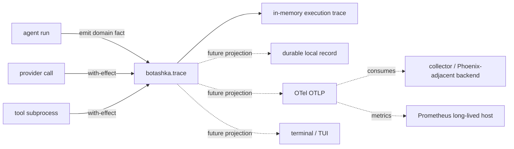

# 执行 trace 重构设计

## 问题

当前 `botashka.agent` 在多个私有函数中构造并拼接 `:trace` vector：用户输入、provider response、tool call/result、final answer、step limit 各自决定 event shape 和 append 时机。它能完成 REPL probe，却没有一个 trace owner，也没有统一的 event envelope、redaction、时间/耗时、发布或未来 exporter 的位置。

这会阻碍后续工作：

- 持久化时不知道哪个位置必须原子追加；
- 终端、文件、OTel、Phoenix UI 等消费者会迫使 `agent` 知道更多输出机制；
- provider/tool 的时间、失败和取消只能零散地补；
- event schema 演进会散落到 control-flow functions；
- 直接把 OpenTelemetry SDK、span 或 Prometheus labels 混进 agent loop，会将可观测性失败变成 agent failure。

## 决策

将 trace 重构为一个深 module：`botashka.trace`。

它拥有**execution event 的生成、排序、保存和发布**；`agent`、`provider`、`tool-runtime` 只在明确的领域或 effect seam 处发出事实。所有观测输出均是 execution trace 的非权威 projection。



`botashka.trace` 不负责 provider conversation、tool authorization、terminal rendering 或 run-state transition。它只记录 host 已观察到的事实并通知 optional observers。

## 术语与边界

- **Execution trace** 是一场 Agent run 的 canonical ordered immutable facts；它不是 provider conversation、文件系统快照、文本日志，也不是 OpenTelemetry trace。
- **Execution event** 是 trace 中一条完整、已脱敏的事实。
- **Observation projection** 是 event 的非权威输出，如 terminal text、本地持久化、OTel spans/logs/metrics、UI update。
- **Observation sink** 消费 event 产生一个 projection；sink 失败不得改变 run 的 control flow 或 terminal result。

这些术语已写入 `CONTEXT.md`。

## 事件 contract

所有 execution event 先经 `botashka.trace/emit!` 归一化，再进入 run trace。调用者不得手写 `:run-id`、`:seq` 或 `:at`。

```clojure
{:run-id "01J..."                         ; recorder 所有
 :seq 7                                    ; 每个 run 内严格单调，从 0 开始
 :at "2026-10-31T10:12:13.456Z"           ; recorder 时钟生成
 :type :tool-result                        ; 封闭的领域事件类型
 :data {:turn 1
        :call-id "call_..."
        :tool "read_file"
        :outcome :ok
        :result {:content-digest "sha256:..."
                 :characters 11}}}
```

### 规则

1. `:data` 是 event-type-specific map；不要把数据平铺到 envelope。
2. event 在产生时已脱敏、限长。不得将 prompt、completion、file content、tool arguments、完整 stdout/stderr、credentials、headers、environment variables 直接放入 event。
3. 能用于诊断的信息采用 allowlist summary，例如 tool name、outcome、字符数、稳定 error kind、redacted message、digest、duration。
4. trace event 是 host fact，不记录“模型认为已修改文件”之类未由 host 验证的结论。
5. recorder 是每 run 显式持有的值；不使用 namespace atom、REPL history 或动态全局变量作为 application state。
6. event sequence 是真相顺序；wall-clock 只用于人类/外部关联，不能替代 `:seq`。

### 第一批事件类型

| 类型 | 产生位置 | `:data` 最小字段 |
| --- | --- | --- |
| `:run-started` | `agent/run!` 入口 | `:workspace`、`:max-turns`、受控 model identifier |
| `:user-prompt` | 用户消息进入 conversation | `:turn`、`:characters`、`:content-digest` |
| `:provider-requested` | provider effect 前 | `:turn`、`:model`、`:message-count`、`:tool-count` |
| `:provider-responded` | provider response 已规范化 | `:turn`、`:model`、`:finish-reason`、`:tool-call-count`、可用 usage 摘要 |
| `:tool-proposed` | JSON arguments 已解析后 | `:turn`、`:call-id`、`:tool`、argument digest/shape 摘要 |
| `:tool-result` | registry/tool runtime 返回后 | `:turn`、`:call-id`、`:tool`、`:outcome`、result/error summary |
| `:limit-reached` | host 强制停止 | `:turn`、`:kind`、limit value |
| `:run-finished` | 所有 terminal transition | `:status`、`:turn`、`:duration-ms` |
| `:effect-started` | macro 包围真正 effect 前 | `:operation`、受控 attributes |
| `:effect-finished` | effect 正常返回后 | `:operation`、`:duration-ms`、`:outcome :ok` |
| `:effect-failed` | effect 抛异常后 | `:operation`、`:duration-ms`、stable error summary |

`provider-requested` 与 `effect-started` 不重复：前者是 provider domain fact；后者是统一的 effect timing 生命周期。相同原则适用于 tool execution。

## 模块 interface

第一切片只需要一个 recorder 和一个可选单向 callback；不引入 protocol、global bus、队列或 component manager。

```clojure
(ns botashka.trace)

(defn recorder
  "Creates a run-scoped recorder.
   options: :run-id, :clock, optional :observe! callback.
   The callback observes normalized events and cannot control execution."
  [{:keys [run-id clock observe!]}])

(defn emit!
  "Normalizes and appends one domain fact. Returns the normalized event.
   A failing observer is isolated from the caller."
  [recorder type data])

(defn events
  "Returns the immutable ordered event vector accumulated by this recorder."
  [recorder])

(defmacro with-effect
  "Records effect lifecycle and duration around body. `attributes` MUST already
   be redacted. Rethrows the original throwable after recording :effect-failed."
  [recorder operation attributes & body])
```

`recorder` 内部可以用一个 atom 保存 vector 和单调计数器；这属于一次 run 的显式 owner，不是 hidden global state。将来若 incremental persistence 需要原子 append，则让 recorder implementation 同时更新 memory projection 和 durable projection；caller interface 不变。

## Macro / aspect-oriented 的正确用法

宏适合消除**重复且横切的 effect 生命周期样板**，不适合隐式猜测业务事实。

```clojure
(trace/with-effect trace :provider/request {:turn turn :model model}
  (provider/complete! request))

(trace/with-effect trace :tool/process {:tool tool-name :program program}
  (tool-runtime/run! program input))
```

宏必须：

1. 在 body 前发 `:effect-started`；
2. 使用 monotonic clock 计算 duration；
3. 正常返回原 body value，不包装成功值；
4. 捕获 `Throwable` 仅为发 `:effect-failed`，随后原样 rethrow；
5. 不检查、序列化或自动记录 body arguments/result；调用点显式选择安全 attributes。

宏**不能**取代这些显式领域 events：`:tool-proposed`、`:tool-result`、`:run-finished`。它们携带 agent semantics，自动 AOP instrumentation 无法安全推导。

拒绝以下设计：

- `binding` 一个隐式全局 `*trace*`，让任意函数悄悄写 state；
- 自动捕获所有函数参数、返回值、异常或 locals；这会泄漏 prompt、文件和 secrets；
- 使用 Java agent/bytecode weaving；当前目标是 Babashka，且这会增加部署/调试复杂度；
- macro 根据 event 自动创建 OTel span；OTel 不是当前 runtime dependency，且 span 选择需要外部边界语义。

## Agent 改造

将 `agent/run!` 增加显式 `:trace` option；未提供时在 run 开头创建 recorder。返回值仍有 `:trace`，但它来自 `(trace/events recorder)`，而不是每个 private helper 拼接 vector。

```clojure
(defn run!
  [{:keys [trace] :as options}]
  (let [trace (or trace (trace/recorder {:run-id (new-run-id)}))]
    (trace/emit! trace :run-started ...)
    ...
    (trace/emit! trace :run-finished ...)
    {:status ... :trace (trace/events trace)}))
```

精确迁移：

| 当前散落逻辑 | 新位置 |
| --- | --- |
| loop 初始 `:user-prompt` map | `trace/emit!`，在 conversation 建立后 |
| `provider-response-event` | 正规化 response 后 `trace/emit! :provider-responded` |
| `tool-call-event` | arguments 成功 parse 后 `trace/emit! :tool-proposed` |
| `tool-result-event` | execution 返回或 argument parse 失败后 `trace/emit! :tool-result` |
| `:step-limit` | `trace/emit! :limit-reached`，再发 `:run-finished` |
| `:final-answer` | 改为 `:run-finished` 的 terminal summary；final text 不进入 trace |
| `tool-runtime/run!` | 由 agent/registry 调用点用 `with-effect` 包围；runtime 不获得 recorder 参数 |

`tool-runtime` 保持“运行 artifact 并返回 structured result”的接口。这样工具可在 agent 之外执行，不会被 telemetry 反向污染；tool execution 的归属由调用方明确。

## 观测投影与 OTel 路径

当前只需 memory trace。第二个消费者出现后才启用 `:observe!` callback：例如 terminal renderer 或 durable append writer。一个 observer 接口足够，因为目前只有一个明确变化轴——consumer；不提前增加 sink registry、dispatcher 或 async publisher。

未来 JVM Clojure host 中，独立 `Event publisher` component 可将事实投影为：

- 每 Agent run 一个 `botashka.agent.run` root span；
- provider/tool 的实际外部 effect 为 child spans；
- `service.name=botashka` 等 resource attributes；
- 低基数 metrics：run status counter、run/tool duration histogram、有限 registry tool names 的 outcome counter；
- 可选 redacted logs。

OTel exporter / collector / Prometheus `/metrics` / Phoenix integration 不属于 recorder。它们的失败、采样、网络延迟不能改变 trace 事实或 agent terminal state。

Babashka 不能假设可加载依赖 OpenTelemetry Java SDK 的 library；详细运行时约束与 Phoenix/Prometheus 消费模型见 [`docs/trace-observability-research.zh.md`](../docs/trace-observability-research.zh.md)。当前不实现 OTLP、HTTP metrics endpoint、sidecar 或常驻 JVM。

## 实施切片与验证

### Slice A — 收敛 execution trace

1. 新建 `src/botashka/trace.clj`，实现 `recorder`、`emit!`、`events`。
2. 在 `agent/run!` 创建/接收 recorder；删除全部本地 trace vector accumulation 和 event-builder helpers。
3. 迁移既有五类事实到统一 envelope，并在所有 terminal path 发 `:run-finished`。
4. 接受可注入 `:clock` 和 `:run-id`，使 event order/time 可确定性测试。
5. 通过真实 workspace agent smoke：读取 `README.md`，确认 `:seq` 连续、每个 event 有 envelope、最后 event 是 `:run-finished`。

**不做：** persistence、OTel、macros、async observer。先证明事实模型正确。

### Slice B — effect macro 与 observer isolation

1. 新增 `with-effect` macro，在 provider request 和 tool process 两个真实 effect seam 使用。
2. 增加可选 `:observe!` callback；callback exception 被隔离，agent 仍产生同样的 result 与 event order。
3. 用 injected monotonic clock 验证 effect duration，并验证原 exception identity/message 被 rethrow。

**不做：** dynamic binding、global event bus、跨线程 propagation、OTel SDK。

### Slice C — durable projection

仅在 CLI/run directory 切片开始时实现。将 local append writer 作为 observer；每条 normalized event 原子写入 `runs/<run-id>/trace.edn` 或 JSONL。写失败应成为本地可见 diagnostic 和 `:failed` terminal policy 的明确设计，不得静默丢失或让 exporter policy 决定结果。

### Slice D — JVM OTel projection

只有 Botashka 确实运行于长寿命 JVM Clojure host，并有 OTLP collector 或 Prometheus scrape consumer 时实施。启动一个 lifecycle-managed publisher component；它消费 Slice A 的 stable events，不改 agent/tool interfaces。以 OTel 当时稳定的 semantic conventions 验证 span attributes、W3C propagation 与 metric cardinality。

## 验收不变量

- 所有 `agent/run!` event 都由一个 run-scoped recorder 发出；调用者不手写 envelope。
- 每个 event 有相同 `:run-id`、连续 `:seq`、有效 `:at`、keyword `:type` 与 map `:data`。
- 每个 terminal run 恰有一个最后的 `:run-finished`；其 `:data :status` 等于 result `:status`。
- observer 缺失或抛错时，run result 和 canonical trace 顺序不变。
- effect macro 成功时保留 body 返回值；失败时记录失败事实并 rethrow 原 throwable。
- trace 与任何 projection 都不得默认包含 secret、prompt/completion 原文、file content、tool I/O 原文或无界 payload。
- 真实 agent smoke 仍可经 discovered `read_file` 回答 `README.md` 标题。
